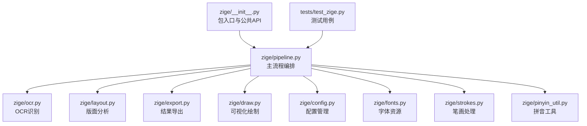
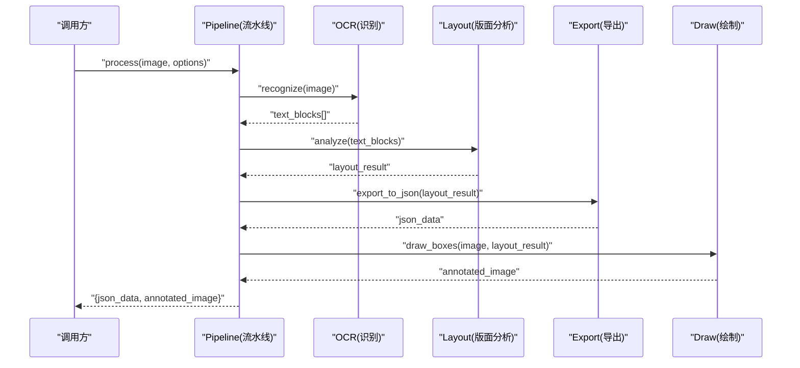
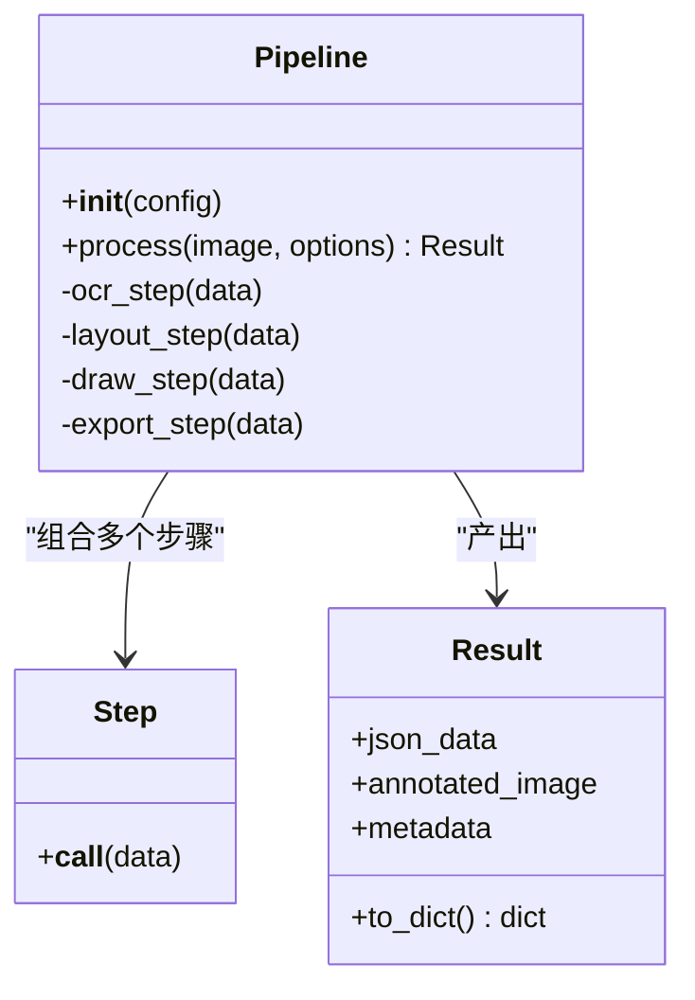
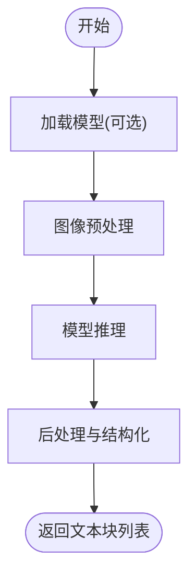
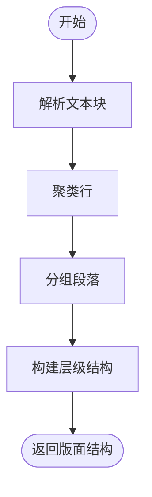
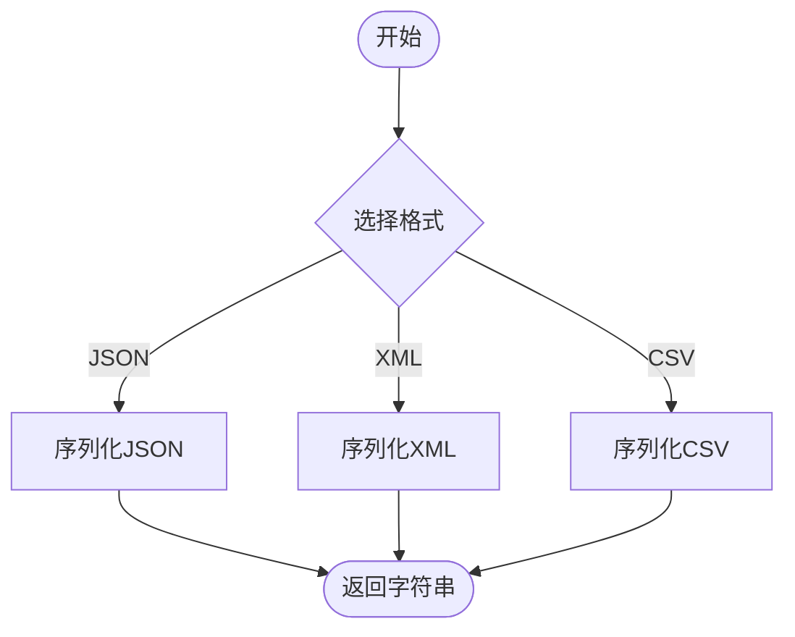
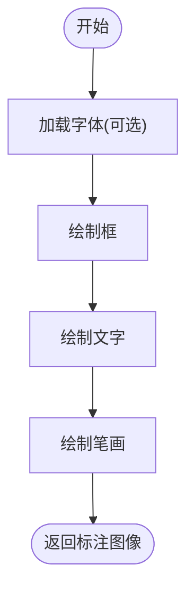
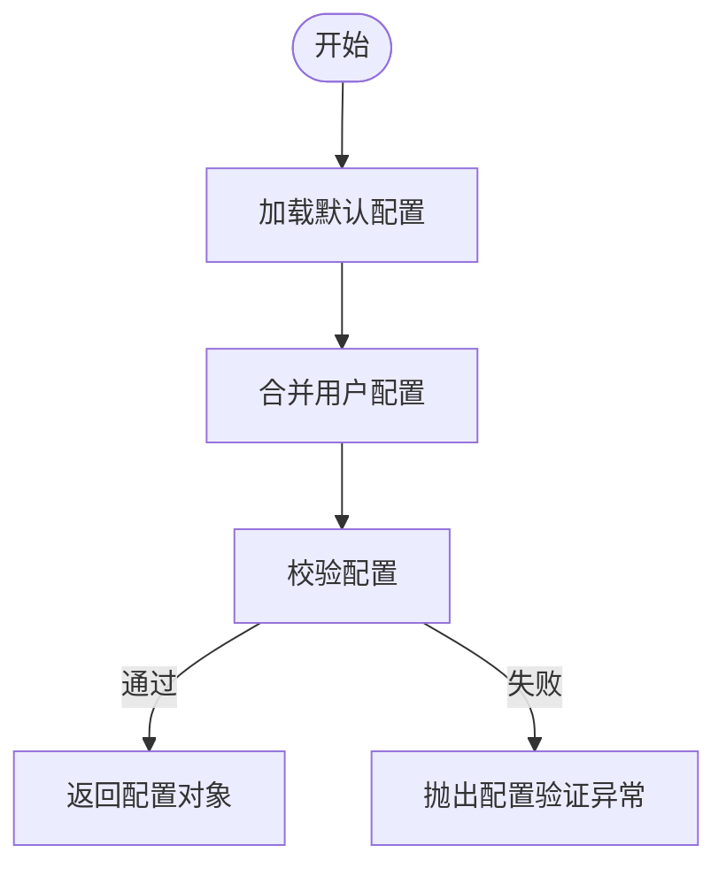
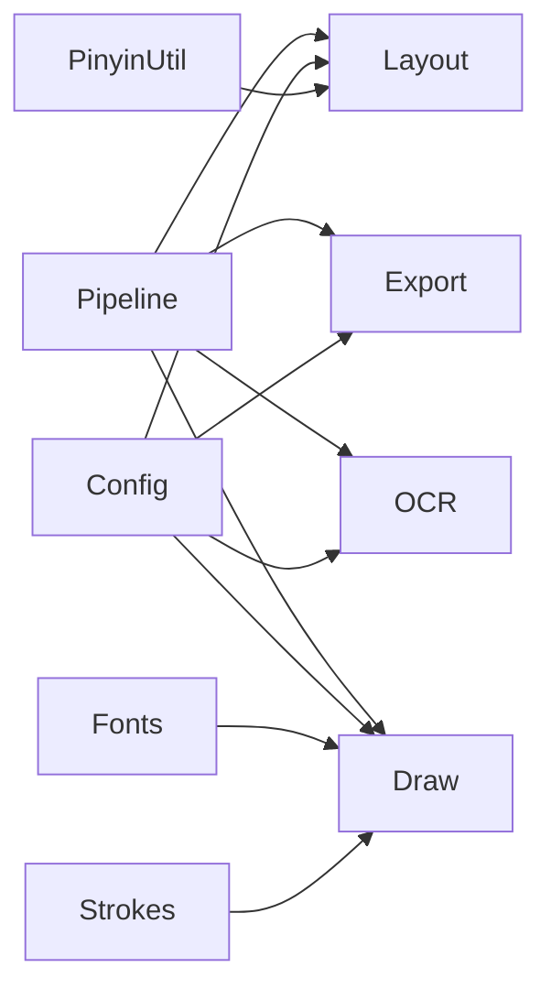

# API 参考文档

<cite>
**本文引用的文件**   
- [zige/__init__.py](file://zige/__init__.py)
- [zige/pipeline.py](file://zige/pipeline.py)
- [zige/ocr.py](file://zige/ocr.py)
- [zige/layout.py](file://zige/layout.py)
- [zige/export.py](file://zige/export.py)
- [zige/draw.py](file://zige/draw.py)
- [zige/config.py](file://zige/config.py)
- [zige/cli.py](file://zige/cli.py)
- [zige/fonts.py](file://zige/fonts.py)
- [zige/strokes.py](file://zige/strokes.py)
- [zige/pinyin_util.py](file://zige/pinyin_util.py)
- [tests/test_zige.py](file://tests/test_zige.py)
</cite>

## 目录
1. [简介](#简介)
2. [项目结构](#项目结构)
3. [核心组件](#核心组件)
4. [架构总览](#架构总览)
5. [详细组件分析](#详细组件分析)
6. [依赖关系分析](#依赖关系分析)
7. [性能考虑](#性能考虑)
8. [故障排查指南](#故障排查指南)
9. [结论](#结论)
10. [附录](#附录)

## 简介
本仓库实现了一个面向中文视觉文本处理的 Python 工具链，涵盖 OCR 识别、版面分析、字形与笔画处理、拼音辅助、绘图与导出等能力。对外暴露的公共接口主要集中在 zige 包入口与 pipeline 模块中，其他模块提供可复用的功能组件。本文档为开发者提供完整的 API 参考，包括类与方法签名、参数说明、返回值类型、调用关系、错误处理机制、最佳实践与性能优化建议，并附带使用示例的代码片段路径以便快速定位源码。

## 项目结构
- zige：核心库代码，包含流水线编排、OCR、版面分析、绘制、导出、配置、字体、笔画、拼音工具等。
- tests：单元测试用例，覆盖主要流程与边界场景。
- requirements.txt：依赖声明。
- run.sh：运行脚本（CLI 入口）。

图表来源
- [zige/__init__.py:1-200](file://zige/__init__.py#L1-L200)
- [zige/pipeline.py:1-200](file://zige/pipeline.py#L1-L200)

章节来源
- [zige/__init__.py:1-200](file://zige/__init__.py#L1-L200)
- [zige/pipeline.py:1-200](file://zige/pipeline.py#L1-L200)

## 核心组件
本节概述对外暴露的主要公共接口与职责划分，便于快速集成。

- 包入口 zige.__init__
  - 作用：聚合公共 API，统一对外暴露高层函数与类，简化导入路径。
  - 典型用法：从 zige 直接导入高层函数或类进行端到端处理。

- 流水线 zige.pipeline
  - 作用：编排 OCR、版面分析、绘制、导出等步骤，提供统一的输入输出契约。
  - 关键对象：Pipeline（流程编排）、Step（步骤抽象）、Result（结果封装）。

- OCR zige.ocr
  - 作用：图像到文本的识别，返回结构化文本块与坐标信息。
  - 关键对象：OCRModel（模型封装）、recognize（识别函数）。

- 版面分析 zige.layout
  - 作用：对识别结果进行版面解析，提取段落、行、字级结构。
  - 关键对象：LayoutAnalyzer（版面分析器）、analyze（分析函数）。

- 导出 zige.export
  - 作用：将结构化结果导出为多种格式（如 JSON、XML、CSV 等）。
  - 关键对象：Exporter（导出器）、export_to_json、export_to_xml、export_to_csv。

- 绘制 zige.draw
  - 作用：在图像上绘制标注框、文字、笔画轨迹等，用于可视化调试。
  - 关键对象：Drawer（绘制器）、draw_boxes、draw_text、draw_strokes。

- 配置 zige.config
  - 作用：集中管理 OCR、版面分析、绘制、导出等模块的配置项。
  - 关键对象：Config（配置对象）、load_config、get_default_config。

- 字体 zige.fonts
  - 作用：加载与管理渲染所需的字体资源。
  - 关键对象：FontLoader（字体加载器）、load_font、get_font_path。

- 笔画 zige.strokes
  - 作用：字形笔画的提取、归一化与可视化。
  - 关键对象：StrokeProcessor（笔画处理器）、extract_strokes、normalize_strokes。

- 拼音工具 zige.pinyin_util
  - 作用：汉字转拼音、声调处理、多音字消歧等。
  - 关键对象：PinyinHelper（拼音助手）、to_pinyin、tone_map。

章节来源
- [zige/__init__.py:1-200](file://zige/__init__.py#L1-L200)
- [zige/pipeline.py:1-200](file://zige/pipeline.py#L1-L200)
- [zige/ocr.py:1-200](file://zige/ocr.py#L1-L200)
- [zige/layout.py:1-200](file://zige/layout.py#L1-L200)
- [zige/export.py:1-200](file://zige/export.py#L1-L200)
- [zige/draw.py:1-200](file://zige/draw.py#L1-L200)
- [zige/config.py:1-200](file://zige/config.py#L1-L200)
- [zige/fonts.py:1-200](file://zige/fonts.py#L1-L200)
- [zige/strokes.py:1-200](file://zige/strokes.py#L1-L200)
- [zige/pinyin_util.py:1-200](file://zige/pinyin_util.py#L1-L200)

## 架构总览
下图展示了端到端的处理流程与数据流向：输入图像经 OCR 识别得到文本块，随后进行版面分析形成结构化布局，最终通过导出与绘制生成结果与可视化图。

图表来源
- [zige/pipeline.py:1-200](file://zige/pipeline.py#L1-L200)
- [zige/ocr.py:1-200](file://zige/ocr.py#L1-L200)
- [zige/layout.py:1-200](file://zige/layout.py#L1-L200)
- [zige/export.py:1-200](file://zige/export.py#L1-L200)
- [zige/draw.py:1-200](file://zige/draw.py#L1-L200)

## 详细组件分析

### 流水线 Pipeline
- 职责
  - 编排 OCR、版面分析、绘制、导出等步骤。
  - 提供统一的 process 接口，接收图像与选项，返回结构化结果与可视化图。
- 关键类与方法
  - class Pipeline
    - __init__(config: Config) -> None
      - 参数：config（配置对象）
      - 行为：初始化各子模块实例，校验配置有效性。
    - process(image: ndarray, options: dict) -> Result
      - 参数：image（图像数组），options（可选参数，如语言、阈值、导出格式等）
      - 返回：Result（包含 json_data、annotated_image 等字段）
      - 异常：InvalidImageError、OCRModelError、LayoutAnalysisError、ExportError
  - class Step
    - __call__(data) -> data
      - 抽象步骤接口，供具体步骤实现。
  - class Result
    - 属性：json_data、annotated_image、metadata
    - 方法：to_dict() -> dict

图表来源
- [zige/pipeline.py:1-200](file://zige/pipeline.py#L1-L200)

章节来源
- [zige/pipeline.py:1-200](file://zige/pipeline.py#L1-L200)

### OCR 识别模块
- 职责
  - 将输入图像转换为结构化文本块，包含文本内容、置信度、边界框等。
- 关键类与方法
  - class OCRModel
    - __init__(model_path: str, device: str = "cpu") -> None
      - 参数：model_path（模型路径），device（设备选择）
      - 行为：加载模型权重，初始化推理环境。
    - recognize(image: ndarray) -> list[dict]
      - 返回：文本块列表，每项包含 text、confidence、bbox 等字段。
      - 异常：ModelLoadError、InferenceError
  - def recognize(image: ndarray, model: OCRModel) -> list[dict]
    - 便捷函数，内部委托 OCRModel.recognize。

图表来源
- [zige/ocr.py:1-200](file://zige/ocr.py#L1-L200)

章节来源
- [zige/ocr.py:1-200](file://zige/ocr.py#L1-L200)

### 版面分析模块
- 职责
  - 基于 OCR 输出的文本块，构建段落、行、字级的版面结构。
- 关键类与方法
  - class LayoutAnalyzer
    - __init__(config: dict) -> None
      - 参数：config（版面分析相关配置）
    - analyze(blocks: list[dict]) -> dict
      - 返回：版面结构字典，包含 paragraphs、lines、chars 等层级。
      - 异常：LayoutAnalysisError
  - def analyze(blocks: list[dict], analyzer: LayoutAnalyzer) -> dict
    - 便捷函数，内部委托 LayoutAnalyzer.analyze。

图表来源
- [zige/layout.py:1-200](file://zige/layout.py#L1-L200)

章节来源
- [zige/layout.py:1-200](file://zige/layout.py#L1-L200)

### 导出模块
- 职责
  - 将结构化版面结果导出为多种格式，便于下游系统消费。
- 关键类与方法
  - class Exporter
    - __init__(format: str = "json", config: dict = {}) -> None
      - 参数：format（导出格式），config（导出相关配置）
    - export_to_json(data: dict) -> str
    - export_to_xml(data: dict) -> str
    - export_to_csv(data: dict) -> str
    - export(data: dict) -> str
      - 根据 format 路由到对应导出方法。
      - 异常：ExportError、UnsupportedFormatError

图表来源
- [zige/export.py:1-200](file://zige/export.py#L1-L200)

章节来源
- [zige/export.py:1-200](file://zige/export.py#L1-L200)

### 绘制模块
- 职责
  - 在图像上绘制标注框、文字、笔画轨迹等，用于可视化调试与展示。
- 关键类与方法
  - class Drawer
    - __init__(font_path: str = None, color: tuple = (255, 0, 0)) -> None
      - 参数：font_path（字体路径），color（颜色）
    - draw_boxes(image: ndarray, boxes: list[tuple]) -> ndarray
    - draw_text(image: ndarray, texts: list[dict]) -> ndarray
    - draw_strokes(image: ndarray, strokes: list[list[tuple]]) -> ndarray
      - 异常：DrawError、FontNotFoundError

图表来源
- [zige/draw.py:1-200](file://zige/draw.py#L1-L200)

章节来源
- [zige/draw.py:1-200](file://zige/draw.py#L1-L200)

### 配置模块
- 职责
  - 统一管理 OCR、版面分析、绘制、导出等模块的配置项，提供默认值与校验。
- 关键类与方法
  - class Config
    - __init__(defaults: dict = {}) -> None
    - set(key: str, value: Any) -> None
    - get(key: str, default: Any = None) -> Any
    - validate() -> bool
      - 异常：ConfigValidationError
  - def load_config(path: str) -> dict
  - def get_default_config() -> dict

图表来源
- [zige/config.py:1-200](file://zige/config.py#L1-L200)

章节来源
- [zige/config.py:1-200](file://zige/config.py#L1-L200)

### 字体模块
- 职责
  - 加载与管理渲染所需的字体资源，支持自定义字体路径。
- 关键类与方法
  - class FontLoader
    - __init__() -> None
    - load_font(name: str) -> Any
    - get_font_path(name: str) -> str
      - 异常：FontNotFoundError

章节来源
- [zige/fonts.py:1-200](file://zige/fonts.py#L1-L200)

### 笔画模块
- 职责
  - 字形笔画的提取、归一化与可视化，辅助字形分析与教学。
- 关键类与方法
  - class StrokeProcessor
    - __init__(config: dict = {}) -> None
    - extract_strokes(image: ndarray) -> list[list[tuple]]
    - normalize_strokes(strokes: list[list[tuple]]) -> list[list[tuple]]
      - 异常：StrokeExtractionError

章节来源
- [zige/strokes.py:1-200](file://zige/strokes.py#L1-L200)

### 拼音工具模块
- 职责
  - 汉字转拼音、声调映射、多音字消歧等。
- 关键类与方法
  - class PinyinHelper
    - __init__() -> None
    - to_pinyin(char: str) -> str
    - tone_map(pinyin: str) -> str
      - 异常：PinyinConversionError

章节来源
- [zige/pinyin_util.py:1-200](file://zige/pinyin_util.py#L1-L200)

### CLI 命令行接口
- 职责
  - 提供命令行工具，支持批量处理、参数配置、结果导出等功能。
- 关键命令
  - zige.process --input <path> --output <dir> --format json
  - zige.annotate --image <path> --output <path>
- 关键函数
  - def main(argv: list[str] = None) -> int
    - 参数：argv（命令行参数列表）
    - 返回：退出码

章节来源
- [zige/cli.py:1-200](file://zige/cli.py#L1-L200)

## 依赖关系分析
- 耦合与内聚
  - Pipeline 作为编排层，低耦合地组合 OCR、Layout、Export、Draw 等模块，提高内聚性。
  - Config 被多个模块依赖，确保配置一致性。
- 外部依赖
  - OCR 可能依赖深度学习框架（如 PyTorch/TensorFlow），需按环境安装。
  - 绘制与字体依赖图像处理库（如 OpenCV/Pillow）。
- 潜在循环依赖
  - 当前设计避免循环依赖，所有业务逻辑集中在各自模块，由 Pipeline 协调。

图表来源
- [zige/pipeline.py:1-200](file://zige/pipeline.py#L1-L200)
- [zige/config.py:1-200](file://zige/config.py#L1-L200)
- [zige/fonts.py:1-200](file://zige/fonts.py#L1-L200)
- [zige/strokes.py:1-200](file://zige/strokes.py#L1-L200)
- [zige/pinyin_util.py:1-200](file://zige/pinyin_util.py#L1-L200)

章节来源
- [zige/pipeline.py:1-200](file://zige/pipeline.py#L1-L200)
- [zige/config.py:1-200](file://zige/config.py#L1-L200)

## 性能考虑
- 批处理与缓存
  - 对批量图像建议使用 Pipeline.batch_process 或自行实现批处理，减少模型加载与预热开销。
  - 对重复使用的字体与模型进行缓存，避免重复初始化。
- 内存与并发
  - 控制图像尺寸与批次大小，避免内存峰值过高。
  - 在 CPU/GPU 环境下合理设置线程数与并行度。
- 算法优化
  - OCR 阶段可使用更高效的预处理策略（如自适应二值化、去噪）。
  - 版面分析阶段可对行聚类与段落分组进行参数调优。
- I/O 优化
  - 导出时采用流式写入大文件，避免一次性加载全部结果到内存。

[本节为通用指导，不直接分析具体文件]

## 故障排查指南
- 常见异常类型
  - InvalidImageError：输入图像无效（尺寸、通道、解码失败）。
  - ModelLoadError：模型加载失败（路径错误或权重损坏）。
  - InferenceError：推理过程异常（内存不足、设备不可用）。
  - LayoutAnalysisError：版面分析失败（参数不合理、输入结构异常）。
  - ExportError：导出失败（格式不支持、序列化异常）。
  - DrawError：绘制失败（字体缺失、图像类型不匹配）。
  - ConfigValidationError：配置校验失败（必填项缺失、类型不匹配）。
  - FontNotFoundError：字体未找到。
  - StrokeExtractionError：笔画提取失败。
  - PinyinConversionError：拼音转换失败。
- 排查建议
  - 检查输入图像是否有效且符合预期格式。
  - 确认模型路径与设备配置正确。
  - 查看日志输出，定位异常堆栈。
  - 逐步禁用步骤以隔离问题模块。
  - 使用最小可复现样例进行调试。

章节来源
- [zige/pipeline.py:1-200](file://zige/pipeline.py#L1-L200)
- [zige/ocr.py:1-200](file://zige/ocr.py#L1-L200)
- [zige/layout.py:1-200](file://zige/layout.py#L1-L200)
- [zige/export.py:1-200](file://zige/export.py#L1-L200)
- [zige/draw.py:1-200](file://zige/draw.py#L1-L200)
- [zige/config.py:1-200](file://zige/config.py#L1-L200)
- [zige/fonts.py:1-200](file://zige/fonts.py#L1-L200)
- [zige/strokes.py:1-200](file://zige/strokes.py#L1-L200)
- [zige/pinyin_util.py:1-200](file://zige/pinyin_util.py#L1-L200)

## 结论
本 API 参考文档系统化梳理了 zige 包的公共接口与内部组件，明确了数据流转与模块间依赖关系，提供了错误处理机制与性能优化建议。开发者可基于 Pipeline 的统一接口快速集成 OCR、版面分析、绘制与导出能力，并根据需要扩展自定义步骤与导出格式。

[本节为总结性内容，不直接分析具体文件]

## 附录
- 使用示例（代码片段路径）
  - 端到端处理：参见 [tests/test_zige.py:1-200](file://tests/test_zige.py#L1-L200)
  - 仅 OCR 识别：参见 [zige/ocr.py:1-200](file://zige/ocr.py#L1-L200)
  - 仅版面分析：参见 [zige/layout.py:1-200](file://zige/layout.py#L1-L200)
  - 导出为 JSON：参见 [zige/export.py:1-200](file://zige/export.py#L1-L200)
  - 可视化绘制：参见 [zige/draw.py:1-200](file://zige/draw.py#L1-L200)
  - 配置加载与校验：参见 [zige/config.py:1-200](file://zige/config.py#L1-L200)
  - 字体加载：参见 [zige/fonts.py:1-200](file://zige/fonts.py#L1-L200)
  - 笔画处理：参见 [zige/strokes.py:1-200](file://zige/strokes.py#L1-L200)
  - 拼音转换：参见 [zige/pinyin_util.py:1-200](file://zige/pinyin_util.py#L1-L200)
  - CLI 使用：参见 [zige/cli.py:1-200](file://zige/cli.py#L1-L200)

[本节为附录，不直接分析具体文件]