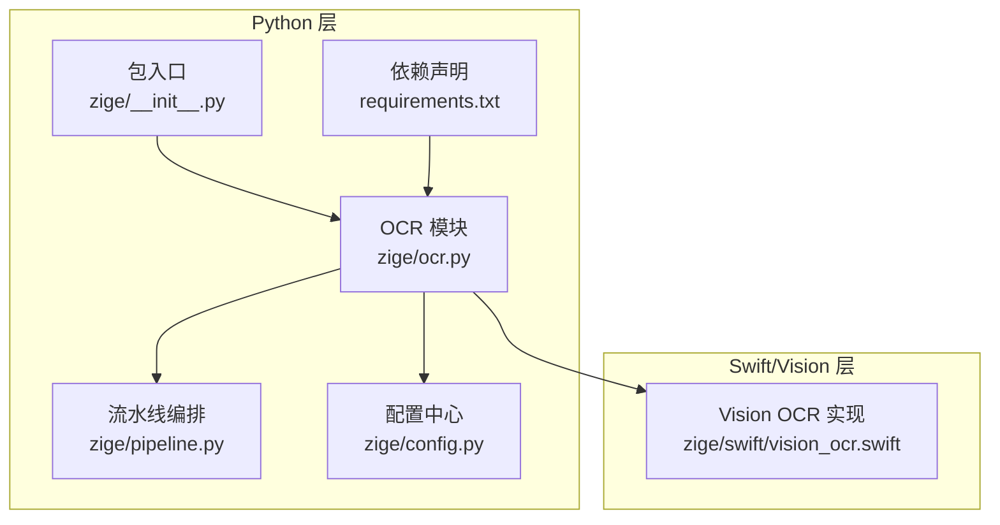
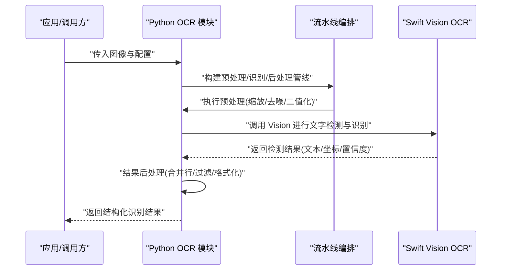
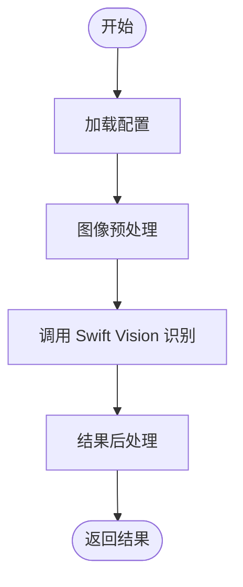
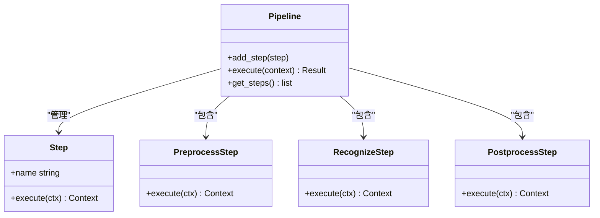
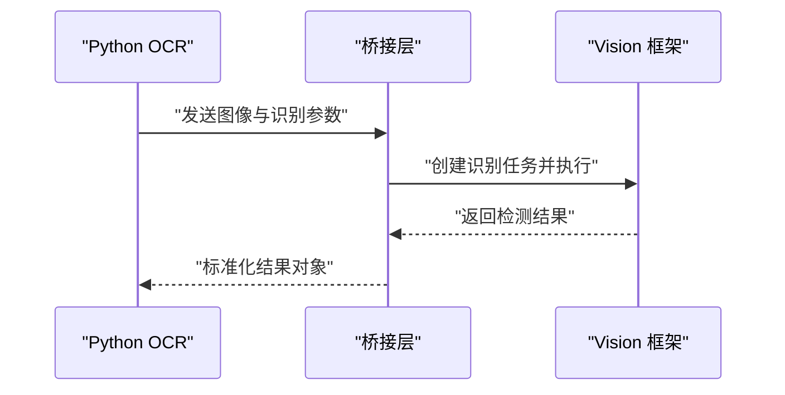
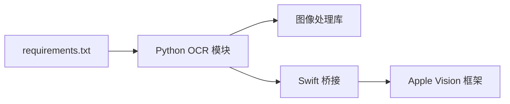

# OCR 识别 API

<cite>
**本文引用的文件**   
- [zige/ocr.py](file://zige/ocr.py)
- [zige/pipeline.py](file://zige/pipeline.py)
- [zige/config.py](file://zige/config.py)
- [zige/swift/vision_ocr.swift](file://zige/swift/vision_ocr.swift)
- [zige/__init__.py](file://zige/__init__.py)
- [requirements.txt](file://requirements.txt)
</cite>

## 目录
1. [简介](#简介)
2. [项目结构](#项目结构)
3. [核心组件](#核心组件)
4. [架构总览](#架构总览)
5. [详细组件分析](#详细组件分析)
6. [依赖分析](#依赖分析)
7. [性能考虑](#性能考虑)
8. [故障排查指南](#故障排查指南)
9. [结论](#结论)
10. [附录](#附录)

## 简介
本文件为 OCR 文本识别功能的 API 文档，覆盖以下方面：
- OCR 引擎初始化与配置
- 图像预处理、字符识别与结果后处理流程
- Swift Vision 框架的集成方式与调用接口
- 不同输入格式支持与处理示例
- 识别精度优化与性能调优的配置选项

该文档面向开发者与使用者，既提供高层架构说明，也给出关键实现路径与参数说明，帮助快速集成与优化 OCR 能力。

## 项目结构
仓库采用 Python 为主、Swift 为辅的混合架构：
- Python 侧负责 OCR 主流程编排、配置管理、数据模型与工具函数
- Swift 侧通过 Vision 框架完成高性能图像文字识别，Python 侧以桥接方式调用

图表来源
- [zige/ocr.py](file://zige/ocr.py)
- [zige/pipeline.py](file://zige/pipeline.py)
- [zige/config.py](file://zige/config.py)
- [zige/swift/vision_ocr.swift](file://zige/swift/vision_ocr.swift)
- [zige/__init__.py](file://zige/__init__.py)
- [requirements.txt](file://requirements.txt)

章节来源
- [zige/__init__.py](file://zige/__init__.py)
- [requirements.txt](file://requirements.txt)

## 核心组件
- OCR 模块：对外暴露 OCR 识别 API，封装图像预处理、调用 Swift Vision 进行识别、结果后处理等步骤
- 流水线编排：将 OCR 各阶段（预处理、识别、后处理）串联，支持扩展与复用
- 配置中心：集中管理 OCR 相关参数（如语言、置信度阈值、输出格式等）
- Swift Vision 集成：在 Swift 中基于 Vision 框架实现文字检测与识别，Python 侧通过桥接调用

章节来源
- [zige/ocr.py](file://zige/ocr.py)
- [zige/pipeline.py](file://zige/pipeline.py)
- [zige/config.py](file://zige/config.py)
- [zige/swift/vision_ocr.swift](file://zige/swift/vision_ocr.swift)

## 架构总览
下图展示从输入到输出的端到端流程，涵盖 Python 与 Swift/Vision 的交互。

图表来源
- [zige/ocr.py](file://zige/ocr.py)
- [zige/pipeline.py](file://zige/pipeline.py)
- [zige/swift/vision_ocr.swift](file://zige/swift/vision_ocr.swift)

## 详细组件分析

### OCR 模块 API
- 职责
  - 接收图像与配置
  - 调用流水线执行预处理、识别、后处理
  - 返回统一的结构化结果
- 关键方法
  - 初始化与配置加载
  - 图像预处理（缩放、灰度、去噪、二值化、旋转校正等）
  - 调用 Swift Vision 进行文字检测与识别
  - 结果后处理（行合并、置信度过滤、坐标规范化、文本清洗）
- 输入
  - 图像：支持常见位图格式（如 PNG/JPEG/BMP），以及可能的内存缓冲区
  - 配置：语言、置信度阈值、输出字段、是否启用旋转校正等
- 输出
  - 文本行/段落对象，包含文本内容、边界框、置信度、语言等信息

图表来源
- [zige/ocr.py](file://zige/ocr.py)
- [zige/config.py](file://zige/config.py)

章节来源
- [zige/ocr.py](file://zige/ocr.py)
- [zige/config.py](file://zige/config.py)

### 流水线编排
- 职责
  - 将 OCR 各阶段抽象为可插拔步骤
  - 按顺序执行预处理、识别、后处理
  - 支持中间结果缓存与错误恢复
- 关键点
  - 步骤定义与注册
  - 执行上下文传递（图像、配置、中间结果）
  - 异常捕获与回退策略

图表来源
- [zige/pipeline.py](file://zige/pipeline.py)

章节来源
- [zige/pipeline.py](file://zige/pipeline.py)

### Swift Vision 集成
- 职责
  - 使用 Vision 框架进行文字检测与识别
  - 提供统一的识别接口供 Python 侧调用
- 关键点
  - 图像数据转换（从 Python 到 Swift）
  - 识别任务配置（语言、方向、区域限制等）
  - 结果映射（文本、坐标、置信度）

图表来源
- [zige/swift/vision_ocr.swift](file://zige/swift/vision_ocr.swift)

章节来源
- [zige/swift/vision_ocr.swift](file://zige/swift/vision_ocr.swift)

### 配置中心
- 职责
  - 集中管理 OCR 相关配置项
  - 提供默认值与校验
- 关键配置项
  - 语言设置
  - 置信度阈值
  - 输出字段控制
  - 预处理开关（去噪、二值化、旋转校正）
  - 性能相关参数（并发、缓存大小）

章节来源
- [zige/config.py](file://zige/config.py)

## 依赖分析
- Python 依赖
  - 图像处理库（用于预处理）
  - 进程/线程管理（用于并行调用 Swift 或外部服务）
- Swift/Vision 依赖
  - Apple Vision 框架（文字检测与识别）
- 交叉依赖
  - Python 与 Swift 之间的数据序列化与传输

图表来源
- [requirements.txt](file://requirements.txt)
- [zige/ocr.py](file://zige/ocr.py)
- [zige/swift/vision_ocr.swift](file://zige/swift/vision_ocr.swift)

章节来源
- [requirements.txt](file://requirements.txt)
- [zige/ocr.py](file://zige/ocr.py)
- [zige/swift/vision_ocr.swift](file://zige/swift/vision_ocr.swift)

## 性能考虑
- 预处理优化
  - 合理缩放比例，避免过大图像导致内存与计算压力
  - 按需启用去噪与二值化，减少无效计算
  - 旋转校正仅在必要时开启
- 识别优化
  - 根据场景选择合适语言与字符集，减少搜索空间
  - 调整置信度阈值，平衡召回率与准确率
  - 对重复区域进行裁剪与去重
- 并发与缓存
  - 对批量图像进行并行处理
  - 缓存常用字体、模板与中间结果
- Swift/Vision 优化
  - 复用识别器实例，避免频繁创建销毁
  - 限制识别区域，缩小 ROI 提升速度
  - 合理设置并发任务数，避免系统资源争用

[本节为通用性能建议，不直接分析具体文件]

## 故障排查指南
- 常见问题
  - 图像格式不支持：确认输入图像为支持的位图格式
  - 识别结果为空：检查置信度阈值是否过高、语言配置是否正确
  - 性能低下：检查是否启用了不必要的预处理步骤，或并发数设置不当
  - Swift 调用失败：检查桥接层日志与 Vision 框架可用性
- 定位手段
  - 打印中间结果（预处理后的图像、检测到的文本块）
  - 记录关键耗时点（预处理、识别、后处理）
  - 对比不同配置下的效果，逐步收敛问题

章节来源
- [zige/ocr.py](file://zige/ocr.py)
- [zige/pipeline.py](file://zige/pipeline.py)
- [zige/config.py](file://zige/config.py)
- [zige/swift/vision_ocr.swift](file://zige/swift/vision_ocr.swift)

## 结论
本 API 通过 Python 与 Swift/Vision 的协作，提供了完整的 OCR 文本识别能力。开发者可通过配置中心灵活调整识别策略，借助流水线编排扩展预处理与后处理逻辑，并结合性能优化建议获得稳定高效的识别体验。

[本节为总结性内容，不直接分析具体文件]

## 附录
- 输入格式支持
  - 位图图像（PNG/JPEG/BMP）
  - 内存缓冲区（需转换为内部图像格式）
- 输出结构
  - 文本行/段落对象，包含文本、边界框、置信度、语言等字段
- 典型调用示例
  - 单张图像识别
  - 批量图像识别（并行）
  - 自定义预处理与后处理步骤

[本节为补充信息，不直接分析具体文件]