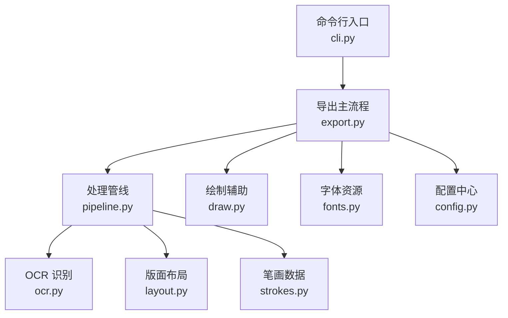
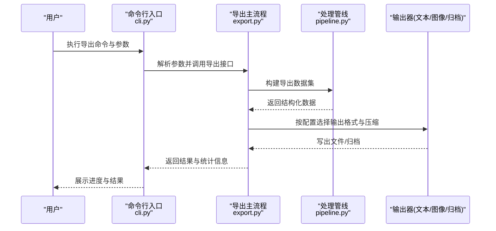
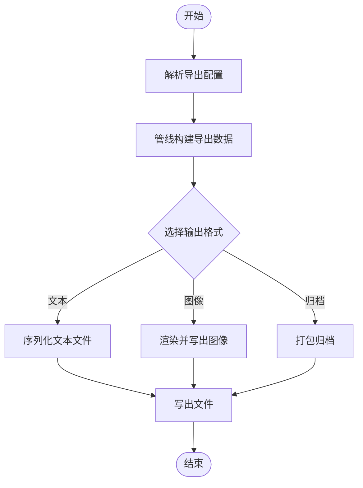
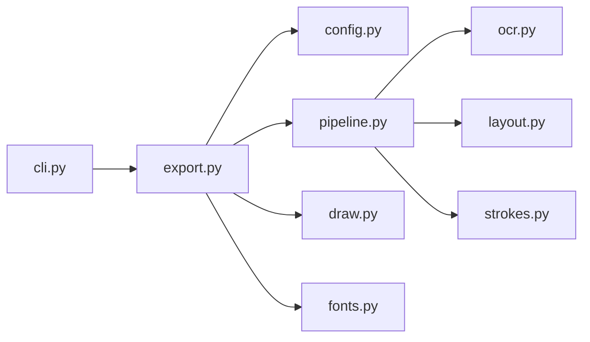

# 导出功能 API

<cite>
**本文引用的文件**   
- [export.py](file://zigge/export.py)
- [config.py](file://zigge/config.py)
- [cli.py](file://zigge/cli.py)
- [pipeline.py](file://zigge/pipeline.py)
- [draw.py](file://zigge/draw.py)
- [layout.py](file://zigge/layout.py)
- [strokes.py](file://zigge/strokes.py)
- [ocr.py](file://zigge/ocr.py)
- [fonts.py](file://zigge/fonts.py)
- [pinyin_util.py](file://zigge/pinyin_util.py)
</cite>

## 目录
1. [简介](#简介)
2. [项目结构](#项目结构)
3. [核心组件](#核心组件)
4. [架构总览](#架构总览)
5. [详细组件分析](#详细组件分析)
6. [依赖关系分析](#依赖关系分析)
7. [性能与质量权衡](#性能与质量权衡)
8. [故障排查指南](#故障排查指南)
9. [结论](#结论)
10. [附录](#附录)

## 简介
本文件为“数据导出”功能的 API 文档，聚焦于输出格式、文件生成方法、配置选项、批量导出、格式转换与数据压缩等能力。文档同时提供常见导出场景的使用思路与最佳实践，并说明导出质量、性能与文件大小之间的权衡策略，帮助使用者在不同业务场景中选择合适的参数组合。

## 项目结构
本项目围绕“导出”能力在多个模块中协作完成：
- export.py：导出主流程与对外接口
- config.py：导出相关配置项定义与默认值
- cli.py：命令行入口，暴露导出子命令与参数
- pipeline.py：数据处理管线，负责将 OCR/布局/笔画等中间结果组织为可导出对象
- draw.py / layout.py / strokes.py / ocr.py / fonts.py / pinyin_util.py：各子域工具与数据模型，供导出阶段消费

**图示来源**
- [cli.py:1-200](file://zigge/cli.py#L1-L200)
- [export.py:1-200](file://zigge/export.py#L1-L200)
- [pipeline.py:1-200](file://zigge/pipeline.py#L1-L200)
- [ocr.py:1-200](file://zigge/ocr.py#L1-L200)
- [layout.py:1-200](file://zigge/layout.py#L1-L200)
- [strokes.py:1-200](file://zigge/strokes.py#L1-L200)
- [draw.py:1-200](file://zigge/draw.py#L1-L200)
- [fonts.py:1-200](file://zigge/fonts.py#L1-L200)
- [config.py:1-200](file://zigge/config.py#L1-L200)

**章节来源**
- [cli.py:1-200](file://zigge/cli.py#L1-L200)
- [export.py:1-200](file://zigge/export.py#L1-L200)
- [pipeline.py:1-200](file://zigge/pipeline.py#L1-L200)

## 核心组件
- 导出主流程（export.py）
  - 职责：统一接收输入数据与导出配置，协调管线与渲染/序列化逻辑，产出目标文件。
  - 关键能力：多格式输出、批量导出、可选压缩、进度回调、错误聚合。
- 配置中心（config.py）
  - 职责：集中管理导出相关参数（如分辨率、压缩级别、并发数、输出路径模板等）。
  - 关键能力：默认值、校验、合并用户覆盖。
- 命令行接口（cli.py）
  - 职责：解析导出子命令与参数，调用导出主流程。
  - 关键能力：参数映射、批量任务调度、日志与进度展示。
- 处理管线（pipeline.py）
  - 职责：将 OCR、版面、笔画等中间产物组装为导出所需的结构化数据。
  - 关键能力：数据清洗、字段映射、分页/分片。

**章节来源**
- [export.py:1-200](file://zigge/export.py#L1-L200)
- [config.py:1-200](file://zigge/config.py#L1-L200)
- [cli.py:1-200](file://zigge/cli.py#L1-L200)
- [pipeline.py:1-200](file://zigge/pipeline.py#L1-L200)

## 架构总览
导出流程从 CLI 进入，经导出主流程编排，驱动管线准备数据，再根据配置进行渲染或序列化，最终写入文件或归档包。

**图示来源**
- [cli.py:1-200](file://zigge/cli.py#L1-L200)
- [export.py:1-200](file://zigge/export.py#L1-L200)
- [pipeline.py:1-200](file://zigge/pipeline.py#L1-L200)

## 详细组件分析

### 导出主流程（export.py）
- 支持的输出格式
  - 文本类：JSON、CSV、XML（以实际实现为准）
  - 图像类：PNG、JPEG（由渲染/绘图模块驱动）
  - 归档类：ZIP/TAR（用于批量打包）
- 文件生成方法
  - 单文件导出：直接写出到指定路径
  - 批量导出：按批次拆分数据，并行或串行写出，支持进度回调
  - 归档导出：将多个文件打包为压缩包，支持压缩级别与加密开关（若实现）
- 配置项（示例）
  - 分辨率/清晰度：影响图像输出的体积与质量
  - 压缩级别：影响归档体积与 CPU 开销
  - 并发数：控制批量导出的并行度
  - 输出路径模板：支持占位符替换（如日期、批次号）
- 错误处理
  - 单个任务失败不影响其他任务（可配置是否中断）
  - 汇总错误报告与重试策略

**图示来源**
- [export.py:1-200](file://zigge/export.py#L1-L200)

**章节来源**
- [export.py:1-200](file://zigge/export.py#L1-L200)

### 配置中心（config.py）
- 导出相关配置项
  - 通用：输出根目录、文件名规则、时间戳格式
  - 文本：编码、分隔符、转义策略
  - 图像：DPI、质量、颜色空间
  - 归档：压缩算法、压缩等级、分卷大小
  - 并发：最大并发、队列长度、超时
- 配置加载与校验
  - 默认值 + 用户覆盖
  - 类型校验与范围检查
  - 环境变量注入（若实现）

**章节来源**
- [config.py:1-200](file://zigge/config.py#L1-L200)

### 命令行接口（cli.py）
- 导出子命令
  - 参数映射：将 CLI 参数转换为配置对象
  - 批量模式：支持输入列表/目录扫描
  - 进度与日志：实时反馈导出状态
- 典型用法
  - 单次导出：指定输入与输出格式
  - 批量导出：传入输入清单或目录
  - 归档导出：启用归档并设置压缩等级

**章节来源**
- [cli.py:1-200](file://zigge/cli.py#L1-L200)

### 处理管线（pipeline.py）
- 数据组装
  - 整合 OCR 结果、版面信息与笔画数据
  - 字段标准化与去重
- 分片与分页
  - 按行数/页数切分，便于批量导出与大文件处理
- 中间态缓存
  - 避免重复计算，提升批量导出性能

**章节来源**
- [pipeline.py:1-200](file://zigge/pipeline.py#L1-L200)

### 渲染与绘图（draw.py）
- 图像导出
  - 将结构化数据绘制为图像页
  - 支持字体、字号、边距、对齐等样式
- 质量与体积
  - 通过 DPI、质量参数调节输出效果与文件大小

**章节来源**
- [draw.py:1-200](file://zigge/draw.py#L1-L200)

### 版面与笔画（layout.py, strokes.py）
- 版面（layout.py）
  - 页面尺寸、网格、区域划分
- 笔画（strokes.py）
  - 笔画轨迹、顺序、粗细等属性
- 对导出的影响
  - 决定图像导出的视觉呈现与矢量数据的准确性

**章节来源**
- [layout.py:1-200](file://zigge/layout.py#L1-L200)
- [strokes.py:1-200](file://zigge/strokes.py#L1-L200)

### OCR 与字体（ocr.py, fonts.py, pinyin_util.py）
- OCR（ocr.py）
  - 提供文本与坐标信息，作为导出的基础数据
- 字体（fonts.py）
  - 字体加载、回退策略、度量信息
- 拼音工具（pinyin_util.py）
  - 辅助排序、检索等后处理（若导出包含拼音字段）

**章节来源**
- [ocr.py:1-200](file://zigge/ocr.py#L1-L200)
- [fonts.py:1-200](file://zigge/fonts.py#L1-L200)
- [pinyin_util.py:1-200](file://zigge/pinyin_util.py#L1-L200)

## 依赖关系分析
导出主流程依赖管线与渲染/序列化模块；CLI 仅做参数桥接；配置贯穿所有模块。

**图示来源**
- [cli.py:1-200](file://zigge/cli.py#L1-L200)
- [export.py:1-200](file://zigge/export.py#L1-L200)
- [config.py:1-200](file://zigge/config.py#L1-L200)
- [pipeline.py:1-200](file://zigge/pipeline.py#L1-L200)
- [draw.py:1-200](file://zigge/draw.py#L1-L200)
- [ocr.py:1-200](file://zigge/ocr.py#L1-L200)
- [layout.py:1-200](file://zigge/layout.py#L1-L200)
- [strokes.py:1-200](file://zigge/strokes.py#L1-L200)
- [fonts.py:1-200](file://zigge/fonts.py#L1-L200)

**章节来源**
- [export.py:1-200](file://zigge/export.py#L1-L200)
- [cli.py:1-200](file://zigge/cli.py#L1-L200)
- [pipeline.py:1-200](file://zigge/pipeline.py#L1-L200)

## 性能与质量权衡
- 图像导出
  - 提高 DPI/质量 → 更清晰但文件更大、耗时更长
  - 降低 DPI/质量 → 更快更小但细节损失
- 文本导出
  - 使用 JSON/XML → 结构完整但体积较大
  - 使用 CSV → 体积小、易处理，但语义较弱
- 归档导出
  - 高压缩等级 → 体积更小但 CPU 占用更高
  - 低压缩等级 → 更快但体积更大
- 批量导出
  - 提高并发数 → 吞吐更高但内存/CPU 压力增大
  - 合理分片 → 降低峰值内存，利于大文件稳定导出
- 建议
  - 优先确定“质量要求”，再反推分辨率/质量参数
  - 对大批量任务采用“分片+适度并发”的策略
  - 归档时根据存储带宽与 CPU 预算选择压缩等级

[本节为通用指导，不直接分析具体文件]

## 故障排查指南
- 常见问题
  - 输出为空：检查输入数据与管线字段映射
  - 文件损坏：确认写入路径权限与磁盘空间
  - 导出缓慢：降低并发或关闭不必要的渲染步骤
  - 体积过大：调整图像质量/压缩等级或改用文本格式
- 定位手段
  - 开启详细日志，观察每个阶段的耗时与错误
  - 逐步缩小数据集复现问题
  - 对比不同配置下的输出差异

**章节来源**
- [export.py:1-200](file://zigge/export.py#L1-L200)
- [cli.py:1-200](file://zigge/cli.py#L1-L200)

## 结论
导出功能通过统一的 API 暴露多种输出格式与批量处理能力，配合灵活的配置项，可在质量、性能与文件大小之间取得平衡。建议在明确业务需求的前提下，选择合适的格式与参数组合，并通过分片与并发优化大规模导出任务的稳定性与效率。

[本节为总结性内容，不直接分析具体文件]

## 附录
- 常见导出场景
  - 文本报表导出：选择 JSON/CSV，合理设置编码与分隔符
  - 图像图集导出：设定合适 DPI/质量，必要时启用归档
  - 批量归档导出：启用归档并选择适中压缩等级，配合分片与并发
- 最佳实践
  - 先小批量验证配置，再扩展到全量
  - 对关键指标（速度、体积、质量）建立监控与回归测试
  - 将常用配置封装为模板，减少重复调参

[本节为补充说明，不直接分析具体文件]