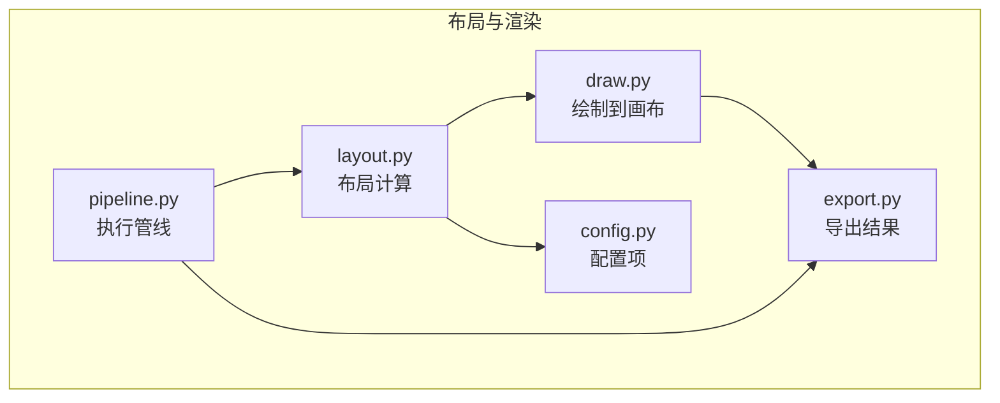
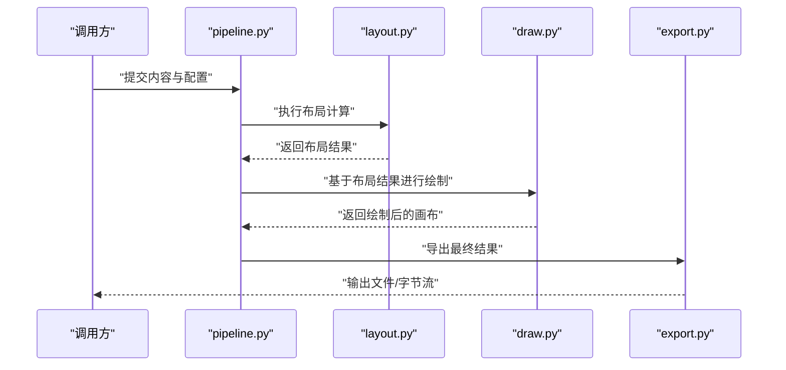
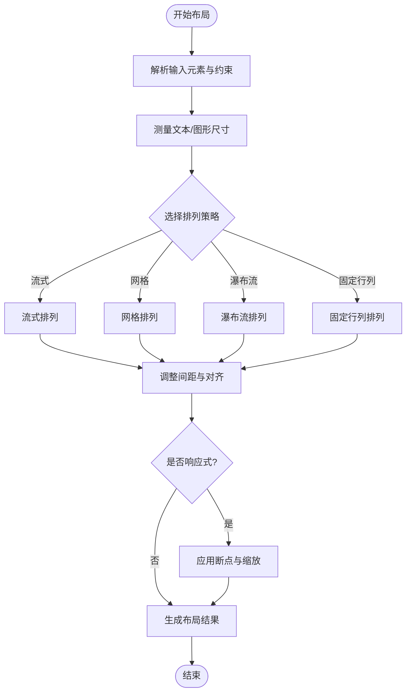
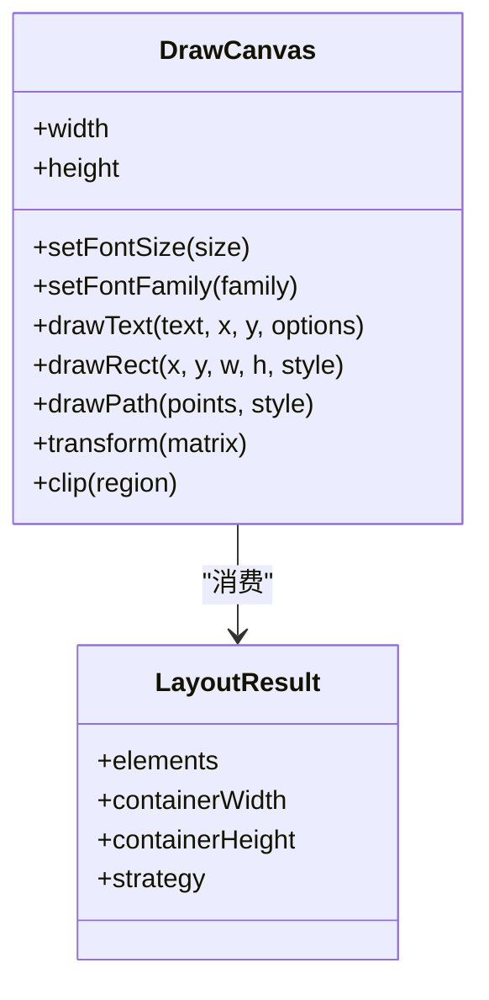
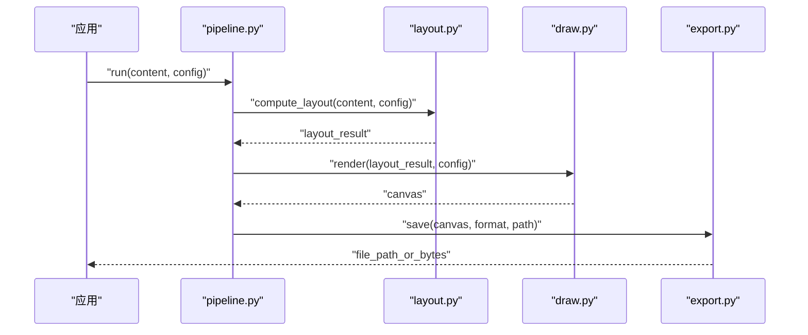
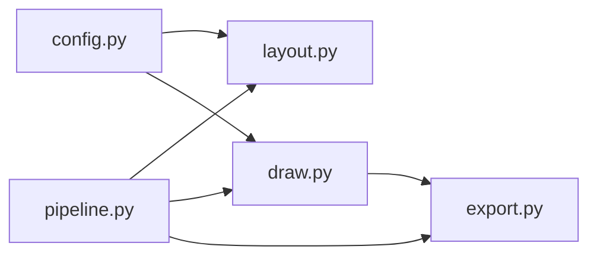

# 布局计算 API

<cite>
**本文引用的文件**   
- [layout.py](file://zig/layout.py)
- [draw.py](file://zig/draw.py)
- [config.py](file://zig/config.py)
- [pipeline.py](file://zig/pipeline.py)
- [export.py](file://zig/export.py)
</cite>

## 目录
1. [简介](#简介)
2. [项目结构](#项目结构)
3. [核心组件](#核心组件)
4. [架构总览](#架构总览)
5. [详细组件分析](#详细组件分析)
6. [依赖关系分析](#依赖关系分析)
7. [性能考量](#性能考量)
8. [故障排查指南](#故障排查指南)
9. [结论](#结论)
10. [附录](#附录)

## 简介
本文件面向“布局计算”相关能力，聚焦元素定位、尺寸计算与排列算法的接口说明，明确坐标系统定义与转换规则，并覆盖响应式布局、自适应排列等高级功能的调用方式。同时给出与其他渲染组件（绘制、导出、管线）协作的最佳实践与示例路径。

## 项目结构
本项目中与布局计算直接相关的代码主要位于 zig 包内：
- layout.py：布局计算的核心实现，包含元素定位、尺寸估算、排列策略与响应式适配逻辑。
- draw.py：将布局结果映射到画布坐标系并进行绘制。
- config.py：布局与绘制的配置项（如字号、间距、对齐、边距等）。
- pipeline.py：编排 OCR、布局、绘制、导出等阶段的执行流程。
- export.py：将最终布局与绘制结果输出为图像或文档。

图表来源
- [layout.py:1-200](file://zig/layout.py#L1-L200)
- [draw.py:1-200](file://zig/draw.py#L1-L200)
- [config.py:1-200](file://zig/config.py#L1-L200)
- [pipeline.py:1-200](file://zig/pipeline.py#L1-L200)
- [export.py:1-200](file://zig/export.py#L1-L200)

章节来源
- [layout.py:1-200](file://zig/layout.py#L1-L200)
- [draw.py:1-200](file://zig/draw.py#L1-L200)
- [config.py:1-200](file://zig/config.py#L1-L200)
- [pipeline.py:1-200](file://zig/pipeline.py#L1-L200)
- [export.py:1-200](file://zig/export.py#L1-L200)

## 核心组件
- 布局引擎（layout.py）
  - 负责解析输入内容（文本块/图形），计算每个元素的几何属性（位置、宽高、行高、基线等），并应用排列策略（水平/垂直、流式、网格、瀑布流等）。
  - 提供响应式适配：根据容器宽度/高度变化重新计算布局，支持断点与比例缩放。
  - 暴露统一的布局结果数据结构，供绘制与导出使用。
- 绘制器（draw.py）
  - 接收布局结果，将其映射到目标画布坐标系，完成文字、线条、形状等的绘制。
  - 处理字体、字号、颜色、描边、阴影等视觉样式。
- 配置中心（config.py）
  - 集中管理布局与绘制的参数，如字号、字重、行距、段距、对齐方式、边距、栅格列数、断点等。
- 管线（pipeline.py）
  - 串联 OCR、布局、绘制、导出阶段，提供统一入口与错误处理。
- 导出器（export.py）
  - 将最终画面保存为图片文件或文档格式，支持分辨率、质量、格式选择。

章节来源
- [layout.py:1-200](file://zig/layout.py#L1-L200)
- [draw.py:1-200](file://zig/draw.py#L1-L200)
- [config.py:1-200](file://zig/config.py#L1-L200)
- [pipeline.py:1-200](file://zig/pipeline.py#L1-L200)
- [export.py:1-200](file://zig/export.py#L1-L200)

## 架构总览
下图展示从输入到输出的整体数据流，以及布局计算在其中的作用。

图表来源
- [pipeline.py:1-200](file://zig/pipeline.py#L1-L200)
- [layout.py:1-200](file://zig/layout.py#L1-L200)
- [draw.py:1-200](file://zig/draw.py#L1-L200)
- [export.py:1-200](file://zig/export.py#L1-L200)

## 详细组件分析

### 布局引擎（layout.py）
- 职责
  - 元素定位：为每个元素计算其在父容器中的精确坐标（x, y）与边界框（left, top, right, bottom）。
  - 尺寸计算：依据字体度量、内容长度、换行策略估算元素宽高；对多行文本计算行高与基线偏移。
  - 排列算法：支持多种排列策略（流式、网格、瀑布流、固定行列等），可组合约束（最大宽度、最小间距、对齐方式）。
  - 响应式布局：根据容器尺寸变化触发重排，支持断点与比例缩放。
- 关键概念
  - 坐标系统：以像素为单位，原点位于容器左上角，x 向右增长，y 向下增长。
  - 变换规则：支持平移、缩放、旋转（用于复杂排版场景），并提供与绘制坐标系的映射函数。
  - 布局结果：包含元素列表及其几何信息，供绘制器消费。
- 典型方法（按功能分组）
  - 定位与尺寸
    - 计算元素边界框与命中区域
    - 估算文本行高、基线与换行位置
    - 合并相邻元素以优化空间利用
  - 排列策略
    - 流式布局：按阅读顺序自动换行与折行
    - 网格布局：按列数/列宽与行高约束排列
    - 瀑布流布局：按可用高度动态分配列
    - 固定行列：强制按指定行列数分布
  - 响应式与自适应
    - 断点切换：在不同容器宽度下切换布局策略
    - 比例缩放：保持相对间距与字号比例
    - 溢出处理：裁剪、省略号、滚动提示等
- 复杂度与性能
  - 时间复杂度：通常为 O(n log n) 或 O(n)，取决于排序与碰撞检测策略。
  - 空间复杂度：O(n) 存储中间布局状态。
  - 优化建议：缓存已计算的度量结果；批量更新时增量重排。

图表来源
- [layout.py:1-200](file://zig/layout.py#L1-L200)

章节来源
- [layout.py:1-200](file://zig/layout.py#L1-L200)

### 绘制器（draw.py）
- 职责
  - 将布局结果映射到画布坐标系，完成文字、线条、形状、背景等的绘制。
  - 处理字体加载、字号缩放、颜色与透明度、描边与阴影等视觉效果。
  - 提供辅助工具：坐标变换、裁剪区域、抗锯齿开关等。
- 与布局的协作
  - 接收布局结果中的元素几何信息，转换为绘制指令。
  - 根据配置项（config.py）决定视觉样式与渲染细节。
- 典型方法（按功能分组）
  - 绘制基础图元：矩形、圆形、路径、文本
  - 文本绘制：字体、字号、行距、对齐、换行
  - 坐标变换：平移、缩放、旋转矩阵
  - 图层管理：分层绘制、叠加顺序、透明度混合

图表来源
- [draw.py:1-200](file://zig/draw.py#L1-L200)
- [layout.py:1-200](file://zig/layout.py#L1-L200)

章节来源
- [draw.py:1-200](file://zig/draw.py#L1-L200)

### 配置中心（config.py）
- 职责
  - 统一管理布局与绘制的参数，包括：
    - 布局：对齐方式、间距、边距、断点、列数、行高、溢出策略。
    - 绘制：字体族、字号、颜色、描边、阴影、抗锯齿。
- 使用方式
  - 通过全局配置对象或上下文传入，避免硬编码。
  - 支持运行时修改，便于 A/B 测试与主题切换。

章节来源
- [config.py:1-200](file://zig/config.py#L1-L200)

### 管线（pipeline.py）
- 职责
  - 编排 OCR、布局、绘制、导出阶段，提供统一入口。
  - 管理生命周期与错误恢复，确保各阶段数据一致性。
- 典型流程
  - 输入校验 -> OCR（可选）-> 布局计算 -> 绘制 -> 导出 -> 输出结果。

图表来源
- [pipeline.py:1-200](file://zig/pipeline.py#L1-L200)
- [layout.py:1-200](file://zig/layout.py#L1-L200)
- [draw.py:1-200](file://zig/draw.py#L1-L200)
- [export.py:1-200](file://zig/export.py#L1-L200)

章节来源
- [pipeline.py:1-200](file://zig/pipeline.py#L1-L200)

### 导出器（export.py）
- 职责
  - 将绘制完成的画布保存为图片（PNG/JPEG/WebP）或文档格式。
  - 支持分辨率、质量、压缩级别、透明通道等选项。
- 与绘制器的协作
  - 接收画布对象，按需进行缩放与采样，再写入目标介质。

章节来源
- [export.py:1-200](file://zig/export.py#L1-L200)

## 依赖关系分析
- 模块耦合
  - pipeline.py 依赖 layout.py、draw.py、export.py，形成单向调用链。
  - layout.py 依赖 config.py 获取布局参数。
  - draw.py 依赖 config.py 获取绘制参数。
- 外部依赖
  - 字体与文本度量库（用于准确测量文本尺寸）。
  - 图像处理库（用于导出与采样）。
- 潜在循环依赖
  - 当前设计避免循环依赖，所有模块均通过配置对象解耦。

图表来源
- [config.py:1-200](file://zig/config.py#L1-L200)
- [layout.py:1-200](file://zig/layout.py#L1-L200)
- [draw.py:1-200](file://zig/draw.py#L1-L200)
- [pipeline.py:1-200](file://zig/pipeline.py#L1-L200)
- [export.py:1-200](file://zig/export.py#L1-L200)

章节来源
- [config.py:1-200](file://zig/config.py#L1-L200)
- [layout.py:1-200](file://zig/layout.py#L1-L200)
- [draw.py:1-200](file://zig/draw.py#L1-L200)
- [pipeline.py:1-200](file://zig/pipeline.py#L1-L200)
- [export.py:1-200](file://zig/export.py#L1-L200)

## 性能考量
- 布局计算
  - 缓存文本度量结果，避免重复测量。
  - 增量重排：仅对受影响的元素重新计算。
  - 批量更新：合并多次变更，减少重排次数。
- 绘制优化
  - 使用离屏缓冲减少闪烁。
  - 按需绘制：仅重绘可见区域。
  - 矢量与位图混合：大图使用位图，小图标使用矢量。
- 内存管理
  - 及时释放中间对象，避免长期引用导致泄漏。
  - 控制并发任务数量，防止资源争用。

## 故障排查指南
- 常见问题
  - 文本溢出：检查换行策略与最大宽度约束；确认字体度量是否正确。
  - 元素重叠：检查间距与对齐设置；验证排列策略是否与容器尺寸匹配。
  - 响应式失效：确认断点配置与容器尺寸监听是否生效。
  - 绘制错位：核对坐标变换矩阵与画布尺寸；检查裁剪区域设置。
- 调试建议
  - 启用布局可视化：输出元素边界框与网格线。
  - 打印关键参数：字号、行高、间距、断点、容器尺寸。
  - 分阶段日志：记录 OCR、布局、绘制、导出的耗时与异常。

章节来源
- [layout.py:1-200](file://zig/layout.py#L1-L200)
- [draw.py:1-200](file://zig/draw.py#L1-L200)
- [config.py:1-200](file://zig/config.py#L1-L200)
- [pipeline.py:1-200](file://zig/pipeline.py#L1-L200)
- [export.py:1-200](file://zig/export.py#L1-L200)

## 结论
布局计算模块通过清晰的职责划分与模块化设计，提供了稳定高效的元素定位、尺寸计算与排列能力。配合绘制与导出组件，能够构建完整的响应式排版与渲染流水线。建议在项目中优先使用配置中心统一参数，并通过管线编排保证流程的可维护性与可扩展性。

## 附录
- 坐标系统约定
  - 原点：容器左上角 (0, 0)
  - X 轴：向右为正
  - Y 轴：向下为正
  - 单位：像素
- 常用布局策略
  - 流式布局：适合长文段落与自由排版
  - 网格布局：适合卡片、相册等规整排列
  - 瀑布流布局：适合高度不一的内容集合
  - 固定行列：适合表格与强约束界面
- 与其他组件协作要点
  - 布局结果只读，避免在绘制阶段修改
  - 配置变更需触发必要的重排与重绘
  - 导出前确保画布已完成所有绘制步骤