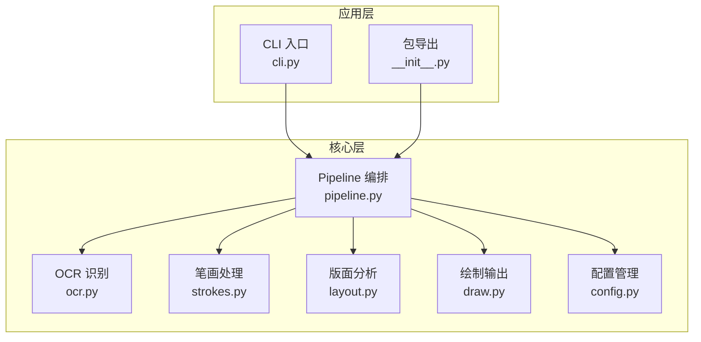
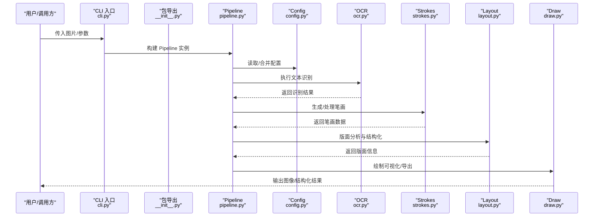
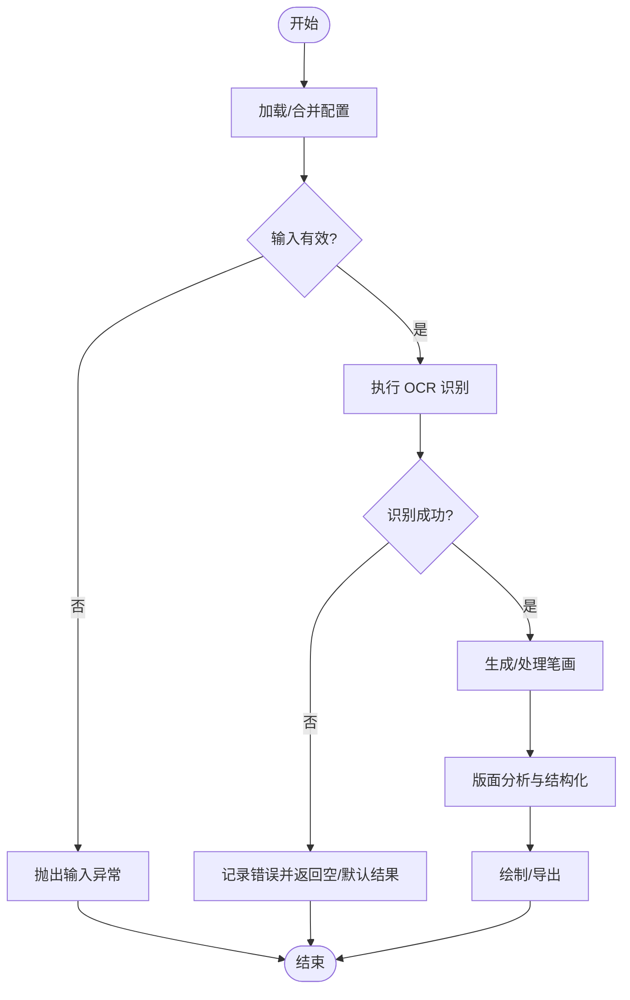
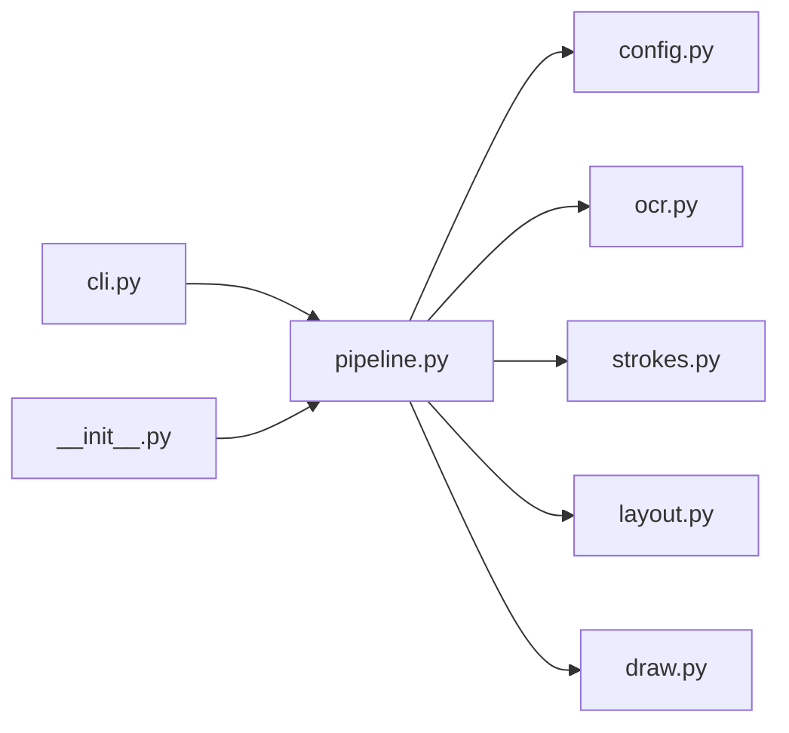

# 核心 API 接口

<cite>
**本文引用的文件**   
- [pipeline.py](file://zig/pipeline.py)
- [ocr.py](file://zig/ocr.py)
- [strokes.py](file://zig/strokes.py)
- [layout.py](file://zig/layout.py)
- [draw.py](file://zig/draw.py)
- [config.py](file://zig/config.py)
- [cli.py](file://zig/cli.py)
- [__init__.py](file://zig/__init__.py)
- [requirements.txt](file://requirements.txt)
</cite>

## 目录
1. [简介](#简介)
2. [项目结构](#项目结构)
3. [核心组件](#核心组件)
4. [架构总览](#架构总览)
5. [详细组件分析](#详细组件分析)
6. [依赖关系分析](#依赖关系分析)
7. [性能考虑](#性能考虑)
8. [故障排查指南](#故障排查指南)
9. [结论](#结论)
10. [附录](#附录)

## 简介
本文件面向使用者与集成方，系统化梳理 OCR 与笔画处理相关的核心 API，重点围绕 Pipeline 类的初始化参数、配置项、主要方法，以及文本识别、笔画渲染等关键能力的调用方式。文档同时给出模块间的依赖关系、数据流向、错误处理策略与常见问题的定位建议，帮助读者快速上手并稳定集成。

## 项目结构
仓库采用按功能划分的模块化组织方式：
- zige/pipeline.py：编排式主流程入口（Pipeline）
- zige/ocr.py：OCR 文本识别相关能力
- zige/strokes.py：笔画生成与处理
- zige/layout.py：版面分析与布局
- zige/draw.py：可视化绘制
- zige/config.py：配置管理
- zige/cli.py：命令行入口
- zig/__init__.py：包级对外暴露的 API 聚合
- requirements.txt：运行时依赖声明

图表来源
- [cli.py:1-200](file://zig/cli.py#L1-L200)
- [__init__.py:1-200](file://zig/__init__.py#L1-L200)
- [pipeline.py:1-200](file://zig/pipeline.py#L1-L200)
- [ocr.py:1-200](file://zig/ocr.py#L1-L200)
- [strokes.py:1-200](file://zig/strokes.py#L1-L200)
- [layout.py:1-200](file://zig/layout.py#L1-L200)
- [draw.py:1-200](file://zig/draw.py#L1-L200)
- [config.py:1-200](file://zig/config.py#L1-L200)

章节来源
- [cli.py:1-200](file://zig/cli.py#L1-L200)
- [__init__.py:1-200](file://zig/__init__.py#L1-L200)
- [pipeline.py:1-200](file://zig/pipeline.py#L1-L200)
- [ocr.py:1-200](file://zig/ocr.py#L1-L200)
- [strokes.py:1-200](file://zig/strokes.py#L1-L200)
- [layout.py:1-200](file://zig/layout.py#L1-L200)
- [draw.py:1-200](file://zig/draw.py#L1-L200)
- [config.py:1-200](file://zig/config.py#L1-L200)

## 核心组件
- Pipeline：统一编排入口，负责加载配置、调度 OCR、笔画、版面与绘制等步骤，提供端到端的输入到输出的处理能力。
- OCR：封装文本识别逻辑，包括图像预处理、模型推理、结果后处理等。
- Strokes：负责笔画生成、路径计算、样式控制与渲染准备。
- Layout：进行版面检测、区域划分、行列/段落结构化。
- Draw：将识别结果与笔画信息绘制为可视化图像或矢量输出。
- Config：集中管理运行参数、模型路径、阈值、设备选择等。

章节来源
- [pipeline.py:1-200](file://zig/pipeline.py#L1-L200)
- [ocr.py:1-200](file://zig/ocr.py#L1-L200)
- [strokes.py:1-200](file://zig/strokes.py#L1-L200)
- [layout.py:1-200](file://zig/layout.py#L1-L200)
- [draw.py:1-200](file://zig/draw.py#L1-L200)
- [config.py:1-200](file://zig/config.py#L1-L200)

## 架构总览
下图展示从 CLI/SDK 调用到内部各模块协作的数据流与控制流。

图表来源
- [cli.py:1-200](file://zig/cli.py#L1-L200)
- [__init__.py:1-200](file://zig/__init__.py#L1-L200)
- [pipeline.py:1-200](file://zig/pipeline.py#L1-L200)
- [config.py:1-200](file://zig/config.py#L1-L200)
- [ocr.py:1-200](file://zig/ocr.py#L1-L200)
- [strokes.py:1-200](file://zig/strokes.py#L1-L200)
- [layout.py:1-200](file://zig/layout.py#L1-L200)
- [draw.py:1-200](file://zig/draw.py#L1-L200)

## 详细组件分析

### Pipeline 类
- 职责
  - 统一接收输入（图片路径/字节/URL 等），完成配置加载、OCR、笔画、版面、绘制的完整流水线。
  - 提供高层 API，屏蔽底层实现细节，便于 CLI 与 SDK 使用。
- 初始化参数与配置选项（概念性说明）
  - 输入类型：支持本地路径、内存字节、网络 URL 等多种输入源。
  - 模型与资源：OCR 模型路径、字体文件、笔画样式表等。
  - 运行参数：设备选择（CPU/GPU）、并发数、阈值、缩放比例、是否启用笔画/版面等开关。
  - 输出选项：是否绘制、导出格式（图像/JSON/CSV 等）。
- 主要方法（概念性说明）
  - run/process：端到端处理入口，内部顺序调用 OCR -> Strokes -> Layout -> Draw。
  - preprocess/postprocess：可选的前/后处理钩子，用于增强鲁棒性与扩展性。
  - export/save：将中间或最终结果持久化。
- 错误处理
  - 对无效输入、模型缺失、IO 异常、推理失败等进行捕获与包装，抛出明确的可诊断异常。
  - 在关键阶段记录日志，便于问题定位。

图表来源
- [pipeline.py:1-200](file://zig/pipeline.py#L1-L200)

章节来源
- [pipeline.py:1-200](file://zig/pipeline.py#L1-L200)

### OCR 模块
- 职责
  - 图像预处理（去噪、二值化、透视校正等）。
  - 模型推理与解码（字符/词级别识别、置信度过滤）。
  - 结果后处理（纠错、对齐、坐标映射）。
- 典型调用
  - 通过 Pipeline 间接调用；也可直接调用以获取细粒度控制。
- 错误处理
  - 针对模型加载失败、推理超时、输入尺寸不合法等情况进行校验与报错。

章节来源
- [ocr.py:1-200](file://zig/ocr.py#L1-L200)

### Strokes 模块
- 职责
  - 根据字形/编码生成笔画路径，支持多种笔画风格与粗细。
  - 与 Layout 配合，将笔画与版面元素对齐。
- 典型调用
  - 由 Pipeline 在 OCR 之后触发，也可独立用于笔画可视化。
- 错误处理
  - 对缺失字体、路径计算失败、坐标越界等进行保护。

章节来源
- [strokes.py:1-200](file://zig/strokes.py#L1-L200)

### Layout 模块
- 职责
  - 检测文本行、列、段落等版面结构，输出结构化布局信息。
  - 与 OCR 结果融合，形成带坐标的结构化文本块。
- 典型调用
  - Pipeline 中在 OCR 之后执行，为后续绘制与导出提供依据。
- 错误处理
  - 对无法解析的版面进行降级处理，保留尽可能多的可用信息。

章节来源
- [layout.py:1-200](file://zig/layout.py#L1-L200)

### Draw 模块
- 职责
  - 将 OCR 文本、笔画路径、版面框等绘制到画布，支持多种输出格式。
- 典型调用
  - Pipeline 最后一步，输出可视化图像或矢量图。
- 错误处理
  - 对绘图资源不足、格式不支持等进行捕获与提示。

章节来源
- [draw.py:1-200](file://zig/draw.py#L1-L200)

### Config 模块
- 职责
  - 集中管理运行期配置，支持默认值、环境变量、配置文件覆盖。
- 典型用法
  - Pipeline 启动时加载，供各子模块读取。
- 错误处理
  - 对缺失键、类型不匹配、路径不存在等进行校验与报错。

章节来源
- [config.py:1-200](file://zig/config.py#L1-L200)

### CLI 与包导出
- CLI
  - 提供命令行参数解析，将用户输入转换为 Pipeline 调用。
- 包导出
  - 在 __init__.py 中聚合常用 API，简化外部导入。

章节来源
- [cli.py:1-200](file://zig/cli.py#L1-L200)
- [__init__.py:1-200](file://zig/__init__.py#L1-L200)

## 依赖关系分析
- 内部依赖
  - Pipeline 依赖 Config、OCR、Strokes、Layout、Draw。
  - CLI 依赖 Pipeline 作为编排入口。
  - __init__.py 聚合对外 API，通常包含 Pipeline 及相关工具函数。
- 外部依赖
  - 图像处理、OCR 推理引擎、字体库、绘图库等由 requirements.txt 声明。

图表来源
- [cli.py:1-200](file://zig/cli.py#L1-L200)
- [__init__.py:1-200](file://zig/__init__.py#L1-L200)
- [pipeline.py:1-200](file://zig/pipeline.py#L1-L200)
- [config.py:1-200](file://zig/config.py#L1-L200)
- [ocr.py:1-200](file://zig/ocr.py#L1-L200)
- [strokes.py:1-200](file://zig/strokes.py#L1-L200)
- [layout.py:1-200](file://zig/layout.py#L1-L200)
- [draw.py:1-200](file://zig/draw.py#L1-L200)

章节来源
- [requirements.txt:1-200](file://requirements.txt#L1-L200)

## 性能考虑
- 批处理与缓存
  - 对重复输入或相似任务启用结果缓存，减少重复推理。
- 并行与异步
  - 在 IO 密集环节（如多图片批量处理）使用线程/进程池或异步 I/O。
- 资源限制
  - 合理设置 GPU/CPU 显存上限、线程数、图像最大尺寸，避免 OOM。
- 模型与量化
  - 优先使用轻量模型或量化版本，权衡精度与速度。
- 绘制优化
  - 按需绘制，关闭不必要的标注；批量导出时复用画布对象。

[本节为通用指导，不涉及具体文件]

## 故障排查指南
- 输入相关问题
  - 现象：无法读取图片、尺寸异常、编码错误。
  - 排查：检查路径/URL 可达性、权限、编码格式；确认输入尺寸在模型允许范围内。
- 模型与资源缺失
  - 现象：模型加载失败、字体缺失、路径不存在。
  - 排查：核对 config 中的模型/字体路径；确保依赖已安装且路径正确。
- 推理失败
  - 现象：OCR 返回空结果或置信度极低。
  - 排查：调整阈值、对比度/二值化参数；更换更合适的模型或分辨率。
- 笔画/绘制异常
  - 现象：笔画错位、缺字、渲染空白。
  - 排查：检查字体文件完整性、笔画样式配置、坐标映射是否正确。
- 日志与断点
  - 建议在 Pipeline 的关键阶段（preprocess、OCR、Strokes、Layout、Draw）增加日志输出，快速定位失败阶段。

章节来源
- [pipeline.py:1-200](file://zig/pipeline.py#L1-L200)
- [config.py:1-200](file://zig/config.py#L1-L200)
- [ocr.py:1-200](file://zig/ocr.py#L1-L200)
- [strokes.py:1-200](file://zig/strokes.py#L1-L200)
- [draw.py:1-200](file://zig/draw.py#L1-L200)

## 结论
Pipeline 作为统一编排入口，串联 OCR、笔画、版面与绘制等核心能力，提供简洁稳定的 API。通过合理的配置与错误处理，可在不同场景下获得一致的识别与可视化效果。建议在生产环境中结合日志、监控与缓存策略，持续优化性能与稳定性。

[本节为总结性内容，不涉及具体文件]

## 附录
- 依赖清单
  - 参见 requirements.txt，了解第三方库版本约束与安装要求。

章节来源
- [requirements.txt:1-200](file://requirements.txt#L1-L200)