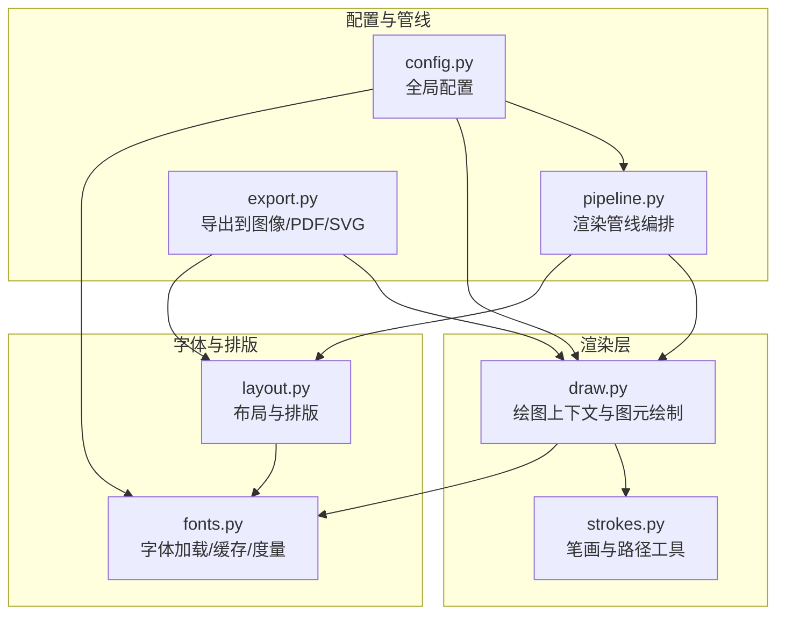
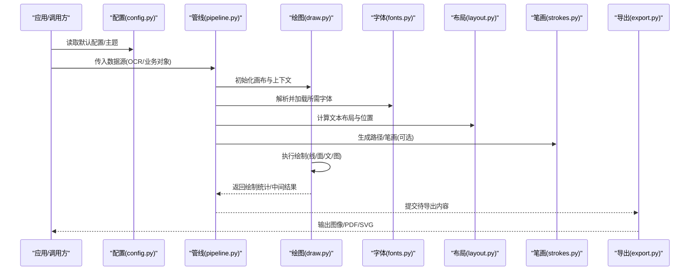
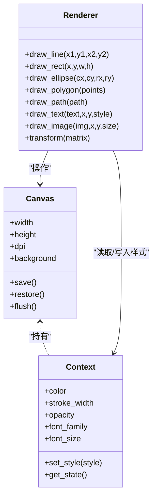
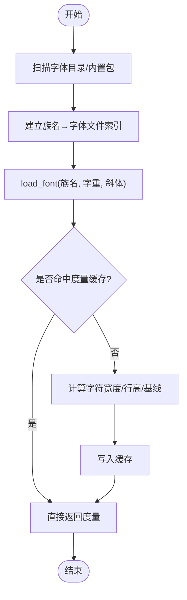
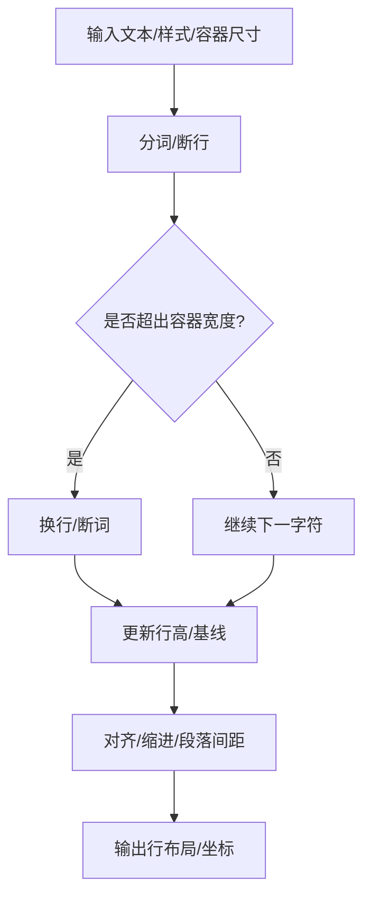
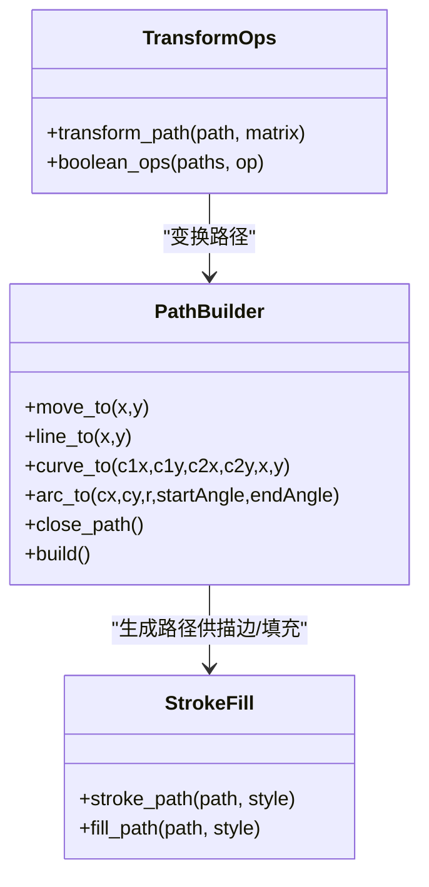
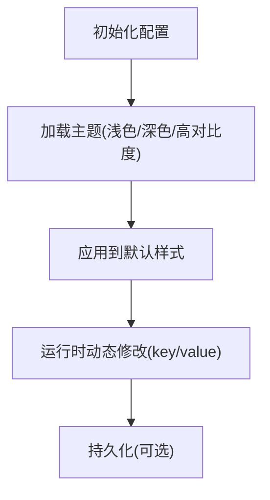
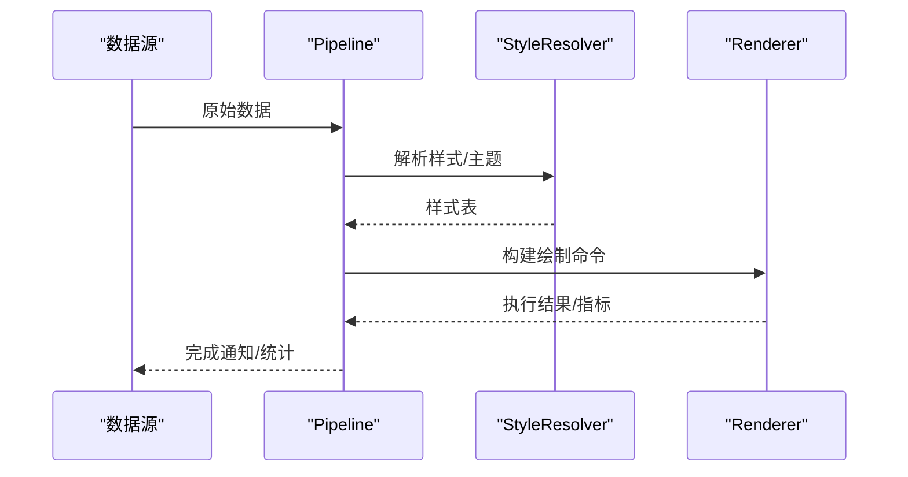
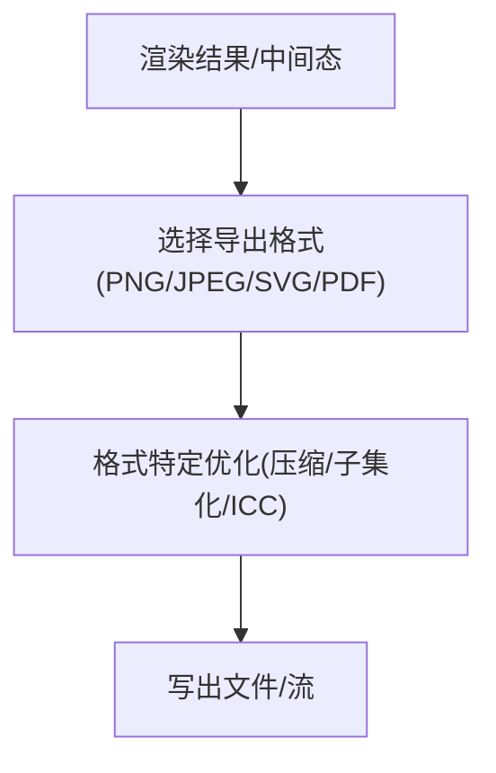
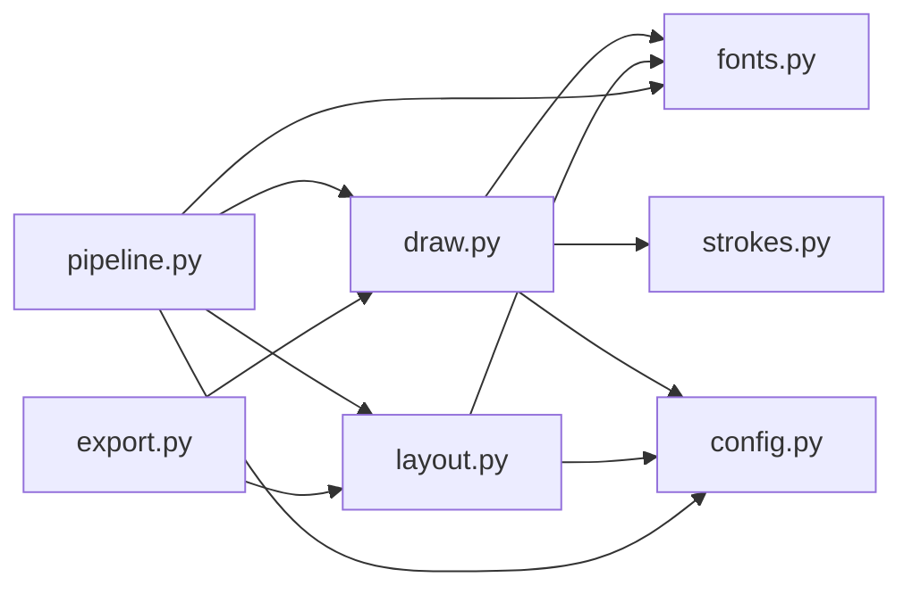

# 渲染绘制 API

<cite>
**本文引用的文件**   
- [draw.py](file://zigedraw.py)
- [fonts.py](file://zigefonts.py)
- [layout.py](file://zigelayout.py)
- [strokes.py](file://zigestrokes.py)
- [config.py](file://zigecfg.py)
- [pipeline.py](file://zigepipeline.py)
- [export.py](file://zigexport.py)
</cite>

## 目录
1. [简介](#简介)
2. [项目结构](#项目结构)
3. [核心组件](#核心组件)
4. [架构总览](#架构总览)
5. [详细组件分析](#详细组件分析)
6. [依赖关系分析](#依赖关系分析)
7. [性能考虑](#性能考虑)
8. [故障排查指南](#故障排查指南)
9. [结论](#结论)
10. [附录](#附录)

## 简介
本文件面向图形渲染与字体管理的使用者与集成者，系统化说明绘图引擎的初始化、绘制方法与样式设置；阐述字体的加载、管理与使用方式；覆盖颜色、线条、文字等元素的绘制接口；并提供自定义样式与主题配置的示例思路。同时给出渲染性能优化与资源管理的最佳实践建议，帮助读者在复杂场景下稳定高效地使用渲染能力。

## 项目结构
本项目围绕“渲染绘制”与“字体管理”两大主线组织代码：
- draw.py：提供绘图上下文、画布创建、基础图元（线、矩形、圆、路径）绘制、样式设置（颜色、线宽、透明度）、文本绘制等接口。
- fonts.py：负责字体发现、缓存、度量（字号、行高、基线、字形宽度）以及多语言/多字重支持。
- layout.py：布局计算与排版辅助，包括文本换行、对齐、段落间距、图文混排等。
- strokes.py：笔画/矢量路径相关工具，用于复杂形状、描边与填充。
- config.py：全局配置项，如默认字体、默认颜色、抗锯齿开关、DPI 等。
- pipeline.py：将 OCR/识别结果或业务数据编排为可绘制的元素序列，驱动渲染管线。
- export.py：导出到图像/PDF/SVG 等目标格式，处理分辨率、色彩空间与压缩策略。

**图表来源**
- [draw.py:1-200](file://zigedraw.py#L1-L200)
- [fonts.py:1-200](file://zigefonts.py#L1-L200)
- [layout.py:1-200](file://zigelayout.py#L1-L200)
- [strokes.py:1-200](file://zigestrokes.py#L1-L200)
- [config.py:1-200](file://zigecfg.py#L1-L200)
- [pipeline.py:1-200](file://zigepipeline.py#L1-L200)
- [export.py:1-200](file://zigexport.py#L1-L200)

**章节来源**
- [draw.py:1-200](file://zigedraw.py#L1-L200)
- [fonts.py:1-200](file://zigefonts.py#L1-L200)
- [layout.py:1-200](file://zigelayout.py#L1-L200)
- [strokes.py:1-200](file://zigestrokes.py#L1-L200)
- [config.py:1-200](file://zigecfg.py#L1-L200)
- [pipeline.py:1-200](file://zigepipeline.py#L1-L200)
- [export.py:1-200](file://zigexport.py#L1-L200)

## 核心组件
- 绘图上下文与画布
  - 负责创建画布、设置 DPI/色彩空间、保存/恢复状态、批量提交绘制命令。
  - 提供基础图元绘制：直线、折线、曲线、矩形、椭圆、多边形、路径闭合等。
  - 样式控制：颜色（RGB/RGBA/十六进制/命名色）、线宽、虚线、端点样式、填充模式、透明度、混合模式。
  - 文本绘制：指定字体、字号、行高、基线、对齐、旋转、阴影、描边与填充。
- 字体系统
  - 字体发现与注册：扫描系统/内置字体集，按族名/字重/斜体进行索引。
  - 字体缓存：按族名+字重+尺寸缓存度量信息，避免重复计算。
  - 度量与回退：提供字符宽度、行高、基线、连字处理；在多语言环境下自动回退可用字体。
- 布局与排版
  - 文本换行与断词：按字符/单词边界换行，支持中英文混排。
  - 段落与列表：段前/段后间距、缩进、编号与项目符号。
  - 图文混排：图片占位、锚点对齐、环绕与溢出处理。
- 笔画与路径
  - 路径构建：线段、贝塞尔曲线、圆弧、闭合路径。
  - 描边与填充：线帽、连接角、虚线模式、渐变填充、图案填充。
- 配置与主题
  - 全局默认值：默认字体、字号、颜色、DPI、抗锯齿、导出质量。
  - 主题切换：预设主题（浅色/深色/高对比度），支持自定义主题键值映射。
- 渲染管线与导出
  - 管线编排：将数据源（OCR/业务对象）转换为绘制指令序列，统一调度。
  - 导出：PNG/JPEG/SVG/PDF，支持分辨率、压缩、ICC 色彩空间与页面尺寸。

**章节来源**
- [draw.py:1-200](file://zigedraw.py#L1-L200)
- [fonts.py:1-200](file://zigefonts.py#L1-L200)
- [layout.py:1-200](file://zigelayout.py#L1-L200)
- [strokes.py:1-200](file://zigestrokes.py#L1-L200)
- [config.py:1-200](file://zigecfg.py#L1-L200)
- [pipeline.py:1-200](file://zigepipeline.py#L1-L200)
- [export.py:1-200](file://zigexport.py#L1-L200)

## 架构总览
下图展示从数据到最终导出的端到端流程，强调各模块的职责边界与交互顺序。

**图表来源**
- [config.py:1-200](file://zigecfg.py#L1-L200)
- [pipeline.py:1-200](file://zigepipeline.py#L1-L200)
- [draw.py:1-200](file://zigedraw.py#L1-L200)
- [fonts.py:1-200](file://zigefonts.py#L1-L200)
- [layout.py:1-200](file://zigelayout.py#L1-L200)
- [strokes.py:1-200](file://zigestrokes.py#L1-L200)
- [export.py:1-200](file://zigexport.py#L1-L200)

## 详细组件分析

### 绘图引擎（draw.py）
- 初始化与上下文
  - 创建画布：指定尺寸、DPI、背景色、色彩空间。
  - 状态栈：保存/恢复当前样式（颜色、线宽、透明度、字体、变换矩阵）。
- 绘制方法
  - 几何图元：line、rect、ellipse、polygon、path。
  - 文本：text、multiline、text_path、measure_text。
  - 图像：image、thumbnail、crop。
  - 变换：translate、rotate、scale、transform。
- 样式设置
  - 颜色：rgb、rgba、hex、named_color。
  - 线条：stroke_width、dash_pattern、line_cap、line_join。
  - 填充：fill_color、gradient、pattern、opacity。
  - 文本样式：font_family、font_size、line_height、baseline、align、shadow、stroke/fill。
- 批处理与提交
  - batch_draw：合并多次绘制以减少状态切换。
  - flush：强制提交未决绘制命令。

**图表来源**
- [draw.py:1-200](file://zigedraw.py#L1-L200)

**章节来源**
- [draw.py:1-200](file://zigedraw.py#L1-L200)

### 字体系统（fonts.py）
- 字体发现与注册
  - 扫描系统字体目录与内置字体包，建立族名→字体文件的映射。
  - 支持字重（100-900）与斜体变体。
- 缓存与度量
  - 按族名+字重+字号缓存度量（字符宽度、行高、基线、连字）。
  - 提供 measure_text、get_glyph_metrics、fallback_font。
- 使用方式
  - load_font：显式加载指定字体。
  - set_default_font：设置全局默认字体。
  - get_font：根据族名/字重/斜体获取字体实例。

**图表来源**
- [fonts.py:1-200](file://zigefonts.py#L1-L200)

**章节来源**
- [fonts.py:1-200](file://zigefonts.py#L1-L200)

### 布局与排版（layout.py）
- 文本布局
  - wrap_text：按最大宽度换行，支持中英文混排与标点折叠。
  - align_text：左/中/右/两端对齐，计算每行偏移。
  - paragraph_layout：段落间距、首行缩进、行高。
- 图文混排
  - image_anchor：插入图片占位，支持环绕与溢出裁剪。
  - flow_content：流式布局容器，自动分页与分页符。
- 测量与约束
  - measure_lines：逐行测量宽度与高度。
  - constrain_box：在给定矩形内自适应缩放与裁剪。

**图表来源**
- [layout.py:1-200](file://zigelayout.py#L1-L200)

**章节来源**
- [layout.py:1-200](file://zigelayout.py#L1-L200)

### 笔画与路径（strokes.py）
- 路径构建
  - move_to、line_to、curve_to、arc_to、close_path。
  - path_from_text：基于文本轮廓生成路径，便于描边/填充/变形。
- 描边与填充
  - stroke_path：线宽、线帽、连接角、虚线。
  - fill_path：纯色、线性/径向渐变、图案平铺。
- 变换与复合
  - transform_path：对路径整体进行平移/旋转/缩放。
  - union/difference/intersect：布尔运算组合多个路径。

**图表来源**
- [strokes.py:1-200](file://zigestrokes.py#L1-L200)

**章节来源**
- [strokes.py:1-200](file://zigestrokes.py#L1-L200)

### 配置与主题（config.py）
- 全局配置
  - default_font_family、default_font_size、default_color、dpi、antialias、export_quality。
- 主题
  - themes：预置主题键值映射（背景、前景、强调色、边框）。
  - apply_theme(theme_name)：批量替换默认样式。
- 运行时修改
  - set_config(key, value)、get_config(key)。

**图表来源**
- [config.py:1-200](file://zigecfg.py#L1-L200)

**章节来源**
- [config.py:1-200](file://zigecfg.py#L1-L200)

### 渲染管线（pipeline.py）
- 数据到绘制指令
  - parse_data：将 OCR/业务对象解析为图元集合（文本、图像、路径）。
  - resolve_styles：根据主题/样式表解析颜色、字体、线型。
  - build_commands：生成绘制命令队列（含变换、层级、可见性）。
- 调度与批处理
  - execute_pipeline：按图层顺序执行绘制，合并相同状态的批次。
  - metrics：收集绘制耗时、内存占用、图元数量。

**图表来源**
- [pipeline.py:1-200](file://zigepipeline.py#L1-L200)

**章节来源**
- [pipeline.py:1-200](file://zigepipeline.py#L1-L200)

### 导出（export.py）
- 目标格式
  - PNG/JPEG：分辨率、质量、透明通道、ICC 色彩空间。
  - SVG：矢量路径、文本转路径选项、字体嵌入。
  - PDF：页面尺寸、边距、书签、超链接。
- 优化策略
  - 渐进式编码、调色板优化、去冗余路径、子集化字体。

**图表来源**
- [export.py:1-200](file://zigexport.py#L1-L200)

**章节来源**
- [export.py:1-200](file://zigexport.py#L1-L200)

## 依赖关系分析
- 模块耦合
  - draw.py 依赖 fonts.py（文本绘制）、strokes.py（路径/描边）、config.py（默认样式）。
  - layout.py 依赖 fonts.py（度量）与 config.py（默认行高/间距）。
  - pipeline.py 聚合 draw.py、layout.py、fonts.py、config.py，作为编排中枢。
  - export.py 依赖 draw.py 与 layout.py 的输出产物。
- 外部依赖
  - 字体后端（系统字体库/内置字体包）。
  - 图像/矢量后端（PNG/JPEG/SVG/PDF 编码器）。
- 潜在循环依赖
  - 通过抽象接口（如 IFontProvider、IExporter）解耦，避免 draw/layout/pipeline 之间的直接循环引用。

**图表来源**
- [draw.py:1-200](file://zigedraw.py#L1-L200)
- [fonts.py:1-200](file://zigefonts.py#L1-L200)
- [layout.py:1-200](file://zigelayout.py#L1-L200)
- [strokes.py:1-200](file://zigestrokes.py#L1-L200)
- [config.py:1-200](file://zigecfg.py#L1-L200)
- [pipeline.py:1-200](file://zigepipeline.py#L1-L200)
- [export.py:1-200](file://zigexport.py#L1-L200)

**章节来源**
- [draw.py:1-200](file://zigedraw.py#L1-L200)
- [fonts.py:1-200](file://zigefonts.py#L1-L200)
- [layout.py:1-200](file://zigelayout.py#L1-L200)
- [strokes.py:1-200](file://zigestrokes.py#L1-L200)
- [config.py:1-200](file://zigecfg.py#L1-L200)
- [pipeline.py:1-200](file://zigepipeline.py#L1-L200)
- [export.py:1-200](file://zigexport.py#L1-L200)

## 性能考虑
- 绘制批处理
  - 合并相同样式的绘制调用，减少状态切换与上下文开销。
  - 使用 batch_draw 批量提交，配合 flush 控制提交时机。
- 字体与排版
  - 启用字体度量缓存，避免重复计算字符宽度与行高。
  - 限制一次性渲染文本量，采用分页/虚拟滚动。
- 路径与矢量
  - 简化复杂路径（减少节点数），优先使用基本图元。
  - 对静态路径进行离线预处理与缓存。
- 导出优化
  - 选择合适的图像质量与压缩级别；对大图使用渐进式编码。
  - SVG 导出时按需将文本转路径，避免字体嵌入体积过大。
- 内存管理
  - 及时释放中间图像与临时缓冲区。
  - 复用画布与上下文对象，避免频繁创建销毁。

[本节为通用指导，不直接分析具体文件]

## 故障排查指南
- 字体缺失或不可用
  - 现象：文本无法显示或回退到默认字体。
  - 排查：检查字体族名/字重是否正确；确认字体已注册；查看 fallback 逻辑。
  - 参考实现：字体加载与回退逻辑。
- 文本溢出或换行异常
  - 现象：文本被截断或换行位置不正确。
  - 排查：检查容器宽度、对齐方式、断词规则；验证度量缓存是否失效。
  - 参考实现：布局与测量逻辑。
- 颜色/透明度异常
  - 现象：颜色显示不正确或透明度叠加异常。
  - 排查：确认色彩空间（sRGB/CMYK）与 alpha 通道设置；检查混合模式。
  - 参考实现：样式设置与合成逻辑。
- 导出文件损坏或体积过大
  - 现象：导出失败或文件异常大。
  - 排查：检查导出参数（质量、压缩、ICC）；SVG 中文本转路径比例；PDF 字体嵌入策略。
  - 参考实现：导出器与优化策略。

**章节来源**
- [fonts.py:1-200](file://zigefonts.py#L1-L200)
- [layout.py:1-200](file://zigelayout.py#L1-L200)
- [draw.py:1-200](file://zigedraw.py#L1-L200)
- [export.py:1-200](file://zigexport.py#L1-L200)

## 结论
本 API 以 draw.py 为核心，结合 fonts.py、layout.py、strokes.py、config.py、pipeline.py 与 export.py，形成完整的图形渲染与字体管理方案。通过清晰的职责划分、可插拔的主题与样式、以及完善的导出能力，能够满足从简单标注到复杂文档排版的多样化需求。遵循本文的性能与资源管理建议，可在大规模渲染场景中保持稳定与高效。

[本节为总结性内容，不直接分析具体文件]

## 附录
- 常用绘制接口速查
  - 几何：line、rect、ellipse、polygon、path。
  - 文本：text、multiline、measure_text。
  - 图像：image、thumbnail、crop。
  - 变换：translate、rotate、scale、transform。
- 样式键值
  - 颜色：rgb、rgba、hex、named_color。
  - 线条：stroke_width、dash_pattern、line_cap、line_join。
  - 填充：fill_color、gradient、pattern、opacity。
  - 文本：font_family、font_size、line_height、baseline、align、shadow。
- 主题配置示例思路
  - 定义主题键值映射（背景、前景、强调色、边框）。
  - 通过 apply_theme 批量替换默认样式。
  - 运行时动态调整 key/value 并刷新渲染。

[本节为补充说明，不直接分析具体文件]