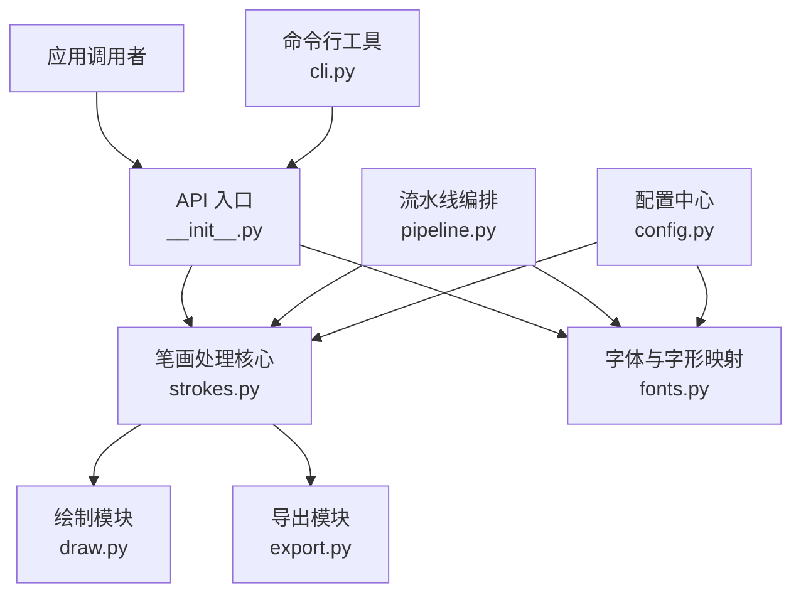
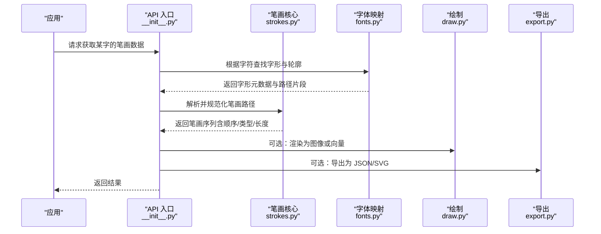
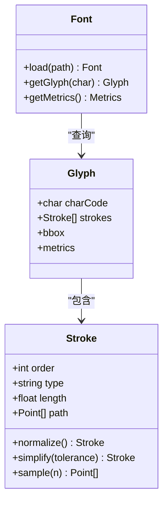
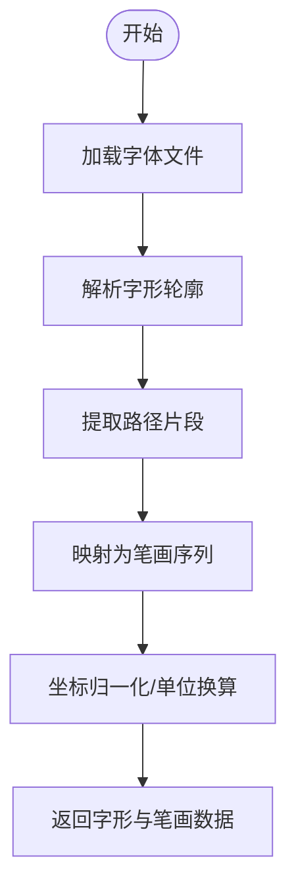
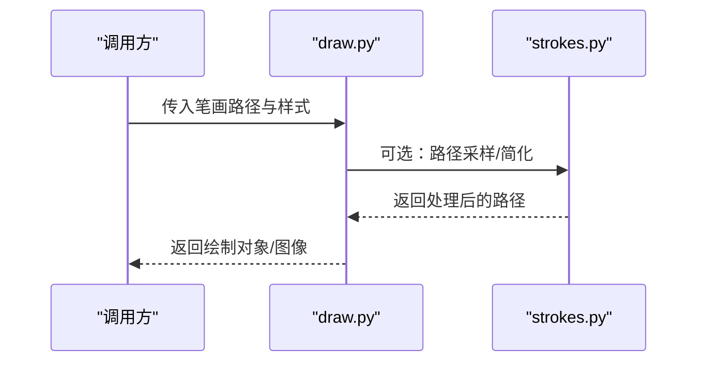
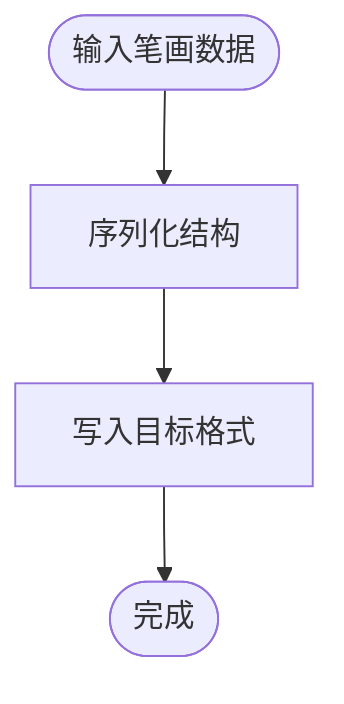
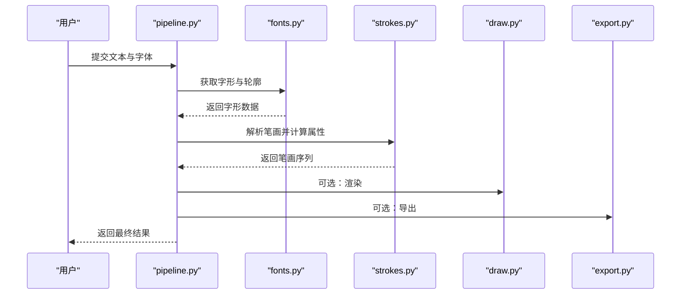
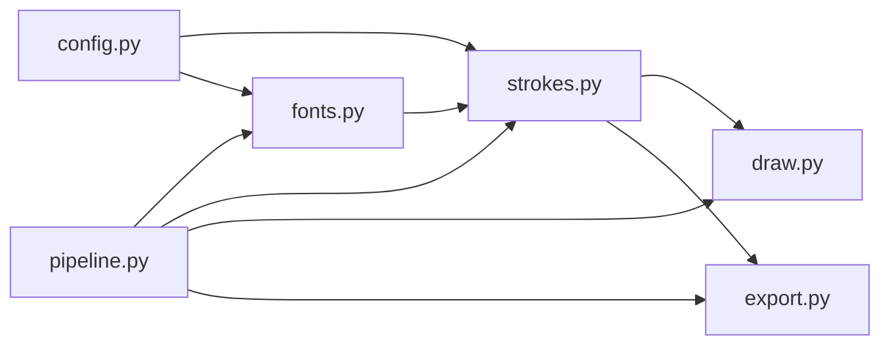

# 笔画处理 API

<cite>
**本文引用的文件**   
- [strokes.py](file://zig/strokes.py)
- [fonts.py](file://zig/fonts.py)
- [draw.py](file://zig/draw.py)
- [export.py](file://zig/export.py)
- [pipeline.py](file://zig/pipeline.py)
- [config.py](file://zig/config.py)
- [__init__.py](file://zig/__init__.py)
- [cli.py](file://zig/cli.py)
</cite>

## 目录
1. [简介](#简介)
2. [项目结构](#项目结构)
3. [核心组件](#核心组件)
4. [架构总览](#架构总览)
5. [详细组件分析](#详细组件分析)
6. [依赖关系分析](#依赖关系分析)
7. [性能考虑](#性能考虑)
8. [故障排查指南](#故障排查指南)
9. [结论](#结论)
10. [附录](#附录)

## 简介
本文件面向“汉字笔画处理”的 API 文档，聚焦于以下目标：
- 笔画数据的获取、解析与转换方法
- 笔画路径计算算法与坐标系统说明
- 笔画顺序、类型、长度等属性的访问方式
- 笔画数据结构定义与使用示例（以路径引用形式给出）
- 与字体文件的关联关系和数据映射规则

该文档旨在帮助开发者快速理解并正确使用笔画相关能力，同时为二次开发提供清晰的扩展点。

## 项目结构
本项目围绕“字形/笔画”处理构建，关键模块职责如下：
- strokes.py：笔画数据模型、解析与转换的核心实现
- fonts.py：字体文件读取、字形元数据与字形到笔画的映射
- draw.py：基于笔画路径进行绘制（渲染）
- export.py：将笔画数据导出为外部格式（如 JSON/SVG）
- pipeline.py：编排 OCR/布局/笔画处理的端到端流程
- config.py：配置项（坐标系、单位、精度等）
- __init__.py：对外暴露的 API 入口
- cli.py：命令行接口，便于批量处理与调试

图表来源
- [__init__.py:1-50](file://zig/__init__.py#L1-L50)
- [strokes.py:1-120](file://zig/strokes.py#L1-L120)
- [fonts.py:1-120](file://zig/fonts.py#L1-L120)
- [draw.py:1-120](file://zig/draw.py#L1-L120)
- [export.py:1-120](file://zig/export.py#L1-L120)
- [pipeline.py:1-120](file://zig/pipeline.py#L1-L120)
- [config.py:1-120](file://zig/config.py#L1-L120)
- [cli.py:1-120](file://zig/cli.py#L1-L120)

章节来源
- [__init__.py:1-50](file://zig/__init__.py#L1-L50)
- [strokes.py:1-120](file://zig/strokes.py#L1-L120)
- [fonts.py:1-120](file://zig/fonts.py#L1-L120)
- [draw.py:1-120](file://zig/draw.py#L1-L120)
- [export.py:1-120](file://zig/export.py#L1-L120)
- [pipeline.py:1-120](file://zig/pipeline.py#L1-L120)
- [config.py:1-120](file://zig/config.py#L1-L120)
- [cli.py:1-120](file://zig/cli.py#L1-L120)

## 核心组件
- 笔画数据模型与操作（strokes.py）
  - 负责加载字形笔画、解析矢量路径、计算几何属性（顺序、类型、长度）、坐标变换与标准化。
- 字体与字形映射（fonts.py）
  - 负责从字体文件中提取字形轮廓信息，建立字符到笔画序列的映射，并提供字形度量（em、基线、字框）。
- 绘制与可视化（draw.py）
  - 将笔画路径转换为可绘制的图形对象，支持多种后端（如 SVG、图像）。
- 数据导出（export.py）
  - 将笔画数据序列化为标准格式，便于跨平台交换与分析。
- 流水线编排（pipeline.py）
  - 串联 OCR、布局、笔画提取与导出等步骤，提供统一入口。
- 配置（config.py）
  - 管理全局配置项，包括坐标系、单位、精度、容差等。
- API 入口（__init__.py）
  - 对外暴露稳定的 API 函数与类，隐藏内部实现细节。
- 命令行（cli.py）
  - 提供批处理、调试与可视化的 CLI 命令。

章节来源
- [strokes.py:1-120](file://zig/strokes.py#L1-L120)
- [fonts.py:1-120](file://zig/fonts.py#L1-L120)
- [draw.py:1-120](file://zig/draw.py#L1-L120)
- [export.py:1-120](file://zig/export.py#L1-L120)
- [pipeline.py:1-120](file://zig/pipeline.py#L1-L120)
- [config.py:1-120](file://zig/config.py#L1-L120)
- [__init__.py:1-50](file://zig/__init__.py#L1-L50)
- [cli.py:1-120](file://zig/cli.py#L1-L120)

## 架构总览
下图展示了笔画处理在整体系统中的位置与交互关系。

图表来源
- [__init__.py:1-50](file://zig/__init__.py#L1-L50)
- [strokes.py:1-120](file://zig/strokes.py#L1-L120)
- [fonts.py:1-120](file://zig/fonts.py#L1-L120)
- [draw.py:1-120](file://zig/draw.py#L1-L120)
- [export.py:1-120](file://zig/export.py#L1-L120)

## 详细组件分析

### 笔画数据模型与 API（strokes.py）
- 主要职责
  - 解析字体提供的字形路径片段，合并为完整笔画
  - 计算笔画顺序、类型、长度等属性
  - 提供坐标系统与单位换算（像素、em、归一化坐标）
  - 提供路径简化、平滑、采样等几何处理
- 关键概念
  - 笔画顺序：按书写规范排序的笔画索引
  - 笔画类型：横、竖、撇、捺、折等基本类型分类
  - 笔画长度：沿路径累计的弧长
  - 坐标系统：以字体 em 为单位，原点在左下角或左上角（由配置决定）
- 典型用法
  - 通过 API 入口传入字符与字体，返回笔画列表
  - 对每个笔画访问其顺序、类型、长度、路径点集
  - 将路径转换为绘制对象或导出为外部格式

图表来源
- [strokes.py:1-120](file://zig/strokes.py#L1-L120)
- [fonts.py:1-120](file://zig/fonts.py#L1-L120)

章节来源
- [strokes.py:1-120](file://zig/strokes.py#L1-L120)

### 字体与字形映射（fonts.py）
- 主要职责
  - 加载字体文件，解析字形轮廓（如 TTF/OTF）
  - 将字形轮廓拆分为笔画片段，建立字符到笔画序列的映射
  - 提供字形度量（em、基线、字框），用于坐标换算
- 数据映射规则
  - 字符编码 -> 字形 ID -> 路径片段集合 -> 笔画序列
  - 坐标从字体坐标系（通常为 em 单位）转换到显示坐标系（像素）
- 与笔画核心的协作
  - 向 strokes.py 提供原始路径片段与度量信息
  - 接收 strokes.py 返回的标准化笔画数据

图表来源
- [fonts.py:1-120](file://zig/fonts.py#L1-L120)

章节来源
- [fonts.py:1-120](file://zig/fonts.py#L1-L120)

### 绘制与可视化（draw.py）
- 主要职责
  - 将笔画路径转换为可绘制对象（SVG、位图）
  - 支持样式设置（线宽、颜色、端点形状）
  - 提供批量绘制与叠加功能
- 与笔画核心的协作
  - 接收 strokes.py 输出的标准化笔画路径
  - 根据配置进行缩放、平移、旋转等变换

图表来源
- [draw.py:1-120](file://zig/draw.py#L1-L120)
- [strokes.py:1-120](file://zig/strokes.py#L1-L120)

章节来源
- [draw.py:1-120](file://zig/draw.py#L1-L120)

### 数据导出（export.py）
- 主要职责
  - 将笔画数据导出为 JSON、SVG 等格式
  - 支持元数据（字符、字体、版本、时间戳）写入
- 与笔画核心的协作
  - 序列化 strokes.py 输出的笔画结构与属性

图表来源
- [export.py:1-120](file://zig/export.py#L1-L120)

章节来源
- [export.py:1-120](file://zig/export.py#L1-L120)

### 流水线编排（pipeline.py）
- 主要职责
  - 编排 OCR、布局、笔画提取、绘制与导出的端到端流程
  - 提供统一的批处理接口
- 与核心组件的协作
  - 调用 fonts.py 获取字形
  - 调用 strokes.py 生成笔画
  - 调用 draw.py/export.py 输出结果

图表来源
- [pipeline.py:1-120](file://zig/pipeline.py#L1-L120)
- [fonts.py:1-120](file://zig/fonts.py#L1-L120)
- [strokes.py:1-120](file://zig/strokes.py#L1-L120)
- [draw.py:1-120](file://zig/draw.py#L1-L120)
- [export.py:1-120](file://zig/export.py#L1-L120)

章节来源
- [pipeline.py:1-120](file://zig/pipeline.py#L1-L120)

### 配置（config.py）
- 主要职责
  - 管理全局配置项：坐标系原点、单位（像素/em）、精度、容差、默认样式等
- 影响范围
  - 影响笔画坐标换算、路径简化阈值、绘制样式等

章节来源
- [config.py:1-120](file://zig/config.py#L1-L120)

### API 入口（__init__.py）
- 主要职责
  - 对外暴露稳定 API：获取笔画、绘制、导出、批量处理等
  - 封装内部模块，屏蔽实现细节

章节来源
- [__init__.py:1-50](file://zig/__init__.py#L1-L50)

### 命令行（cli.py）
- 主要职责
  - 提供批处理、调试、可视化命令
  - 便于非交互式场景下的自动化处理

章节来源
- [cli.py:1-120](file://zig/cli.py#L1-L120)

## 依赖关系分析
- 模块耦合
  - strokes.py 依赖 fonts.py 提供字形与路径片段
  - draw.py 与 export.py 依赖 strokes.py 的输出
  - pipeline.py 协调各模块，形成端到端流程
- 外部依赖
  - 字体解析库（TTF/OTF）
  - 绘图后端（如 SVG/图像库）
  - 序列化库（JSON/XML）

图表来源
- [fonts.py:1-120](file://zig/fonts.py#L1-L120)
- [strokes.py:1-120](file://zig/strokes.py#L1-L120)
- [draw.py:1-120](file://zig/draw.py#L1-L120)
- [export.py:1-120](file://zig/export.py#L1-L120)
- [pipeline.py:1-120](file://zig/pipeline.py#L1-L120)
- [config.py:1-120](file://zig/config.py#L1-L120)

章节来源
- [fonts.py:1-120](file://zig/fonts.py#L1-L120)
- [strokes.py:1-120](file://zig/strokes.py#L1-L120)
- [draw.py:1-120](file://zig/draw.py#L1-L120)
- [export.py:1-120](file://zig/export.py#L1-L120)
- [pipeline.py:1-120](file://zig/pipeline.py#L1-L120)
- [config.py:1-120](file://zig/config.py#L1-L120)

## 性能考虑
- 路径简化与采样
  - 合理设置简化容差与采样点数，平衡精度与性能
- 批量处理
  - 复用字体实例与资源，避免重复加载
- 内存占用
  - 大字形或复杂路径时，按需加载与释放中间结果
- 并发与并行
  - 对多字处理可采用线程/进程并行，注意锁与资源隔离

[本节为通用指导，不直接分析具体文件]

## 故障排查指南
- 常见问题
  - 笔画缺失或断裂：检查字体文件是否损坏或字形未正确解析
  - 坐标异常：确认坐标系与单位配置是否正确
  - 绘制错位：核对缩放、平移、旋转参数与字体度量
  - 导出失败：检查目标格式支持与权限
- 定位建议
  - 启用日志与中间结果保存（如中间路径、简化前后对比）
  - 使用 CLI 命令逐步验证各阶段输出
  - 针对单个字符最小化复现问题

章节来源
- [config.py:1-120](file://zig/config.py#L1-L120)
- [cli.py:1-120](file://zig/cli.py#L1-L120)

## 结论
本 API 围绕“字形—笔画—绘制/导出”的主线，提供了从字体解析到笔画属性计算与可视化的完整链路。通过清晰的模块划分与稳定的 API 入口，开发者可以便捷地集成汉字笔画处理能力，并根据业务需求进行扩展与优化。

[本节为总结性内容，不直接分析具体文件]

## 附录
- 术语表
  - 笔画：构成汉字的单一线条单元
  - 路径：由若干线段/曲线组成的矢量轨迹
  - 坐标系统：描述路径点的空间参考系（像素/em）
  - 字形：字符在字体中的视觉表示
- 参考路径
  - 笔画数据模型与操作：[strokes.py:1-120](file://zig/strokes.py#L1-L120)
  - 字体与字形映射：[fonts.py:1-120](file://zig/fonts.py#L1-L120)
  - 绘制与可视化：[draw.py:1-120](file://zig/draw.py#L1-L120)
  - 数据导出：[export.py:1-120](file://zig/export.py#L1-L120)
  - 流水线编排：[pipeline.py:1-120](file://zig/pipeline.py#L1-L120)
  - 配置项：[config.py:1-120](file://zig/config.py#L1-L120)
  - API 入口：[__init__.py:1-50](file://zig/__init__.py#L1-L50)
  - 命令行工具：[cli.py:1-120](file://zig/cli.py#L1-L120)