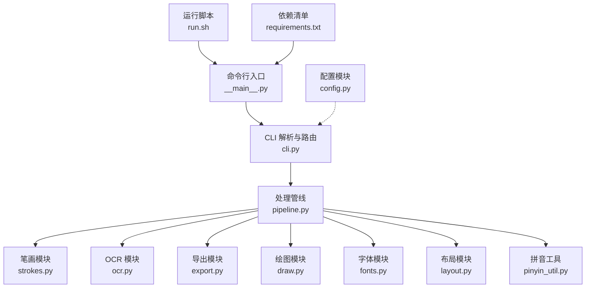
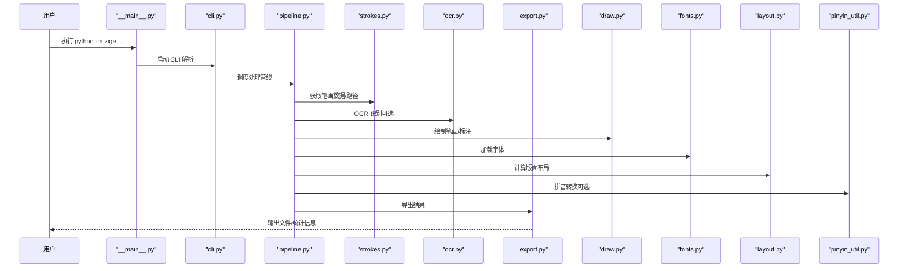
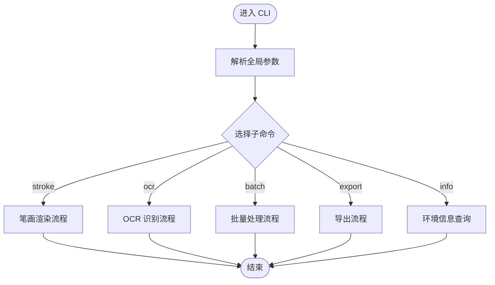
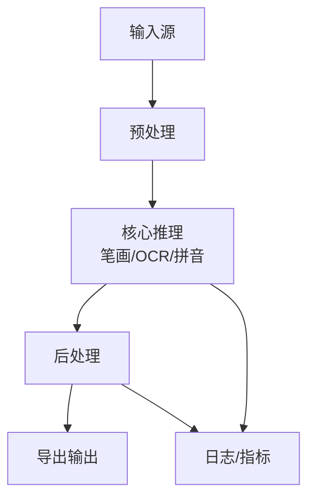
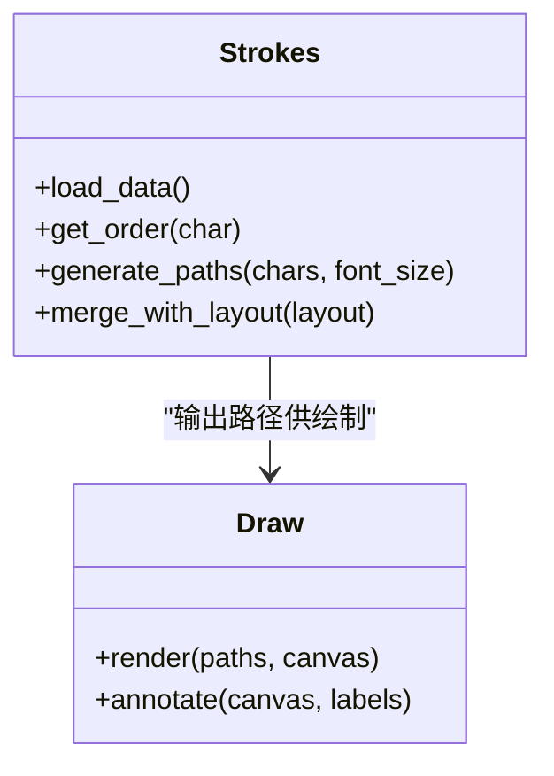
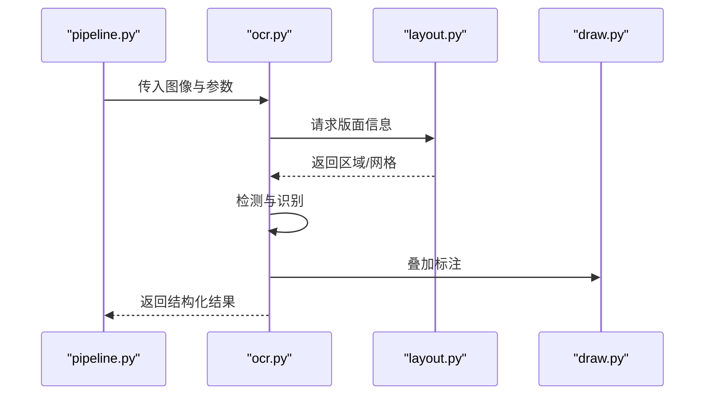
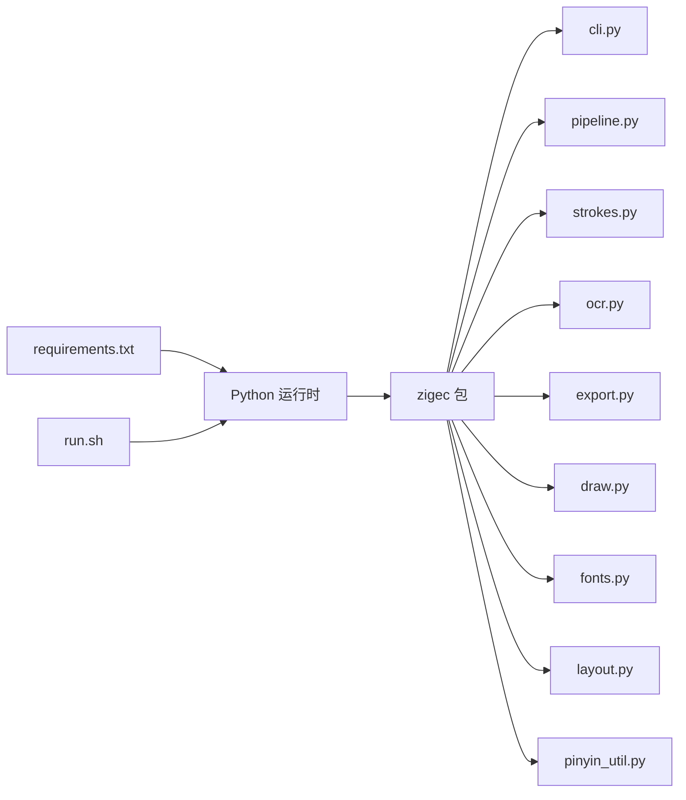

# 命令行工具使用

<cite>
**本文引用的文件**   
- [cli.py](file://zigec/cli.py)
- [config.py](file://zigec/config.py)
- [pipeline.py](file://zigec/pipeline.py)
- [strokes.py](file://zigec/strokes.py)
- [ocr.py](file://zigec/ocr.py)
- [export.py](file://zigec/export.py)
- [draw.py](file://zigec/draw.py)
- [fonts.py](file://zigec/fonts.py)
- [layout.py](file://zigec/layout.py)
- [pinyin_util.py](file://zigec/pinyin_util.py)
- [__main__.py](file://zigec/__main__.py)
- [requirements.txt](file://requirements.txt)
- [run.sh](file://run.sh)
</cite>

## 目录
1. [简介](#简介)
2. [项目结构](#项目结构)
3. [核心组件](#核心组件)
4. [架构总览](#架构总览)
5. [详细组件分析](#详细组件分析)
6. [依赖分析](#依赖分析)
7. [性能考虑](#性能考虑)
8. [故障排除指南](#故障排除指南)
9. [结论](#结论)
10. [附录](#附录)

## 简介
本文件面向命令行使用者，系统化说明该仓库提供的命令行工具能力与用法。内容涵盖：
- 所有可用命令、参数选项与语法
- 从基础汉字笔画查询到复杂批量处理的示例
- 参数组合与最佳实践
- 错误处理与调试技巧
- 与其他工具的集成方式

目标是帮助用户快速上手并高效完成汉字笔画可视化、OCR 识别、导出等任务。

## 项目结构
仓库采用模块化组织，核心 CLI 入口位于 zige 包内，各模块职责清晰：
- cli.py：命令行解析与子命令路由
- pipeline.py：端到端处理管线（输入→处理→输出）
- strokes.py：笔画数据与渲染逻辑
- ocr.py：OCR 识别流程
- export.py：结果导出（如图片、文本等）
- draw.py：绘图辅助
- fonts.py：字体管理
- layout.py：版面布局
- pinyin_util.py：拼音相关工具
- __main__.py：包可执行入口
- requirements.txt：依赖声明
- run.sh：运行脚本

图表来源
- [__main__.py:1-200](file://zigec/__main__.py#L1-L200)
- [cli.py:1-200](file://zigec/cli.py#L1-L200)
- [pipeline.py:1-200](file://zigec/pipeline.py#L1-L200)
- [strokes.py:1-200](file://zigec/strokes.py#L1-L200)
- [ocr.py:1-200](file://zigec/ocr.py#L1-L200)
- [export.py:1-200](file://zigec/export.py#L1-L200)
- [draw.py:1-200](file://zigec/draw.py#L1-L200)
- [fonts.py:1-200](file://zigec/fonts.py#L1-L200)
- [layout.py:1-200](file://zigec/layout.py#L1-L200)
- [pinyin_util.py:1-200](file://zigec/pinyin_util.py#L1-L200)
- [config.py:1-200](file://zigec/config.py#L1-L200)
- [run.sh:1-200](file://run.sh#L1-L200)
- [requirements.txt:1-200](file://requirements.txt#L1-L200)

章节来源
- [__main__.py:1-200](file://zigec/__main__.py#L1-L200)
- [cli.py:1-200](file://zigec/cli.py#L1-L200)
- [pipeline.py:1-200](file://zigec/pipeline.py#L1-L200)

## 核心组件
- CLI 层（cli.py）
  - 负责解析命令行参数、注册子命令、分发到具体处理器
  - 提供全局开关（如日志级别、输出目录、并发数等）
- 管线层（pipeline.py）
  - 编排输入读取、预处理、模型推理、后处理、导出
  - 支持批处理、进度条、重试与失败隔离
- 笔画模块（strokes.py）
  - 加载笔画数据、计算笔画顺序、生成矢量路径
- OCR 模块（ocr.py）
  - 图像预处理、文字检测与识别、结果结构化
- 导出模块（export.py）
  - 将结果保存为图片、JSON、CSV 等格式
- 绘图模块（draw.py）
  - 绘制笔画、标注、叠加信息
- 字体模块（fonts.py）
  - 字体加载、回退策略、度量信息
- 布局模块（layout.py）
  - 版面尺寸、边距、对齐、分页
- 拼音工具（pinyin_util.py）
  - 拼音转换、声调处理、多音字消歧
- 配置模块（config.py）
  - 配置文件读取、默认值、环境变量覆盖

章节来源
- [cli.py:1-200](file://zigec/cli.py#L1-L200)
- [pipeline.py:1-200](file://zigec/pipeline.py#L1-L200)
- [strokes.py:1-200](file://zigec/strokes.py#L1-L200)
- [ocr.py:1-200](file://zigec/ocr.py#L1-L200)
- [export.py:1-200](file://zigec/export.py#L1-L200)
- [draw.py:1-200](file://zigec/draw.py#L1-L200)
- [fonts.py:1-200](file://zigec/fonts.py#L1-L200)
- [layout.py:1-200](file://zigec/layout.py#L1-L200)
- [pinyin_util.py:1-200](file://zigec/pinyin_util.py#L1-L200)
- [config.py:1-200](file://zigec/config.py#L1-L200)

## 架构总览
下图展示从命令行到内部模块的调用关系与数据流向。

图表来源
- [__main__.py:1-200](file://zigec/__main__.py#L1-L200)
- [cli.py:1-200](file://zigec/cli.py#L1-L200)
- [pipeline.py:1-200](file://zigec/pipeline.py#L1-L200)
- [strokes.py:1-200](file://zigec/strokes.py#L1-L200)
- [ocr.py:1-200](file://zigec/ocr.py#L1-L200)
- [export.py:1-200](file://zigec/export.py#L1-L200)
- [draw.py:1-200](file://zigec/draw.py#L1-L200)
- [fonts.py:1-200](file://zigec/fonts.py#L1-L200)
- [layout.py:1-200](file://zigec/layout.py#L1-L200)
- [pinyin_util.py:1-200](file://zigec/pinyin_util.py#L1-L200)

## 详细组件分析

### 命令行接口（cli.py）
- 功能要点
  - 定义全局参数（如 --log-level、--output-dir、--workers、--timeout 等）
  - 注册子命令（如 stroke、ocr、batch、export、info 等）
  - 参数校验与帮助信息生成
- 常见子命令
  - stroke：按字符或文件生成笔画图
  - ocr：对图像进行 OCR 识别并叠加笔画/拼音
  - batch：批量处理目录下的多个文件
  - export：将中间结果导出为指定格式
  - info：打印环境、版本、可用字体等信息
- 参数组合建议
  - 小批量交互：单线程 + 高日志级别
  - 大批量生产：多线程 + 低日志级别 + 断点续跑

图表来源
- [cli.py:1-200](file://zigec/cli.py#L1-L200)

章节来源
- [cli.py:1-200](file://zigec/cli.py#L1-L200)

### 处理管线（pipeline.py）
- 功能要点
  - 统一编排输入读取、预处理、推理、后处理、导出
  - 支持并发控制、重试机制、进度反馈
  - 暴露钩子用于扩展自定义步骤
- 关键阶段
  - 输入：文件列表、字符串、图像流
  - 预处理：缩放、去噪、二值化、版面分析
  - 推理：笔画生成、OCR 识别、拼音转换
  - 后处理：合并、排序、过滤
  - 导出：图片、文本、结构化数据

图表来源
- [pipeline.py:1-200](file://zigec/pipeline.py#L1-L200)

章节来源
- [pipeline.py:1-200](file://zigec/pipeline.py#L1-L200)

### 笔画模块（strokes.py）
- 功能要点
  - 加载笔画数据、计算笔画顺序、生成矢量路径
  - 与 draw.py 协作完成渲染
- 典型用法
  - 给定字符序列，返回笔画路径集合
  - 根据字体与字号调整路径比例

图表来源
- [strokes.py:1-200](file://zigec/strokes.py#L1-L200)
- [draw.py:1-200](file://zigec/draw.py#L1-L200)

章节来源
- [strokes.py:1-200](file://zigec/strokes.py#L1-L200)
- [draw.py:1-200](file://zigec/draw.py#L1-L200)

### OCR 模块（ocr.py）
- 功能要点
  - 图像预处理、检测、识别、结构化输出
  - 与 layout.py 配合进行版面定位
- 典型用法
  - 对单张或多张图像进行识别，输出文本与坐标

图表来源
- [ocr.py:1-200](file://zigec/ocr.py#L1-L200)
- [layout.py:1-200](file://zigec/layout.py#L1-L200)
- [draw.py:1-200](file://zigec/draw.py#L1-L200)

章节来源
- [ocr.py:1-200](file://zigec/ocr.py#L1-L200)
- [layout.py:1-200](file://zigec/layout.py#L1-L200)

### 导出模块（export.py）
- 功能要点
  - 支持多种格式导出（图片、JSON、CSV、TXT）
  - 可配置文件名模板、覆盖策略、压缩选项
- 典型用法
  - 将 OCR 结果与笔画图一并导出

章节来源
- [export.py:1-200](file://zigec/export.py#L1-L200)

### 绘图模块（draw.py）
- 功能要点
  - 绘制笔画路径、叠加文字与标注
  - 支持颜色、线宽、透明度等样式参数
- 典型用法
  - 在画布上绘制笔画并保存为图片

章节来源
- [draw.py:1-200](file://zigec/draw.py#L1-L200)

### 字体模块（fonts.py）
- 功能要点
  - 字体加载、回退策略、度量信息
  - 与 layout.py 协同保证排版一致性
- 典型用法
  - 指定字体族与字号，确保跨平台一致显示

章节来源
- [fonts.py:1-200](file://zigec/fonts.py#L1-L200)

### 布局模块（layout.py）
- 功能要点
  - 页面尺寸、边距、对齐、分页
  - 与 draw.py 协作完成最终版面
- 典型用法
  - 根据内容自动计算合适页边距与行高

章节来源
- [layout.py:1-200](file://zigec/layout.py#L1-L200)

### 拼音工具（pinyin_util.py）
- 功能要点
  - 拼音转换、声调处理、多音字消歧
  - 可与 OCR 结果联动标注拼音
- 典型用法
  - 对识别出的文本批量转拼音并附加到结果中

章节来源
- [pinyin_util.py:1-200](file://zigec/pinyin_util.py#L1-L200)

### 配置模块（config.py）
- 功能要点
  - 读取配置文件、环境变量覆盖、默认值管理
  - 为 CLI 与管线提供统一配置入口
- 典型用法
  - 通过环境变量或配置文件设置默认输出目录、并发数等

章节来源
- [config.py:1-200](file://zigec/config.py#L1-L200)

## 依赖分析
外部依赖由 requirements.txt 声明，运行时由 Python 解释器加载；运行脚本 run.sh 封装了常用启动方式。

图表来源
- [requirements.txt:1-200](file://requirements.txt#L1-L200)
- [run.sh:1-200](file://run.sh#L1-L200)
- [cli.py:1-200](file://zigec/cli.py#L1-L200)
- [pipeline.py:1-200](file://zigec/pipeline.py#L1-L200)
- [strokes.py:1-200](file://zigec/strokes.py#L1-L200)
- [ocr.py:1-200](file://zigec/ocr.py#L1-L200)
- [export.py:1-200](file://zigec/export.py#L1-L200)
- [draw.py:1-200](file://zigec/draw.py#L1-L200)
- [fonts.py:1-200](file://zigec/fonts.py#L1-L200)
- [layout.py:1-200](file://zigec/layout.py#L1-L200)
- [pinyin_util.py:1-200](file://zigec/pinyin_util.py#L1-L200)

章节来源
- [requirements.txt:1-200](file://requirements.txt#L1-L200)
- [run.sh:1-200](file://run.sh#L1-L200)

## 性能考虑
- 并发与吞吐
  - 合理设置工作线程数，避免 CPU/GPU 瓶颈
  - 大图像先做降采样，减少推理时间
- 内存与缓存
  - 复用字体与模型实例，避免重复加载
  - 分批写入导出文件，降低峰值内存
- I/O 优化
  - 使用 SSD 存储中间结果
  - 启用增量/断点续跑，避免重复计算
- 质量与速度权衡
  - 调整 OCR 阈值与笔画精度参数，平衡速度与效果

[本节为通用指导，不直接分析具体文件]

## 故障排除指南
常见问题与解决思路：
- 找不到字体
  - 检查字体路径与权限，确认字体已安装或提供回退字体
- OCR 识别率低
  - 调整图像预处理参数（对比度、二值化阈值），检查分辨率与噪声
- 导出文件为空或损坏
  - 检查输出目录权限与磁盘空间，确认导出格式参数正确
- 命令行参数报错
  - 使用帮助命令查看可用参数，核对类型与取值范围
- 批量任务中断
  - 启用断点续跑与重试，检查日志定位失败项

章节来源
- [cli.py:1-200](file://zigec/cli.py#L1-L200)
- [pipeline.py:1-200](file://zigec/pipeline.py#L1-L200)
- [config.py:1-200](file://zigec/config.py#L1-L200)

## 结论
本工具以清晰的 CLI 入口与模块化管线为核心，覆盖笔画渲染、OCR 识别、导出与排版等关键环节。通过合理的参数组合与批处理策略，用户可快速完成从单字笔画查询到大规模文档处理的各类任务。建议在生产环境中结合日志与监控，持续优化性能与稳定性。

[本节为总结性内容，不直接分析具体文件]

## 附录

### 常用命令速查
- 基本笔画查询
  - 命令：stroke
  - 用途：根据字符生成笔画图
  - 常用参数：字符输入、字体、字号、输出路径
- OCR 识别
  - 命令：ocr
  - 用途：对图像进行文字识别并叠加标注
  - 常用参数：输入图像、输出目录、语言、置信度阈值
- 批量处理
  - 命令：batch
  - 用途：对目录下的多个文件进行流水线处理
  - 常用参数：输入目录、输出目录、并发数、跳过失败
- 导出
  - 命令：export
  - 用途：将中间结果导出为指定格式
  - 常用参数：输入数据、目标格式、文件名模板
- 环境信息
  - 命令：info
  - 用途：打印版本、字体、依赖等信息

[本节为概念性速查，不直接分析具体文件]

### 实际使用示例（从基础到高级）
- 基础：查询单个汉字的笔画图
  - 步骤：选择 stroke 子命令 → 指定字符与字体 → 设置输出路径 → 执行
- 进阶：对一张图片进行 OCR 并叠加笔画
  - 步骤：选择 ocr 子命令 → 指定输入图像 → 开启笔画叠加 → 设置输出目录 → 执行
- 高级：批量处理文件夹中的图片并导出 JSON
  - 步骤：选择 batch 子命令 → 指定输入/输出目录 → 设置并发数 → 选择导出格式为 JSON → 执行

[本节为概念性示例，不直接分析具体文件]

### 与其他工具的集成
- 与图像处理工具链集成
  - 可在 OCR 前接入图像增强、裁剪、去噪等步骤
- 与数据分析工具集成
  - 将 OCR 结果导出为 CSV/JSON，供下游分析或入库
- 与 CI/CD 集成
  - 在流水线中调用 batch 命令，自动化处理批量任务

[本节为概念性集成说明，不直接分析具体文件]