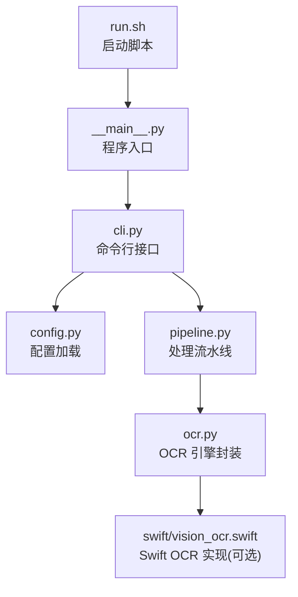
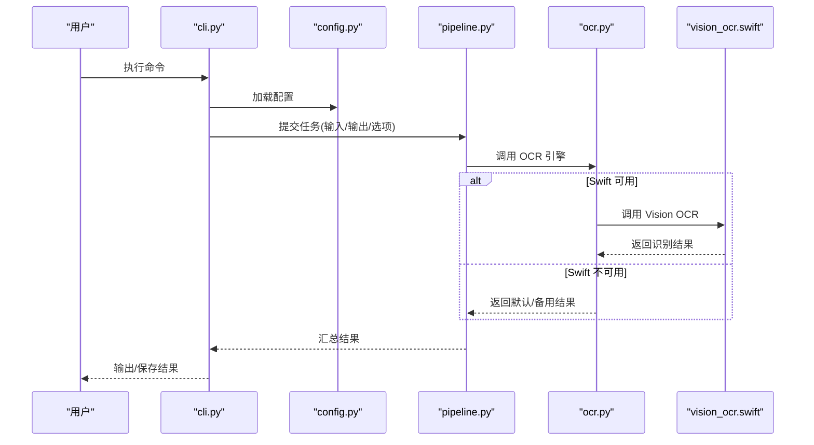
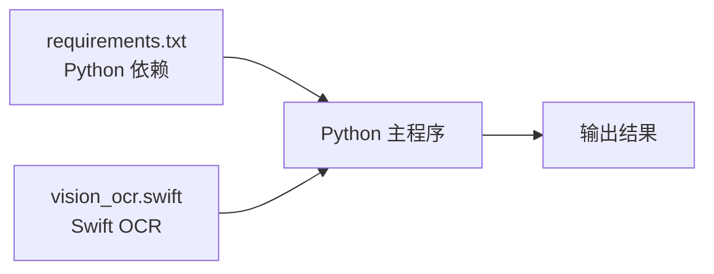

# 安装与配置

<cite>
**本文引用的文件**   
- [requirements.txt](file://requirements.txt)
- [run.sh](file://run.sh)
- [zige/__init__.py](file://zige/__init__.py)
- [zige/__main__.py](file://zige/__main__.py)
- [zige/cli.py](file://zige/cli.py)
- [zige/config.py](file://zige/config.py)
- [zige/ocr.py](file://zige/ocr.py)
- [zige/pipeline.py](file://zige/pipeline.py)
- [zige/swift/vision_ocr.swift](file://zige/swift/vision_ocr.swift)
</cite>

## 目录
1. [简介](#简介)
2. [项目结构](#项目结构)
3. [核心组件](#核心组件)
4. [架构总览](#架构总览)
5. [详细组件分析](#详细组件分析)
6. [依赖关系分析](#依赖关系分析)
7. [性能考虑](#性能考虑)
8. [故障排除指南](#故障排除指南)
9. [结论](#结论)
10. [附录](#附录)

## 简介
本指南面向初次使用者与高级用户，提供从环境准备、依赖安装、项目初始化到运行配置的完整流程。项目包含 Python 主程序与可选的 Swift OCR 模块，支持命令行交互与脚本化调用。文档同时给出常见问题的排查思路与性能优化建议，帮助你快速搭建并稳定运行系统。

## 项目结构
仓库采用“Python 主程序 + Swift 扩展”的结构：
- Python 侧负责命令行入口、配置管理、OCR 流水线编排与导出等能力
- Swift 侧提供基于 Vision 框架的 OCR 实现（可选）

图表来源
- [run.sh:1-200](file://run.sh#L1-L200)
- [zige/__main__.py:1-200](file://zige/__main__.py#L1-L200)
- [zige/cli.py:1-200](file://zige/cli.py#L1-L200)
- [zige/config.py:1-200](file://zige/config.py#L1-L200)
- [zige/pipeline.py:1-200](file://zige/pipeline.py#L1-L200)
- [zige/ocr.py:1-200](file://zige/ocr.py#L1-L200)
- [zige/swift/vision_ocr.swift:1-200](file://zige/swift/vision_ocr.swift#L1-L200)

章节来源
- [run.sh:1-200](file://run.sh#L1-L200)
- [zige/__main__.py:1-200](file://zige/__main__.py#L1-L200)
- [zige/cli.py:1-200](file://zige/cli.py#L1-L200)
- [zige/config.py:1-200](file://zige/config.py#L1-L200)
- [zige/pipeline.py:1-200](file://zige/pipeline.py#L1-L200)
- [zige/ocr.py:1-200](file://zige/ocr.py#L1-L200)
- [zige/swift/vision_ocr.swift:1-200](file://zige/swift/vision_ocr.swift#L1-L200)

## 核心组件
- 命令行接口：提供统一的 CLI 命令，解析参数并调度流水线
- 配置管理：集中读取与校验配置项，为各组件提供统一参数
- OCR 流水线：串联图像预处理、OCR 识别、结果后处理与导出
- Swift OCR 模块：在 macOS 环境下通过 Vision 框架进行文本识别（可选）

章节来源
- [zige/cli.py:1-200](file://zige/cli.py#L1-L200)
- [zige/config.py:1-200](file://zige/config.py#L1-L200)
- [zige/pipeline.py:1-200](file://zige/pipeline.py#L1-L200)
- [zige/ocr.py:1-200](file://zige/ocr.py#L1-L200)
- [zige/swift/vision_ocr.swift:1-200](file://zige/swift/vision_ocr.swift#L1-L200)

## 架构总览
下图展示了从命令行到 OCR 识别再到结果导出的端到端流程。

图表来源
- [zige/cli.py:1-200](file://zige/cli.py#L1-L200)
- [zige/config.py:1-200](file://zige/config.py#L1-L200)
- [zige/pipeline.py:1-200](file://zige/pipeline.py#L1-L200)
- [zige/ocr.py:1-200](file://zige/ocr.py#L1-L200)
- [zige/swift/vision_ocr.swift:1-200](file://zige/swift/vision_ocr.swift#L1-L200)

## 详细组件分析

### 环境与依赖
- Python 版本
  - 请根据 requirements.txt 中的约束选择匹配的 Python 版本
  - 建议使用虚拟环境隔离依赖
- Swift 支持（可选）
  - 若启用 Swift OCR，需要 macOS 与 Xcode 工具链
  - Swift 源码位于 zige/swift/vision_ocr.swift，由 Python 侧按需调用

章节来源
- [requirements.txt:1-200](file://requirements.txt#L1-L200)
- [zige/swift/vision_ocr.swift:1-200](file://zige/swift/vision_ocr.swift#L1-L200)

### 安装步骤
- 克隆仓库并进入项目目录
- 创建并激活 Python 虚拟环境
- 安装 Python 依赖
- 验证安装是否成功（可运行一次最小化命令）
- 可选：构建或准备 Swift OCR 模块（仅在 macOS 且需要时）

章节来源
- [requirements.txt:1-200](file://requirements.txt#L1-L200)
- [run.sh:1-200](file://run.sh#L1-L200)

### 项目初始化
- 首次运行前，确认配置文件存在且路径正确
- 使用 CLI 生成默认配置模板（如支持），或在配置文件中填写必要项
- 如需 Swift OCR，确保 Swift 编译产物或运行时依赖已就绪

章节来源
- [zige/config.py:1-200](file://zige/config.py#L1-L200)
- [zige/cli.py:1-200](file://zige/cli.py#L1-L200)

### 配置文件说明
- 配置文件位置
  - 可通过命令行参数指定配置文件路径
  - 若未指定，将回退到默认路径（以代码为准）
- 关键配置项（示例类别）
  - 输入/输出路径：指定待处理图片与结果保存目录
  - OCR 后端：选择 Swift Vision 或其他后端
  - 语言与模型：设置识别语言、模型权重路径等
  - 性能相关：线程数、批大小、缓存开关等
- 配置优先级
  - 命令行参数 > 配置文件 > 默认值

章节来源
- [zige/config.py:1-200](file://zige/config.py#L1-L200)
- [zige/cli.py:1-200](file://zige/cli.py#L1-L200)

### 命令行用法
- 基本语法
  - 通过 CLI 传入输入文件、输出路径与配置项
- 常用子命令
  - 识别：对单张或多张图片执行 OCR
  - 导出：将识别结果导出为结构化格式
- 参数说明
  - 输入/输出：支持本地路径与批量路径
  - 配置：指定配置文件或覆盖部分选项
  - 日志：控制日志级别与输出目标

章节来源
- [zige/cli.py:1-200](file://zige/cli.py#L1-L200)

### Swift OCR 集成要点
- 适用平台
  - macOS（依赖 Vision 框架）
- 启用方式
  - 在配置中启用 Swift 后端
  - 确保 Swift 运行时可用
- 回退策略
  - 当 Swift 不可用时，自动降级至其他后端或返回空结果

章节来源
- [zige/ocr.py:1-200](file://zige/ocr.py#L1-L200)
- [zige/swift/vision_ocr.swift:1-200](file://zige/swift/vision_ocr.swift#L1-L200)

## 依赖关系分析
- Python 依赖
  - 详见 requirements.txt，按行声明包名与版本约束
- Swift 依赖
  - 依赖 macOS SDK 与 Vision 框架（Xcode 工具链）

图表来源
- [requirements.txt:1-200](file://requirements.txt#L1-L200)
- [zige/swift/vision_ocr.swift:1-200](file://zige/swift/vision_ocr.swift#L1-L200)

章节来源
- [requirements.txt:1-200](file://requirements.txt#L1-L200)
- [zige/swift/vision_ocr.swift:1-200](file://zige/swift/vision_ocr.swift#L1-L200)

## 性能考虑
- 并发与批处理
  - 合理设置线程数与批大小，避免内存峰值过高
- I/O 优化
  - 使用 SSD 存储输入/输出，减少磁盘瓶颈
- 模型与后端
  - Swift Vision 在 macOS 上通常具备较好性能；非 macOS 环境可选择更合适的后端
- 资源监控
  - 观察 CPU/GPU 与内存占用，必要时调整批大小或关闭非必要功能

[本节为通用指导，不直接分析具体文件]

## 故障排除指南
- 无法找到配置文件
  - 检查配置文件路径是否正确，或通过命令行参数显式指定
- Swift OCR 不可用
  - 确认当前平台为 macOS，并已安装 Xcode 工具链
  - 检查配置是否启用了 Swift 后端
- 依赖安装失败
  - 检查 Python 版本是否与 requirements.txt 兼容
  - 尝试清理并重建虚拟环境后重新安装
- 输出为空或识别质量差
  - 检查输入图像质量与分辨率
  - 调整 OCR 语言与模型配置
  - 开启调试日志定位问题

章节来源
- [zige/config.py:1-200](file://zige/config.py#L1-L200)
- [zige/cli.py:1-200](file://zige/cli.py#L1-L200)
- [zige/ocr.py:1-200](file://zige/ocr.py#L1-L200)
- [zige/swift/vision_ocr.swift:1-200](file://zige/swift/vision_ocr.swift#L1-L200)

## 结论
按照本指南完成环境准备、依赖安装与配置后，即可通过命令行稳定运行 OCR 流水线。对于 macOS 用户，建议启用 Swift Vision 以获得更佳性能；非 macOS 用户可根据需求选择合适的后端。遇到问题时，优先检查配置与依赖，再结合日志定位原因。

[本节为总结性内容，不直接分析具体文件]

## 附录

### 环境变量与启动脚本
- run.sh
  - 用于便捷启动程序，内部会调用 Python 入口并传递参数
  - 可在其中设置环境变量或固定参数

章节来源
- [run.sh:1-200](file://run.sh#L1-L200)

### 程序入口与模块组织
- __main__.py
  - 作为 Python 包的入口点，便于通过 python -m 方式运行
- __init__.py
  - 定义包级初始化逻辑（如有）

章节来源
- [zige/__main__.py:1-200](file://zige/__main__.py#L1-L200)
- [zige/__init__.py:1-200](file://zige/__init__.py#L1-L200)