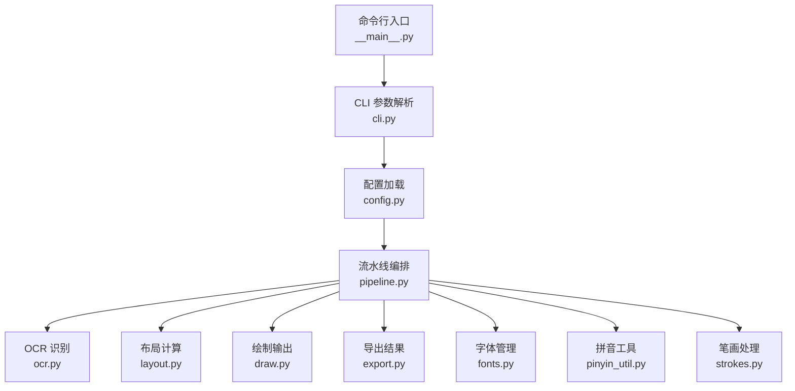
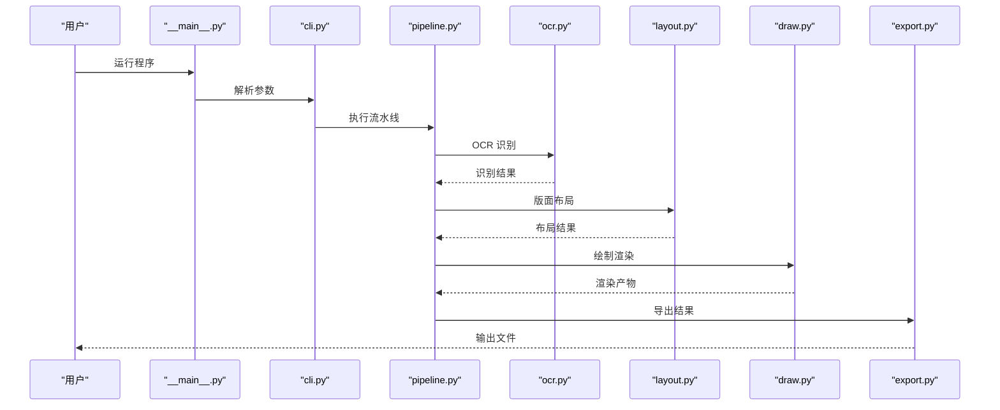
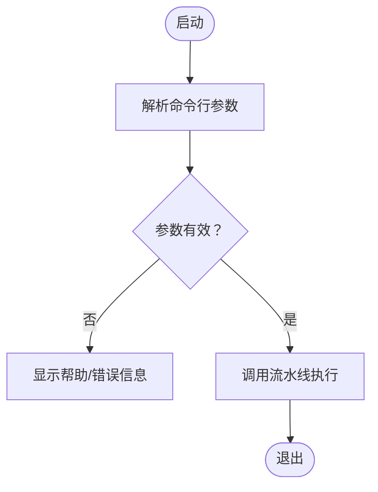
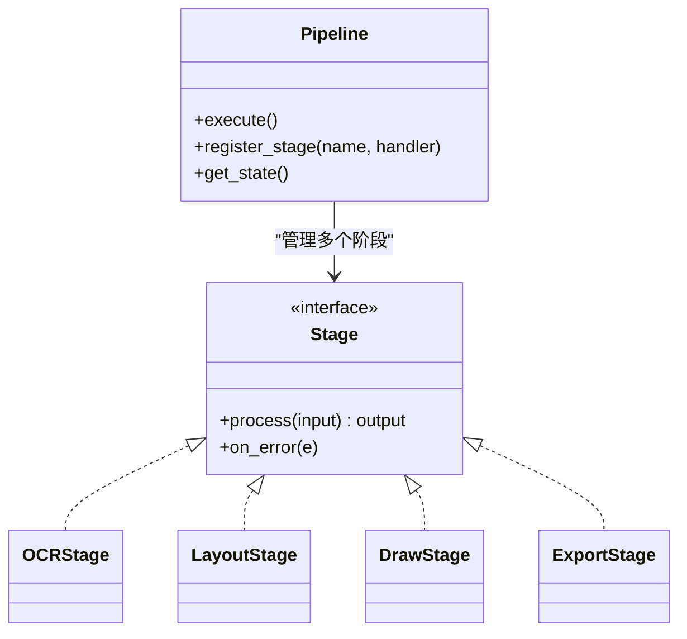
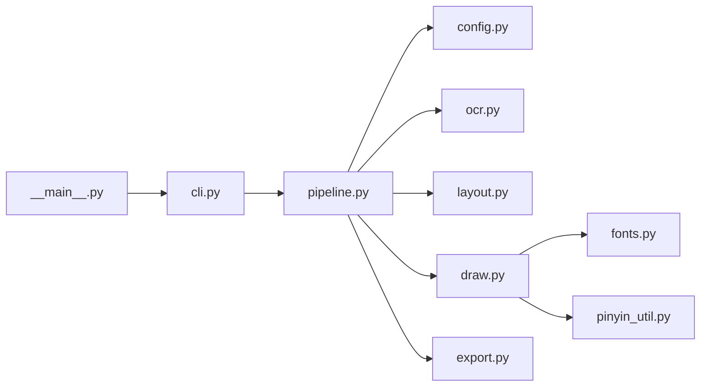

# 开发者指南

<cite>
**本文引用的文件**   
- [requirements.txt](file://requirements.txt)
- [run.sh](file://run.sh)
- [tests/test_zige.py](file://tests/test_zige.py)
- [zig/__init__.py](file://zig/__init__.py)
- [zig/__main__.py](file://zig/__main__.py)
- [zig/cli.py](file://zig/cli.py)
- [zig/config.py](file://zig/config.py)
- [zig/draw.py](file://zig/draw.py)
- [zig/export.py](file://zig/export.py)
- [zig/fonts.py](file://zig/fonts.py)
- [zig/layout.py](file://zig/layout.py)
- [zig/ocr.py](file://zig/ocr.py)
- [zig/pinyin_util.py](file://zig/pinyin_util.py)
- [zig/pipeline.py](file://zig/pipeline.py)
- [zig/strokes.py](file://zig/strokes.py)
</cite>

## 目录
1. [简介](#简介)
2. [项目结构](#项目结构)
3. [核心组件](#核心组件)
4. [架构总览](#架构总览)
5. [详细组件分析](#详细组件分析)
6. [依赖关系分析](#依赖关系分析)
7. [性能与可扩展性](#性能与可扩展性)
8. [开发环境搭建](#开发环境搭建)
9. [代码风格与提交规范](#代码风格与提交规范)
10. [测试编写指南](#测试编写指南)
11. [调试技巧](#调试技巧)
12. [构建与发布流程](#构建与发布流程)
13. [故障排查](#故障排查)
14. [结论](#结论)

## 简介
本指南面向新贡献者与团队成员，旨在帮助快速理解并高效参与项目开发。内容涵盖：
- 整体架构与设计模式
- 模块职责与相互关系
- 开发环境与工具链配置
- 代码风格、测试与调试实践
- 构建与发布流程
- 常见问题与排错建议

## 项目结构
仓库采用“包 + 功能模块”的组织方式：
- zig/: Python 包，包含命令行入口、配置、OCR、布局、绘制、导出、字体、拼音工具、笔画处理与流水线编排等模块
- tests/: 单元测试
- requirements.txt: 运行时依赖声明
- run.sh: 便捷启动脚本

图示来源
- [zig/__main__.py:1-50](file://zig/__main__.py#L1-L50)
- [zig/cli.py:1-120](file://zig/cli.py#L1-L120)
- [zig/config.py:1-120](file://zig/config.py#L1-L120)
- [zig/pipeline.py:1-200](file://zig/pipeline.py#L1-L200)
- [zig/ocr.py:1-150](file://zig/ocr.py#L1-L150)
- [zig/layout.py:1-150](file://zig/layout.py#L1-L150)
- [zig/draw.py:1-150](file://zig/draw.py#L1-L150)
- [zig/export.py:1-150](file://zig/export.py#L1-L150)
- [zig/fonts.py:1-120](file://zig/fonts.py#L1-L120)
- [zig/pinyin_util.py:1-120](file://zig/pinyin_util.py#L1-L120)
- [zig/strokes.py:1-120](file://zig/strokes.py#L1-L120)

章节来源
- [zig/__init__.py:1-50](file://zig/__init__.py#L1-L50)
- [zig/__main__.py:1-50](file://zig/__main__.py#L1-L50)
- [zig/cli.py:1-120](file://zig/cli.py#L1-L120)
- [zig/config.py:1-120](file://zig/config.py#L1-L120)
- [zig/pipeline.py:1-200](file://zig/pipeline.py#L1-L200)
- [zig/ocr.py:1-150](file://zig/ocr.py#L1-L150)
- [zig/layout.py:1-150](file://zig/layout.py#L1-L150)
- [zig/draw.py:1-150](file://zig/draw.py#L1-L150)
- [zig/export.py:1-150](file://zig/export.py#L1-L150)
- [zig/fonts.py:1-120](file://zig/fonts.py#L1-L120)
- [zig/pinyin_util.py:1-120](file://zig/pinyin_util.py#L1-L120)
- [zig/strokes.py:1-120](file://zig/strokes.py#L1-L120)

## 核心组件
- 命令行与入口
  - __main__.py: 程序入口，负责初始化与调用 CLI
  - cli.py: 参数解析、子命令组织、帮助信息
- 配置
  - config.py: 统一配置读取、默认值与环境变量覆盖
- 流水线
  - pipeline.py: 编排 OCR、布局、绘制、导出等阶段，提供可插拔的处理器接口
- OCR
  - ocr.py: 图像文本识别、预处理、后处理
- 布局
  - layout.py: 文本块检测、坐标归一化、版面重建
- 绘制
  - draw.py: 将结构化结果渲染为图像或矢量图
- 导出
  - export.py: 导出 JSON/PDF/图片等多格式结果
- 字体
  - fonts.py: 字体发现、回退策略、度量信息
- 拼音工具
  - pinyin_util.py: 拼音转换、声调处理、多音字消歧（可选）
- 笔画
  - strokes.py: 笔画拆分、顺序与路径生成（用于可视化或教学场景）

章节来源
- [zig/__main__.py:1-50](file://zig/__main__.py#L1-L50)
- [zig/cli.py:1-120](file://zig/cli.py#L1-L120)
- [zig/config.py:1-120](file://zig/config.py#L1-L120)
- [zig/pipeline.py:1-200](file://zig/pipeline.py#L1-L200)
- [zig/ocr.py:1-150](file://zig/ocr.py#L1-L150)
- [zig/layout.py:1-150](file://zig/layout.py#L1-L150)
- [zig/draw.py:1-150](file://zig/draw.py#L1-L150)
- [zig/export.py:1-150](file://zig/export.py#L1-L150)
- [zig/fonts.py:1-120](file://zig/fonts.py#L1-L120)
- [zig/pinyin_util.py:1-120](file://zig/pinyin_util.py#L1-L120)
- [zig/strokes.py:1-120](file://zig/strokes.py#L1-L120)

## 架构总览
系统采用“流水线 + 插件式处理器”的架构：
- 入口层：__main__.py 启动 CLI
- 控制层：cli.py 解析参数并调度 pipeline
- 编排层：pipeline.py 定义阶段与数据流
- 处理层：ocr.py、layout.py、draw.py、export.py 等实现具体逻辑
- 支撑层：config.py、fonts.py、pinyin_util.py、strokes.py 提供通用能力

图示来源
- [zig/__main__.py:1-50](file://zig/__main__.py#L1-L50)
- [zig/cli.py:1-120](file://zig/cli.py#L1-L120)
- [zig/pipeline.py:1-200](file://zig/pipeline.py#L1-L200)
- [zig/ocr.py:1-150](file://zig/ocr.py#L1-L150)
- [zig/layout.py:1-150](file://zig/layout.py#L1-L150)
- [zig/draw.py:1-150](file://zig/draw.py#L1-L150)
- [zig/export.py:1-150](file://zig/export.py#L1-L150)

## 详细组件分析

### 命令行与入口（__main__.py, cli.py）
- 职责
  - __main__.py: 作为程序入口，初始化日志、加载配置并调用 CLI
  - cli.py: 定义子命令、参数校验、错误提示与帮助文档
- 设计要点
  - 参数分层：全局参数与子命令参数分离
  - 错误处理：对缺失参数、非法输入进行友好提示
- 扩展点
  - 新增子命令时，在 cli.py 中注册并绑定到 pipeline 的执行器

图示来源
- [zig/__main__.py:1-50](file://zig/__main__.py#L1-L50)
- [zig/cli.py:1-120](file://zig/cli.py#L1-L120)

章节来源
- [zig/__main__.py:1-50](file://zig/__main__.py#L1-L50)
- [zig/cli.py:1-120](file://zig/cli.py#L1-L120)

### 配置中心（config.py）
- 职责
  - 集中管理默认配置、环境变量覆盖、配置文件加载
- 设计要点
  - 配置项分类：输入输出路径、模型参数、渲染选项
  - 安全与健壮性：对缺失键提供默认值，对非法类型进行校验
- 扩展点
  - 新增配置项需同时更新默认值与校验逻辑

章节来源
- [zig/config.py:1-120](file://zig/config.py#L1-L120)

### 流水线编排（pipeline.py）
- 职责
  - 定义阶段（OCR、Layout、Draw、Export），串联数据流，支持并行与重试
- 设计要点
  - 阶段抽象：每个阶段实现统一的接口（输入/输出/错误码）
  - 中间状态：保存每步产物，便于断点续跑与调试
- 优化点
  - 缓存中间结果，避免重复计算
  - 按资源占用动态调整并发度

图示来源
- [zig/pipeline.py:1-200](file://zig/pipeline.py#L1-L200)

章节来源
- [zig/pipeline.py:1-200](file://zig/pipeline.py#L1-L200)

### OCR 识别（ocr.py）
- 职责
  - 图像预处理、文本检测、字符识别、置信度过滤
- 设计要点
  - 预处理管线：去噪、二值化、透视校正
  - 识别引擎：可替换后端（如 Tesseract、自研模型）
- 性能优化
  - 批处理与内存池复用
  - GPU/CPU 自动选择

章节来源
- [zig/ocr.py:1-150](file://zig/ocr.py#L1-L150)

### 版面布局（layout.py）
- 职责
  - 文本块聚类、行列对齐、标题/正文区分、坐标归一化
- 设计要点
  - 规则与启发式结合：基于几何特征与语义先验
  - 可配置阈值：适应不同文档风格
- 扩展点
  - 新增版面模板或检测算法

章节来源
- [zig/layout.py:1-150](file://zig/layout.py#L1-L150)

### 绘制与导出（draw.py, export.py）
- 职责
  - draw.py: 将结构化结果渲染为图像或矢量图
  - export.py: 导出 JSON、PDF、图片等格式
- 设计要点
  - 渲染后端抽象：支持多种图形库
  - 导出适配器：统一输出接口，适配不同格式
- 质量保障
  - 颜色/字体一致性检查
  - 边界框与文本对齐校验

章节来源
- [zig/draw.py:1-150](file://zig/draw.py#L1-L150)
- [zig/export.py:1-150](file://zig/export.py#L1-L150)

### 字体与拼音工具（fonts.py, pinyin_util.py）
- 职责
  - fonts.py: 字体发现、回退策略、度量信息
  - pinyin_util.py: 拼音转换、声调处理、多音字消歧
- 设计要点
  - 字体缓存：减少 IO 开销
  - 拼音字典：可热更新
- 扩展点
  - 新增字体族或拼音规则

章节来源
- [zig/fonts.py:1-120](file://zig/fonts.py#L1-L120)
- [zig/pinyin_util.py:1-120](file://zig/pinyin_util.py#L1-L120)

### 笔画处理（strokes.py）
- 职责
  - 笔画拆分、顺序与路径生成，用于可视化或教学
- 设计要点
  - 路径平滑与简化
  - 与字体度量联动
- 扩展点
  - 接入更多字形库或手写轨迹

章节来源
- [zig/strokes.py:1-120](file://zig/strokes.py#L1-L120)

## 依赖关系分析
- 内部依赖
  - __main__.py -> cli.py -> pipeline.py -> (ocr.py, layout.py, draw.py, export.py)
  - pipeline.py 依赖 config.py 获取运行参数
  - draw.py/export.py 依赖 fonts.py 与 pinyin_util.py（视使用场景）
- 外部依赖
  - 由 requirements.txt 统一管理，建议在虚拟环境中安装

图示来源
- [zig/__main__.py:1-50](file://zig/__main__.py#L1-L50)
- [zig/cli.py:1-120](file://zig/cli.py#L1-L120)
- [zig/pipeline.py:1-200](file://zig/pipeline.py#L1-L200)
- [zig/config.py:1-120](file://zig/config.py#L1-L120)
- [zig/ocr.py:1-150](file://zig/ocr.py#L1-L150)
- [zig/layout.py:1-150](file://zig/layout.py#L1-L150)
- [zig/draw.py:1-150](file://zig/draw.py#L1-L150)
- [zig/export.py:1-150](file://zig/export.py#L1-L150)
- [zig/fonts.py:1-120](file://zig/fonts.py#L1-L120)
- [zig/pinyin_util.py:1-120](file://zig/pinyin_util.py#L1-L120)

章节来源
- [requirements.txt:1-200](file://requirements.txt#L1-L200)

## 性能与可扩展性
- 性能建议
  - 批量处理与缓存中间结果
  - 合理设置并发度，避免 CPU/GPU 争抢
  - 对大图像进行分块处理
- 可扩展性
  - 通过 pipeline 的阶段接口扩展新的处理步骤
  - 使用配置开关切换 OCR 后端或渲染引擎
  - 插件化字体与拼音规则

[本节为通用指导，不直接分析具体文件]

## 开发环境搭建
- 前置条件
  - Python 版本满足 requirements.txt 要求
  - 操作系统支持所需的外部库（如图像处理、PDF 生成等）
- 安装步骤
  - 创建并激活虚拟环境
  - 安装依赖：pip install -r requirements.txt
  - 验证安装：python -m zige --help
- 可选依赖
  - 如需 GPU 加速，请根据 OCR 后端文档安装对应驱动与库

章节来源
- [requirements.txt:1-200](file://requirements.txt#L1-L200)

## 代码风格与提交规范
- 代码风格
  - 遵循 PEP 8；函数/类命名清晰；注释简洁准确
  - 单行长度建议不超过 100 字符
  - 使用类型注解提升可读性与 IDE 体验
- 提交规范
  - 提交信息格式：type(scope): subject
    - type: feat/fix/docs/style/refactor/test/chore
    - scope: 模块名（如 pipeline、ocr、layout）
    - subject: 简明描述变更目的
  - 小步提交，保持变更原子性
- 分支策略
  - main: 稳定分支
  - feature/*: 功能分支
  - hotfix/*: 紧急修复分支

[本节为通用指导，不直接分析具体文件]

## 测试编写指南
- 测试范围
  - 单元测试：各模块的纯函数与类方法
  - 集成测试：端到端流水线验证
- 编写建议
  - 使用 pytest 框架
  - 用例命名以行为为中心，覆盖正常与异常路径
  - 使用 fixtures 管理共享数据与模拟对象
- 运行测试
  - python -m pytest tests/ -v
  - 覆盖率报告：pytest-cov

章节来源
- [tests/test_zige.py:1-200](file://tests/test_zige.py#L1-L200)

## 调试技巧
- 日志与断点
  - 在关键阶段添加结构化日志（输入摘要、耗时、错误堆栈）
  - 使用 pdb 或 IDE 断点进行交互式调试
- 可视化中间结果
  - 启用 draw 阶段的中间图输出，检查 OCR 与布局效果
- 性能剖析
  - 使用 cProfile 定位热点函数
  - 针对 OCR 与布局阶段进行瓶颈分析

[本节为通用指导，不直接分析具体文件]

## 构建与发布流程
- 本地构建
  - 打包源码：python -m build
  - 生成分发文件：python -m twine check dist/*
- 发布流程
  - 版本号管理：遵循语义化版本
  - 上传至 PyPI：twine upload dist/*
  - 发布说明：记录变更、兼容性与升级指引
- 自动化
  - CI 流水线：lint -> test -> build -> publish（可选）

[本节为通用指导，不直接分析具体文件]

## 故障排查
- 常见问题
  - 依赖缺失：确认 requirements.txt 已安装
  - 字体缺失：检查 fonts.py 的回退策略与系统字体
  - OCR 失败：检查输入图像质量与后端配置
- 定位方法
  - 开启详细日志，查看阶段耗时与错误码
  - 逐步禁用阶段，缩小问题范围
  - 使用最小复现用例提交 Issue

[本节为通用指导，不直接分析具体文件]

## 结论
本项目以“流水线 + 插件式处理器”为核心架构，模块职责清晰、扩展性强。遵循本指南中的环境搭建、代码风格、测试与调试实践，有助于团队保持一致的开发标准与质量要求。欢迎贡献代码，共同完善 OCR 与版面处理的工具链。