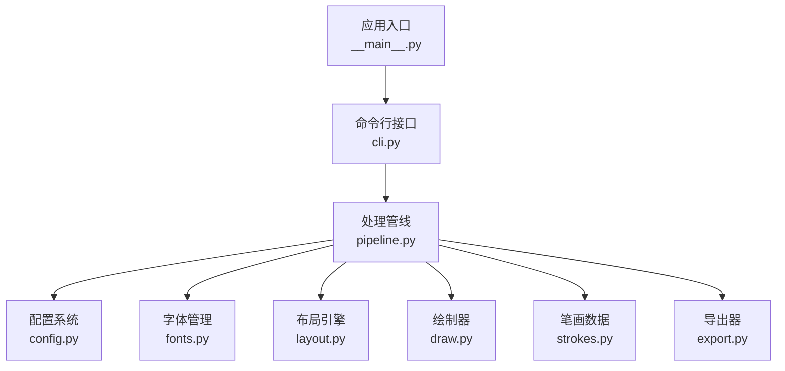
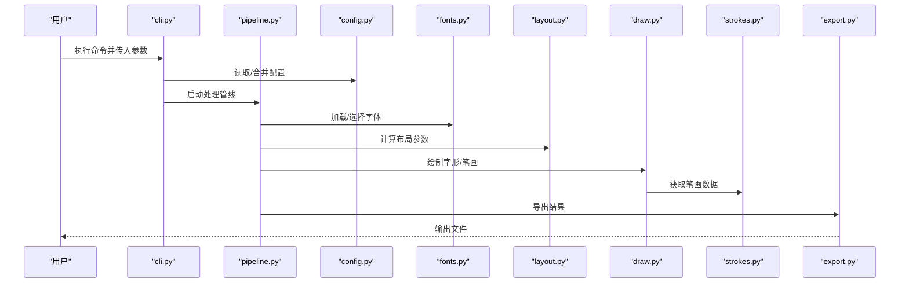
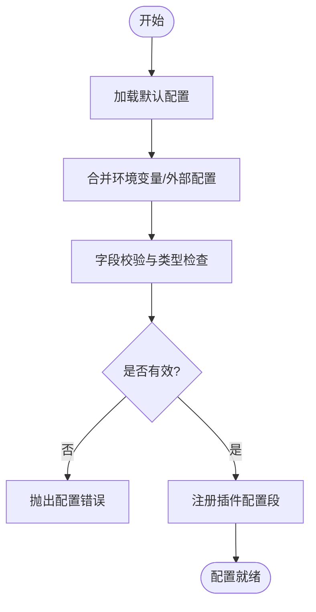
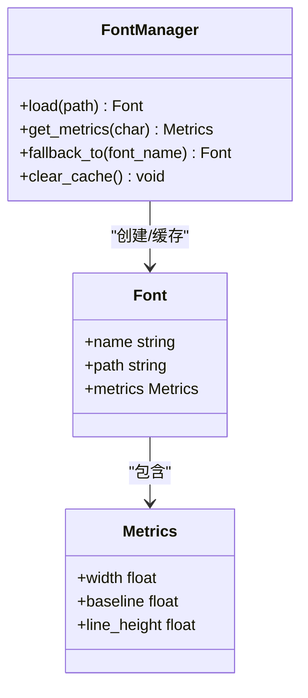
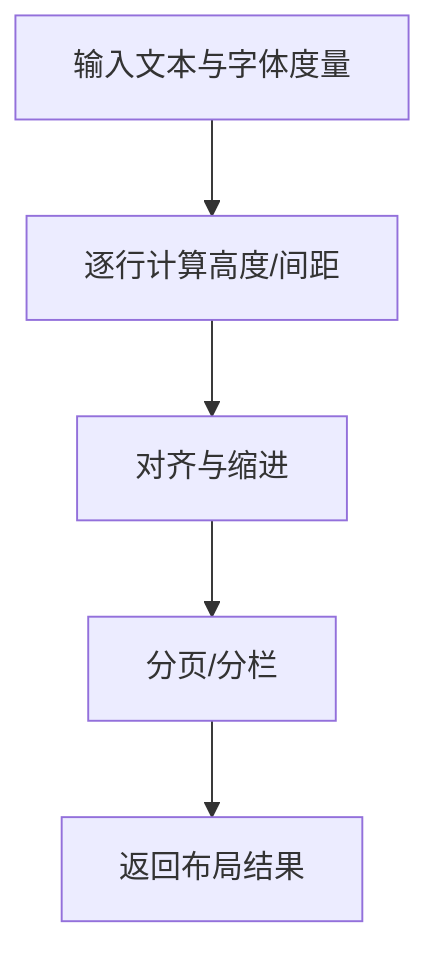
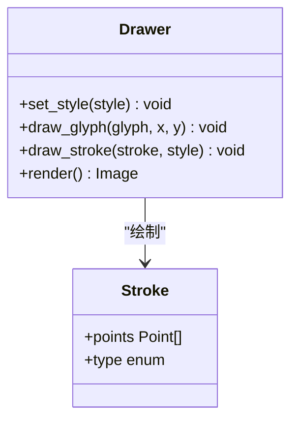
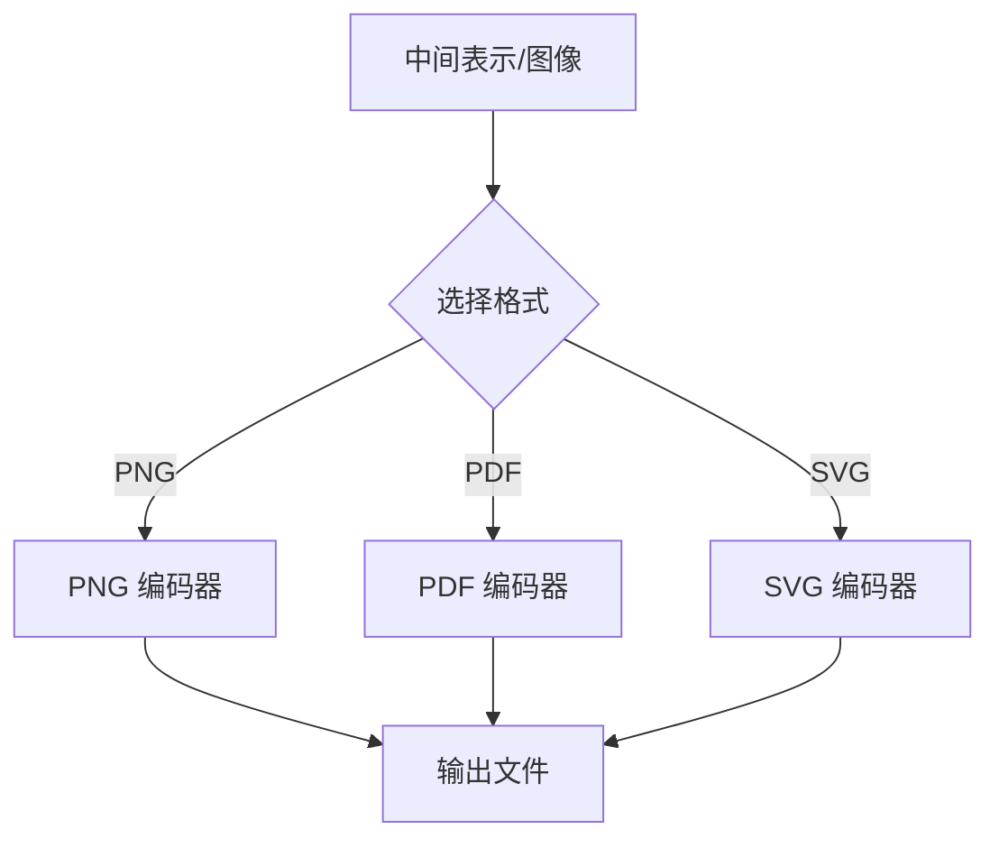
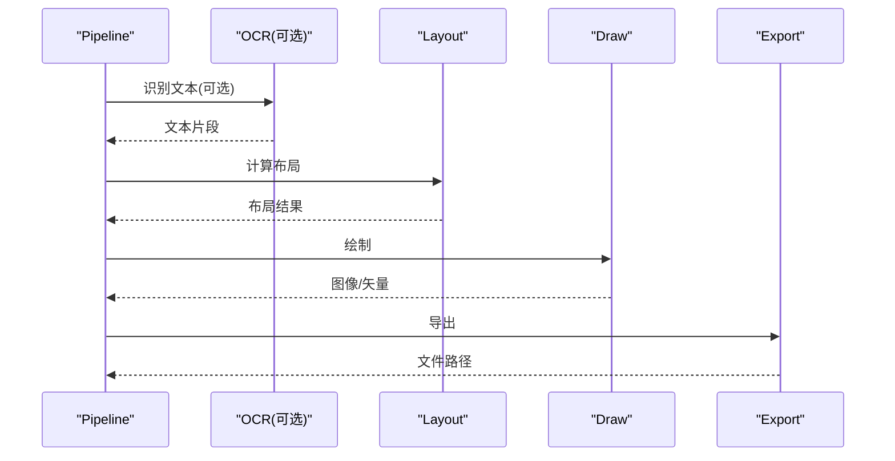
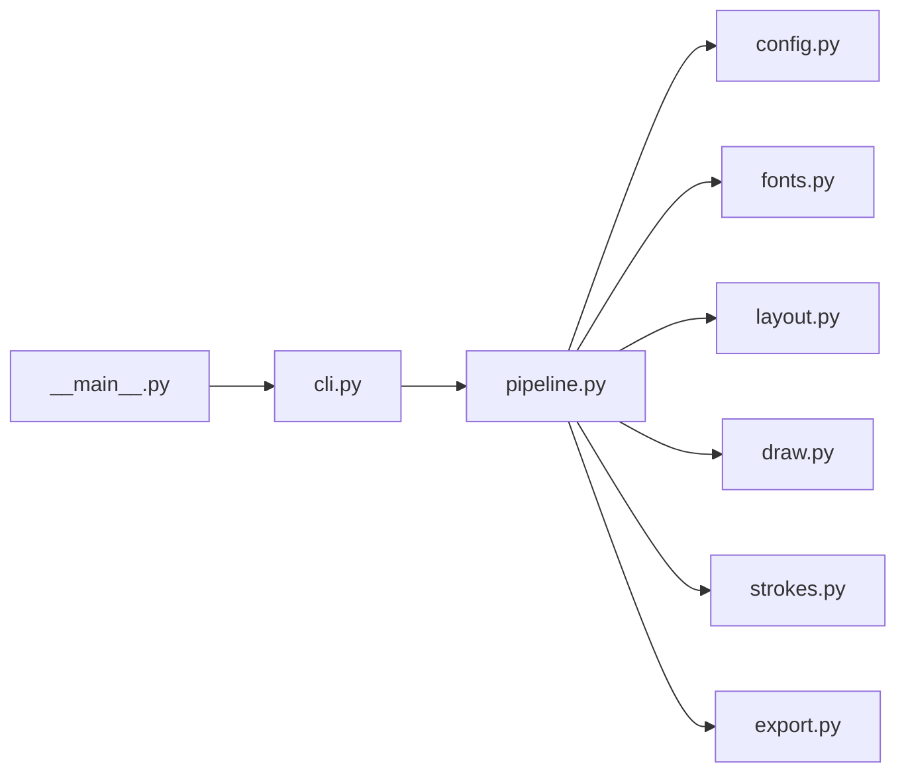

# 扩展与定制

<cite>
**本文引用的文件**   
- [config.py](file://zigec/config.py)
- [fonts.py](file://zigec/fonts.py)
- [layout.py](file://zigec/layout.py)
- [draw.py](file://zigec/draw.py)
- [strokes.py](file://zigec/strokes.py)
- [export.py](file://zigec/export.py)
- [pipeline.py](file://zigec/pipeline.py)
- [cli.py](file://zigec/cli.py)
- [__main__.py](file://zigec/__main__.py)
- [requirements.txt](file://requirements.txt)
</cite>

## 目录
1. [简介](#简介)
2. [项目结构](#项目结构)
3. [核心组件](#核心组件)
4. [架构总览](#架构总览)
5. [详细组件分析](#详细组件分析)
6. [依赖关系分析](#依赖关系分析)
7. [性能考虑](#性能考虑)
8. [故障排查指南](#故障排查指南)
9. [结论](#结论)
10. [附录：资源与配置规范](#附录资源与配置规范)

## 简介
本指南面向希望扩展与定制项目的开发者，覆盖以下主题：
- 如何添加自定义字体、修改笔画样式、调整布局规则
- 资源文件的结构与组织方式
- 字体文件格式规范与自定义字体的添加方法
- 配置系统的扩展点与插件开发机制
- 实际定制示例与最佳实践

目标是帮助你在不侵入核心逻辑的前提下，通过配置与少量代码扩展完成个性化定制。

## 项目结构
仓库采用按功能模块划分的扁平结构，关键目录与文件职责如下：
- zige/：核心包，包含配置、渲染、布局、导出、管线等模块
- tests/：单元测试
- requirements.txt：运行时依赖声明
- run.sh：启动脚本（如有）

图表来源
- [__main__.py:1-200](file://zigec/__main__.py#L1-L200)
- [cli.py:1-200](file://zigec/cli.py#L1-L200)
- [pipeline.py:1-200](file://zigec/pipeline.py#L1-L200)
- [config.py:1-200](file://zigec/config.py#L1-L200)
- [fonts.py:1-200](file://zigec/fonts.py#L1-L200)
- [layout.py:1-200](file://zigec/layout.py#L1-L200)
- [draw.py:1-200](file://zigec/draw.py#L1-L200)
- [strokes.py:1-200](file://zigec/strokes.py#L1-L200)
- [export.py:1-200](file://zigec/export.py#L1-L200)

章节来源
- [__main__.py:1-200](file://zigec/__main__.py#L1-L200)
- [cli.py:1-200](file://zigec/cli.py#L1-L200)
- [pipeline.py:1-200](file://zigec/pipeline.py#L1-L200)
- [config.py:1-200](file://zigec/config.py#L1-L200)
- [fonts.py:1-200](file://zigec/fonts.py#L1-L200)
- [layout.py:1-200](file://zigec/layout.py#L1-L200)
- [draw.py:1-200](file://zigec/draw.py#L1-L200)
- [strokes.py:1-200](file://zigec/strokes.py#L1-L200)
- [export.py:1-200](file://zigec/export.py#L1-L200)

## 核心组件
- 配置系统（config.py）：集中管理全局配置项，提供默认值、校验与合并策略，是扩展点的核心入口。
- 字体管理（fonts.py）：负责字体加载、缓存、度量与回退策略，支持自定义字体注册。
- 布局引擎（layout.py）：根据文本内容与字体度量计算行高、字距、对齐与分页等布局参数。
- 绘制器（draw.py）：将字形路径或位图绘制到画布，支持笔画样式与颜色控制。
- 笔画数据（strokes.py）：定义笔画数据结构、解析与渲染辅助函数。
- 导出器（export.py）：将最终图像或矢量数据导出为多种格式。
- 处理管线（pipeline.py）：编排 OCR→布局→绘制→导出的端到端流程。
- 命令行接口（cli.py）：暴露可配置的子命令与参数，便于自动化与集成。

章节来源
- [config.py:1-200](file://zigec/config.py#L1-L200)
- [fonts.py:1-200](file://zigec/fonts.py#L1-L200)
- [layout.py:1-200](file://zigec/layout.py#L1-L200)
- [draw.py:1-200](file://zigec/draw.py#L1-L200)
- [strokes.py:1-200](file://zigec/strokes.py#L1-L200)
- [export.py:1-200](file://zigec/export.py#L1-L200)
- [pipeline.py:1-200](file://zigec/pipeline.py#L1-L200)
- [cli.py:1-200](file://zigec/cli.py#L1-L200)

## 架构总览
下图展示从命令行到渲染导出的主要调用链，以及各模块之间的依赖关系。

图表来源
- [cli.py:1-200](file://zigec/cli.py#L1-L200)
- [pipeline.py:1-200](file://zigec/pipeline.py#L1-L200)
- [config.py:1-200](file://zigec/config.py#L1-L200)
- [fonts.py:1-200](file://zigec/fonts.py#L1-L200)
- [layout.py:1-200](file://zigec/layout.py#L1-L200)
- [draw.py:1-200](file://zigec/draw.py#L1-L200)
- [strokes.py:1-200](file://zigec/strokes.py#L1-L200)
- [export.py:1-200](file://zigec/export.py#L1-L200)

## 详细组件分析

### 配置系统扩展点（config.py）
- 设计要点
  - 集中式配置字典，提供默认值与环境变量/配置文件覆盖能力
  - 类型校验与字段白名单，避免非法配置进入下游
  - 可扩展的“插件配置段”，允许第三方模块注入自身配置键
- 扩展建议
  - 新增配置项时，在默认配置中声明并提供合理默认值
  - 对影响渲染的关键参数（如字号、行距、边距、抗锯齿开关）增加范围校验
  - 使用命名空间区分不同子系统（如 fonts.*、layout.*、draw.*）

图表来源
- [config.py:1-200](file://zigec/config.py#L1-L200)

章节来源
- [config.py:1-200](file://zigec/config.py#L1-L200)

### 字体管理与自定义字体（fonts.py）
- 设计要点
  - 字体加载器：支持常见字体格式，维护字体缓存
  - 度量信息：字符宽度、基线、行高等
  - 回退策略：当目标字形缺失时自动回退到备用字体
- 添加自定义字体步骤
  1) 准备字体文件（见附录：字体文件格式规范）
  2) 将字体文件放入 assets 目录或指定路径
  3) 在配置中注册新字体名称与路径
  4) 在需要的位置引用该字体名称
- 注意事项
  - 确保字体编码与文本一致（通常为 UTF-8）
  - 大字体文件建议启用缓存以减少 IO 开销

图表来源
- [fonts.py:1-200](file://zigec/fonts.py#L1-L200)

章节来源
- [fonts.py:1-200](file://zigec/fonts.py#L1-L200)

### 布局规则与排版（layout.py）
- 设计要点
  - 基于字体度量计算行高、字距、段落缩进、对齐方式
  - 支持分页/分栏与边界裁剪
  - 可通过配置开关开启/关闭特定布局算法
- 定制建议
  - 新增布局模式时，以策略模式封装，保持与绘制解耦
  - 对复杂版面，优先通过配置参数调优，再考虑扩展算法

图表来源
- [layout.py:1-200](file://zigec/layout.py#L1-L200)

章节来源
- [layout.py:1-200](file://zigec/layout.py#L1-L200)

### 绘制器与笔画样式（draw.py, strokes.py）
- 设计要点
  - draw.py 负责将字形路径或位图绘制到画布，支持颜色、透明度、缩放等
  - strokes.py 提供笔画数据结构与基础绘制原语
- 修改笔画样式
  - 通过配置项控制笔画粗细、圆角、描边/填充、阴影等
  - 如需自定义笔画形状，可在 strokes.py 中扩展新的笔画生成器，并在 draw.py 中接入

图表来源
- [draw.py:1-200](file://zigec/draw.py#L1-L200)
- [strokes.py:1-200](file://zigec/strokes.py#L1-L200)

章节来源
- [draw.py:1-200](file://zigec/draw.py#L1-L200)
- [strokes.py:1-200](file://zigec/strokes.py#L1-L200)

### 导出器（export.py）
- 设计要点
  - 统一导出接口，支持多种格式（如 PNG、PDF、SVG 等）
  - 针对矢量/位图分别优化压缩与质量参数
- 扩展建议
  - 新增导出格式时，实现统一接口并注册到导出器工厂

图表来源
- [export.py:1-200](file://zigec/export.py#L1-L200)

章节来源
- [export.py:1-200](file://zigec/export.py#L1-L200)

### 处理管线（pipeline.py）
- 设计要点
  - 编排 OCR→布局→绘制→导出的阶段化流程
  - 每阶段可插拔，支持跳过/替换某阶段
- 扩展建议
  - 新增处理阶段时，以中间件形式接入，不影响既有链路

图表来源
- [pipeline.py:1-200](file://zigec/pipeline.py#L1-L200)

章节来源
- [pipeline.py:1-200](file://zigec/pipeline.py#L1-L200)

### 命令行接口（cli.py）
- 设计要点
  - 提供子命令与参数映射，将用户输入转换为配置对象
  - 支持批量任务与进度反馈
- 扩展建议
  - 新增子命令时，遵循现有参数命名约定，并在配置中提供默认值

章节来源
- [cli.py:1-200](file://zigec/cli.py#L1-L200)

## 依赖关系分析
- 内部依赖
  - pipeline 依赖 config、fonts、layout、draw、strokes、export
  - cli 依赖 pipeline 与 config
  - __main__ 作为入口，初始化并调用 cli
- 外部依赖
  - 由 requirements.txt 声明，通常包括图像处理、字体解析、导出库等

图表来源
- [__main__.py:1-200](file://zigec/__main__.py#L1-L200)
- [cli.py:1-200](file://zigec/cli.py#L1-L200)
- [pipeline.py:1-200](file://zigec/pipeline.py#L1-L200)
- [config.py:1-200](file://zigec/config.py#L1-L200)
- [fonts.py:1-200](file://zigec/fonts.py#L1-L200)
- [layout.py:1-200](file://zigec/layout.py#L1-L200)
- [draw.py:1-200](file://zigec/draw.py#L1-L200)
- [strokes.py:1-200](file://zigec/strokes.py#L1-L200)
- [export.py:1-200](file://zigec/export.py#L1-L200)

章节来源
- [requirements.txt:1-200](file://requirements.txt#L1-L200)

## 性能考虑
- 字体缓存：避免重复加载大字体文件，减少 IO 与解码开销
- 布局批处理：对长文档进行分页/分栏批处理，降低内存峰值
- 绘制优化：按需重绘区域，避免全量刷新
- 导出压缩：根据用途选择合适的压缩级别与色彩深度
- 并发与异步：在 IO 密集环节（如批量导出）使用线程/进程池

[本节为通用指导，不涉及具体文件]

## 故障排查指南
- 配置错误
  - 现象：启动时报错或行为异常
  - 排查：检查配置键名、类型与取值范围；确认环境变量覆盖顺序
- 字体缺失或乱码
  - 现象：部分字符无法显示或显示为方块
  - 排查：确认字体文件存在且编码正确；检查回退字体配置
- 布局错位
  - 现象：行高异常、文字溢出或对齐不正确
  - 排查：核对字体度量；检查布局参数（字距、行距、边距）
- 导出失败
  - 现象：导出为空文件或格式不支持
  - 排查：确认导出格式与中间表示匹配；检查权限与磁盘空间

章节来源
- [config.py:1-200](file://zigec/config.py#L1-L200)
- [fonts.py:1-200](file://zigec/fonts.py#L1-L200)
- [layout.py:1-200](file://zigec/layout.py#L1-L200)
- [export.py:1-200](file://zigec/export.py#L1-L200)

## 结论
通过配置系统与模块化设计，你可以在不侵入核心逻辑的情况下完成字体、笔画样式与布局规则的定制，并通过插件机制扩展导出与其他功能。建议优先使用配置驱动的方式进行调整，仅在必要时扩展代码层。

[本节为总结性内容，不涉及具体文件]

## 附录：资源与配置规范

### 资源文件组织结构
- assets/：存放静态资源，如字体文件、模板、预设样式等
- 命名建议：按用途与版本划分目录，例如 assets/fonts/v1/、assets/templates/
- 访问方式：通过配置中的路径引用，避免硬编码

[本节为概念性说明，不涉及具体文件]

### 字体文件格式规范
- 推荐格式：TrueType(.ttf)、OpenType(.otf)
- 编码要求：UTF-8 兼容字形集
- 元数据：建议包含字体族名、字重、斜体等元信息，便于回退与选择
- 尺寸与性能：优先使用矢量字体；若使用位图字体，注意分辨率与缓存策略

[本节为概念性说明，不涉及具体文件]

### 自定义字体的添加方法
- 步骤
  1) 将字体文件放入 assets 目录
  2) 在配置中新增字体条目（名称、路径、回退策略）
  3) 在业务中使用该字体名称
- 验证
  - 使用最小用例渲染一段包含特殊字符的文本
  - 检查是否存在缺字与回退情况

[本节为概念性说明，不涉及具体文件]

### 配置系统的扩展点
- 新增配置项
  - 在默认配置中声明键名、类型、默认值与校验规则
  - 在 CLI 中暴露对应参数
- 插件配置段
  - 为第三方模块预留独立配置段，避免污染全局命名空间
- 配置合并优先级
  - 默认配置 < 外部配置文件 < 环境变量 < 命令行参数

[本节为概念性说明，不涉及具体文件]

### 插件开发机制
- 插件接口
  - 统一的注册函数与生命周期钩子（初始化、处理、清理）
- 发现与加载
  - 通过约定目录或清单文件发现插件
- 隔离与沙箱
  - 限制插件对核心资源的直接访问，通过配置与回调交互

[本节为概念性说明，不涉及具体文件]

### 实际定制示例与最佳实践
- 添加自定义字体
  - 在配置中注册新字体，并在布局/绘制阶段引用
  - 最佳实践：为常用字体建立多字重/斜体变体集合，提升可读性
- 修改笔画样式
  - 通过配置调整笔画粗细、圆角、描边与填充
  - 最佳实践：为不同场景（标题、正文、注释）定义样式预设
- 调整布局规则
  - 调整行高、字距、对齐与分页策略
  - 最佳实践：先通过配置调优，再考虑扩展算法
- 扩展导出功能
  - 实现统一导出接口并注册
  - 最佳实践：为每种格式提供独立的压缩/质量参数

[本节为概念性说明，不涉及具体文件]