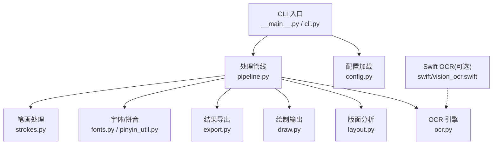
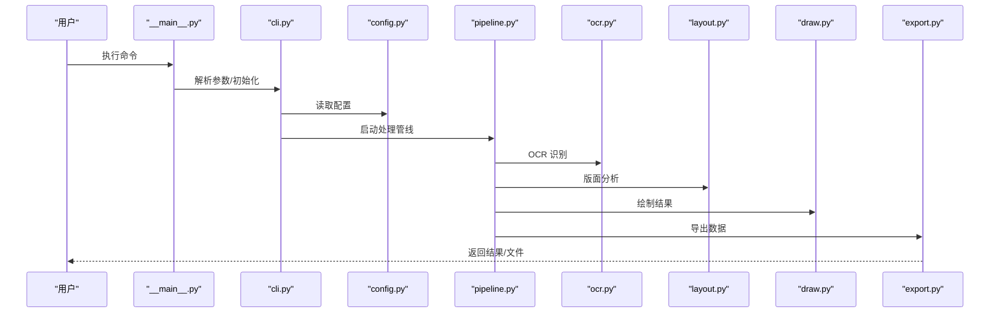
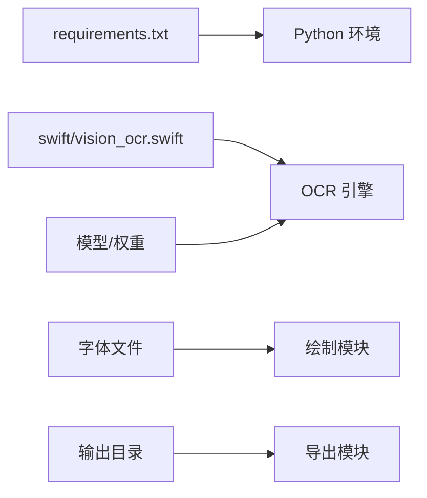

# 故障排除

<cite>
**本文引用的文件**   
- [requirements.txt](file://requirements.txt)
- [run.sh](file://run.sh)
- [__main__.py](file://zige/__main__.py)
- [cli.py](file://zige/cli.py)
- [config.py](file://zige/config.py)
- [pipeline.py](file://zige/pipeline.py)
- [ocr.py](file://zige/ocr.py)
- [layout.py](file://zige/layout.py)
- [draw.py](file://zige/draw.py)
- [export.py](file://zige/export.py)
- [fonts.py](file://zige/fonts.py)
- [pinyin_util.py](file://zige/pinyin_util.py)
- [strokes.py](file://zige/strokes.py)
- [vision_ocr.swift](file://zige/swift/vision_ocr.swift)
</cite>

## 目录
1. [简介](#简介)
2. [项目结构](#项目结构)
3. [核心组件](#核心组件)
4. [架构总览](#架构总览)
5. [详细组件分析](#详细组件分析)
6. [依赖关系分析](#依赖关系分析)
7. [性能考虑](#性能考虑)
8. [故障排除指南](#故障排除指南)
9. [结论](#结论)
10. [附录](#附录)

## 简介
本指南面向安装、配置与运行过程中遇到的常见问题，提供系统化的诊断步骤、日志分析方法、错误代码对照表以及性能优化建议。目标是帮助用户自助定位并解决问题，减少技术支持负担。

## 项目结构
本项目为 Python CLI 工具，主要模块包括：
- 入口与命令行：__main__.py、cli.py
- 配置与参数：config.py
- 处理管线：pipeline.py
- OCR 与布局：ocr.py、layout.py
- 绘制与导出：draw.py、export.py
- 字体与拼音：fonts.py、pinyin_util.py
- 笔画与字形：strokes.py
- Swift 侧 OCR（可选）：swift/vision_ocr.swift
- 依赖与环境：requirements.txt、run.sh

**图表来源** 
- [__main__.py:1-200](file://zige/__main__.py#L1-L200)
- [cli.py:1-200](file://zige/cli.py#L1-L200)
- [config.py:1-200](file://zige/config.py#L1-L200)
- [pipeline.py:1-200](file://zige/pipeline.py#L1-L200)
- [ocr.py:1-200](file://zige/ocr.py#L1-L200)
- [layout.py:1-200](file://zige/layout.py#L1-L200)
- [draw.py:1-200](file://zige/draw.py#L1-L200)
- [export.py:1-200](file://zige/export.py#L1-L200)
- [fonts.py:1-200](file://zige/fonts.py#L1-L200)
- [pinyin_util.py:1-200](file://zige/pinyin_util.py#L1-L200)
- [strokes.py:1-200](file://zige/strokes.py#L1-L200)
- [vision_ocr.swift:1-200](file://zige/swift/vision_ocr.swift#L1-L200)

**章节来源**
- [__main__.py:1-200](file://zige/__main__.py#L1-L200)
- [cli.py:1-200](file://zige/cli.py#L1-L200)
- [config.py:1-200](file://zige/config.py#L1-L200)
- [pipeline.py:1-200](file://zige/pipeline.py#L1-L200)
- [ocr.py:1-200](file://zige/ocr.py#L1-L200)
- [layout.py:1-200](file://zige/layout.py#L1-L200)
- [draw.py:1-200](file://zige/draw.py#L1-L200)
- [export.py:1-200](file://zige/export.py#L1-L200)
- [fonts.py:1-200](file://zige/fonts.py#L1-L200)
- [pinyin_util.py:1-200](file://zige/pinyin_util.py#L1-L200)
- [strokes.py:1-200](file://zige/strokes.py#L1-L200)
- [vision_ocr.swift:1-200](file://zige/swift/vision_ocr.swift#L1-L200)

## 核心组件
- CLI 与入口：负责解析参数、初始化日志、调用处理管线。
- 配置：集中管理默认值、环境变量与配置文件路径。
- 管线：编排 OCR、版面分析、绘制与导出等阶段。
- OCR：封装底层 OCR 能力（Python 或 Swift）。
- 版面分析：识别文本块、行、列等结构。
- 绘制与导出：生成可视化结果与结构化数据。
- 字体与拼音：字体加载、拼音转换与校验。
- 笔画：字形笔画相关处理。

**章节来源**
- [__main__.py:1-200](file://zige/__main__.py#L1-L200)
- [cli.py:1-200](file://zige/cli.py#L1-L200)
- [config.py:1-200](file://zige/config.py#L1-L200)
- [pipeline.py:1-200](file://zige/pipeline.py#L1-L200)
- [ocr.py:1-200](file://zige/ocr.py#L1-L200)
- [layout.py:1-200](file://zige/layout.py#L1-L200)
- [draw.py:1-200](file://zige/draw.py#L1-L200)
- [export.py:1-200](file://zige/export.py#L1-L200)
- [fonts.py:1-200](file://zige/fonts.py#L1-L200)
- [pinyin_util.py:1-200](file://zige/pinyin_util.py#L1-L200)
- [strokes.py:1-200](file://zige/strokes.py#L1-L200)

## 架构总览
下图展示从命令行到各子系统的调用链路与数据流向，便于在异常发生时快速定位问题域。

**图表来源** 
- [__main__.py:1-200](file://zige/__main__.py#L1-L200)
- [cli.py:1-200](file://zige/cli.py#L1-L200)
- [config.py:1-200](file://zige/config.py#L1-L200)
- [pipeline.py:1-200](file://zige/pipeline.py#L1-L200)
- [ocr.py:1-200](file://zige/ocr.py#L1-L200)
- [layout.py:1-200](file://zige/layout.py#L1-L200)
- [draw.py:1-200](file://zige/draw.py#L1-L200)
- [export.py:1-200](file://zige/export.py#L1-L200)

## 详细组件分析

### 命令行与入口（__main__.py / cli.py）
- 职责：参数解析、日志初始化、调用 pipeline。
- 常见故障点：
  - 参数缺失或类型不匹配导致初始化失败。
  - 日志级别设置不当导致关键信息不可见。
- 排查要点：
  - 检查传入参数是否完整、有效。
  - 提升日志级别以捕获更详细信息。
  - 确认入口脚本可执行权限与解释器路径正确。

**章节来源**
- [__main__.py:1-200](file://zige/__main__.py#L1-L200)
- [cli.py:1-200](file://zige/cli.py#L1-L200)

### 配置（config.py）
- 职责：集中管理默认配置、环境变量与配置文件路径。
- 常见故障点：
  - 环境变量未设置或拼写错误。
  - 配置文件路径不存在或权限不足。
- 排查要点：
  - 逐项核对必需的环境变量是否存在且非空。
  - 验证配置文件路径存在且可读。
  - 使用最小化配置复现问题。

**章节来源**
- [config.py:1-200](file://zige/config.py#L1-L200)

### 处理管线（pipeline.py）
- 职责：编排 OCR、版面分析、绘制与导出流程。
- 常见故障点：
  - 上游阶段失败导致下游无输入。
  - 中间结果格式不一致引发断言或类型错误。
- 排查要点：
  - 分阶段启用/禁用步骤以隔离问题。
  - 打印每阶段输入输出摘要（尺寸、数量、字段）。
  - 对异常进行堆栈跟踪与上下文记录。

**章节来源**
- [pipeline.py:1-200](file://zige/pipeline.py#L1-L200)

### OCR（ocr.py）
- 职责：封装 OCR 能力（Python 或 Swift）。
- 常见故障点：
  - 模型/权重文件缺失或版本不匹配。
  - Swift 二进制不可用或签名/平台不兼容。
  - 图像分辨率过高/过低导致识别失败或超时。
- 排查要点：
  - 校验模型文件完整性与路径。
  - 若使用 Swift OCR，检查二进制存在性与可执行权限。
  - 调整图像预处理参数（缩放、对比度、二值化）。

**章节来源**
- [ocr.py:1-200](file://zige/ocr.py#L1-L200)
- [vision_ocr.swift:1-200](file://zige/swift/vision_ocr.swift#L1-L200)

### 版面分析（layout.py）
- 职责：识别文本块、行、列等结构。
- 常见故障点：
  - 检测阈值不当导致漏检或误检。
  - 复杂版面（表格、多栏）解析不稳定。
- 排查要点：
  - 调整检测阈值与后处理参数。
  - 针对特定版面准备样本集进行回归测试。
  - 输出中间检测结果（框图、置信度）辅助定位。

**章节来源**
- [layout.py:1-200](file://zige/layout.py#L1-L200)

### 绘制与导出（draw.py / export.py）
- 职责：将结果可视化并导出结构化数据。
- 常见故障点：
  - 字体缺失导致渲染异常。
  - 导出路径不可写或磁盘空间不足。
  - 编码问题导致中文乱码。
- 排查要点：
  - 检查字体文件存在性与路径。
  - 确保输出目录存在且有写入权限。
  - 统一编码为 UTF-8，避免混用 GBK/GB2312。

**章节来源**
- [draw.py:1-200](file://zige/draw.py#L1-L200)
- [export.py:1-200](file://zige/export.py#L1-L200)

### 字体与拼音（fonts.py / pinyin_util.py）
- 职责：字体加载、拼音转换与校验。
- 常见故障点：
  - 字体文件损坏或格式不支持。
  - 拼音映射缺失或字符不在映射表中。
- 排查要点：
  - 校验字体文件完整性与格式。
  - 对缺失的拼音映射进行补充或降级策略。
  - 记录未映射字符以便后续完善字典。

**章节来源**
- [fonts.py:1-200](file://zige/fonts.py#L1-L200)
- [pinyin_util.py:1-200](file://zige/pinyin_util.py#L1-L200)

### 笔画（strokes.py）
- 职责：字形笔画相关处理。
- 常见故障点：
  - 笔画库缺失或不一致。
  - 输入字形超出支持范围。
- 排查要点：
  - 校验笔画库版本与一致性。
  - 过滤或替换不受支持的字符。

**章节来源**
- [strokes.py:1-200](file://zige/strokes.py#L1-L200)

## 依赖关系分析
- 运行时依赖：Python 包由 requirements.txt 管理。
- 外部依赖：Swift OCR 二进制（可选），需满足平台与权限要求。
- 资源依赖：字体文件、模型/权重文件、输出目录。

**图表来源** 
- [requirements.txt:1-200](file://requirements.txt#L1-L200)
- [vision_ocr.swift:1-200](file://zige/swift/vision_ocr.swift#L1-L200)
- [draw.py:1-200](file://zige/draw.py#L1-L200)
- [export.py:1-200](file://zige/export.py#L1-L200)

**章节来源**
- [requirements.txt:1-200](file://requirements.txt#L1-L200)
- [run.sh:1-200](file://run.sh#L1-L200)

## 性能考虑
- 图像预处理：合理缩放与裁剪可减少 OCR 耗时。
- 批量处理：合并小图或采用批处理降低 IO 开销。
- 并行度：根据 CPU/GPU 资源调整并发数，避免过度竞争。
- 缓存：对重复输入或公共资源（字体、模型）进行缓存。
- 内存：监控峰值内存，及时释放中间大对象。
- I/O：使用 SSD 存储模型与输出，减少磁盘瓶颈。

[本节为通用指导，无需具体文件引用]

## 故障排除指南

### 安装与环境问题
- 症状：
  - 无法导入模块或报缺少依赖。
  - run.sh 执行失败。
- 排查步骤：
  - 检查 Python 版本与 pip 可用。
  - 重新安装依赖：pip install -r requirements.txt。
  - 校验 run.sh 可执行权限与解释器路径。
  - 如使用 Swift OCR，确认二进制存在且可执行。
- 解决建议：
  - 清理虚拟环境后重装依赖。
  - 更新或回滚至兼容版本。
  - 为 Swift 二进制赋予执行权限并确保平台匹配。

**章节来源**
- [requirements.txt:1-200](file://requirements.txt#L1-L200)
- [run.sh:1-200](file://run.sh#L1-L200)

### 配置错误
- 症状：
  - 启动时报环境变量缺失或配置文件路径无效。
  - 字体/模型加载失败。
- 排查步骤：
  - 列出并校验所有必需环境变量。
  - 验证配置文件路径存在且可读。
  - 检查字体与模型文件路径与完整性。
- 解决建议：
  - 使用最小化配置复现问题。
  - 修正环境变量拼写与路径。
  - 修复或替换损坏的资源文件。

**章节来源**
- [config.py:1-200](file://zige/config.py#L1-L200)

### 运行时异常
- 症状：
  - OCR 阶段崩溃或返回空结果。
  - 版面分析失败或结果异常。
  - 绘制时字体缺失或乱码。
  - 导出失败（权限/磁盘空间）。
- 排查步骤：
  - 提升日志级别，捕获完整堆栈。
  - 分阶段禁用/启用流水线步骤以隔离问题。
  - 检查输入图像质量与尺寸。
  - 校验输出目录权限与磁盘空间。
- 解决建议：
  - 修复输入数据或调整预处理参数。
  - 更换或修复字体/模型文件。
  - 调整并发与批大小以降低资源压力。

**章节来源**
- [pipeline.py:1-200](file://zige/pipeline.py#L1-L200)
- [ocr.py:1-200](file://zige/ocr.py#L1-L200)
- [layout.py:1-200](file://zige/layout.py#L1-L200)
- [draw.py:1-200](file://zige/draw.py#L1-L200)
- [export.py:1-200](file://zige/export.py#L1-L200)

### 日志分析方法
- 建议开启详细日志（DEBUG/INFO），记录：
  - 参数与配置摘要。
  - 每阶段输入输出维度与统计。
  - 异常堆栈与上下文（文件名、行号、函数名）。
- 定位技巧：
  - 按时间戳筛选关键事件。
  - 使用关键字（如“error”、“exception”、“timeout”）过滤。
  - 对比正常与异常样本的差异。

[本节为通用指导，无需具体文件引用]

### 性能问题识别与优化
- 识别方法：
  - 使用性能剖析工具（cProfile、timeit）定位热点。
  - 监控 CPU、内存、I/O 指标。
- 优化建议：
  - 调整图像预处理与 OCR 参数。
  - 增加批处理规模与并行度（受资源限制）。
  - 缓存常用资源（字体、模型、中间结果）。
  - 优化 I/O（SSD、异步写入）。

[本节为通用指导，无需具体文件引用]

### 错误代码对照表与解决建议
说明：以下为常见错误类别与对应解决思路，实际错误码以运行时日志为准。

- 依赖缺失（ImportError/ModuleNotFoundError）
  - 现象：启动即报错，提示缺少模块。
  - 解决：重新安装依赖；检查 Python 环境与路径。
  - 参考：requirements.txt

- 环境变量缺失（KeyError/ConfigError）
  - 现象：启动时报环境变量为空或未定义。
  - 解决：设置必需环境变量；检查配置文件路径。
  - 参考：config.py

- 模型/权重加载失败（FileNotFoundError/IOError）
  - 现象：OCR 阶段无法加载模型。
  - 解决：校验模型路径与完整性；检查权限。
  - 参考：ocr.py

- Swift 二进制不可用（PermissionError/PlatformError）
  - 现象：调用 Swift OCR 失败。
  - 解决：赋予执行权限；确认平台与架构匹配。
  - 参考：vision_ocr.swift

- 字体缺失或渲染异常（FontError/UnicodeError）
  - 现象：绘制中文乱码或缺字。
  - 解决：安装/修复字体；统一编码为 UTF-8。
  - 参考：fonts.py、draw.py

- 导出失败（PermissionError/DiskFull）
  - 现象：写入输出目录失败。
  - 解决：检查目录权限与磁盘空间；切换输出路径。
  - 参考：export.py

- 版面分析异常（ValueError/AssertionError）
  - 现象：检测框为空或越界。
  - 解决：调整阈值；检查输入图像质量。
  - 参考：layout.py

**章节来源**
- [requirements.txt:1-200](file://requirements.txt#L1-L200)
- [config.py:1-200](file://zige/config.py#L1-L200)
- [ocr.py:1-200](file://zige/ocr.py#L1-L200)
- [vision_ocr.swift:1-200](file://zige/swift/vision_ocr.swift#L1-L200)
- [fonts.py:1-200](file://zige/fonts.py#L1-L200)
- [draw.py:1-200](file://zige/draw.py#L1-L200)
- [export.py:1-200](file://zige/export.py#L1-L200)
- [layout.py:1-200](file://zige/layout.py#L1-L200)

### 自助排障清单
- 环境检查：
  - Python 版本与 pip 可用。
  - 依赖已安装：pip install -r requirements.txt。
  - run.sh 可执行权限正确。
- 配置检查：
  - 环境变量齐全且非空。
  - 配置文件路径存在且可读。
  - 字体与模型文件存在且完整。
- 运行检查：
  - 输入图像质量良好（清晰、方向正确）。
  - 输出目录存在且有写入权限。
  - 磁盘空间充足。
- 日志检查：
  - 开启详细日志。
  - 搜索关键词：error、exception、timeout、permission denied。
  - 记录异常堆栈与上下文。

[本节为通用指导，无需具体文件引用]

## 结论
通过系统化地检查环境、配置、输入数据与日志，结合分阶段隔离与性能调优，大多数安装、配置与运行时问题均可被快速定位与解决。建议在生产环境中建立标准化排障流程与知识库，持续沉淀常见问题与解决方案。

[本节为总结性内容，无需具体文件引用]

## 附录
- 快速命令示例（概念性）：
  - 安装依赖：pip install -r requirements.txt
  - 运行脚本：./run.sh
  - 查看日志：tail -f logs/app.log
- 资源链接：
  - 依赖清单：requirements.txt
  - 入口脚本：run.sh

**章节来源**
- [requirements.txt:1-200](file://requirements.txt#L1-L200)
- [run.sh:1-200](file://run.sh#L1-L200)