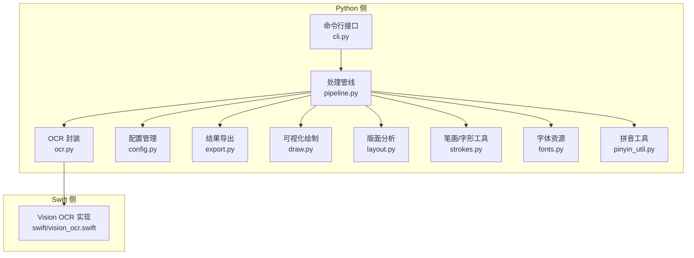
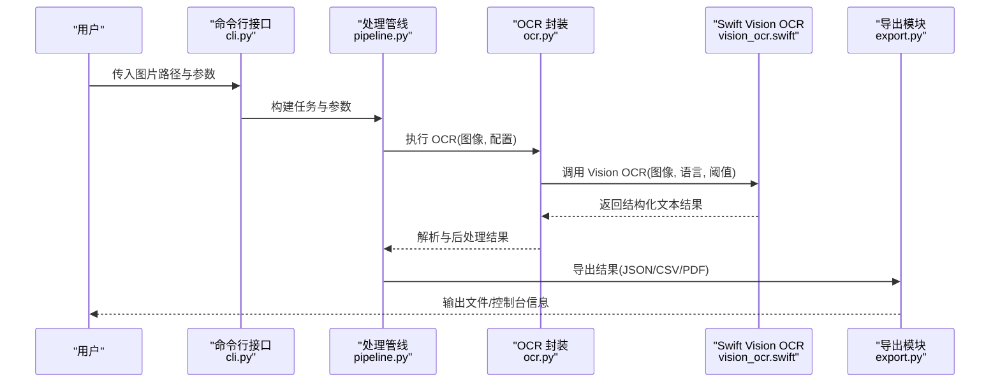
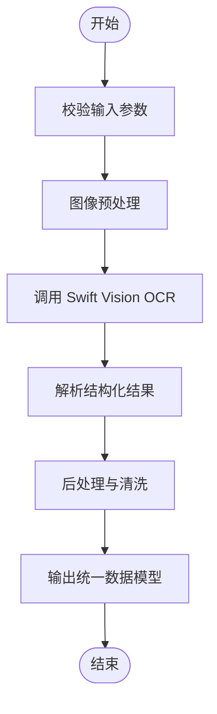
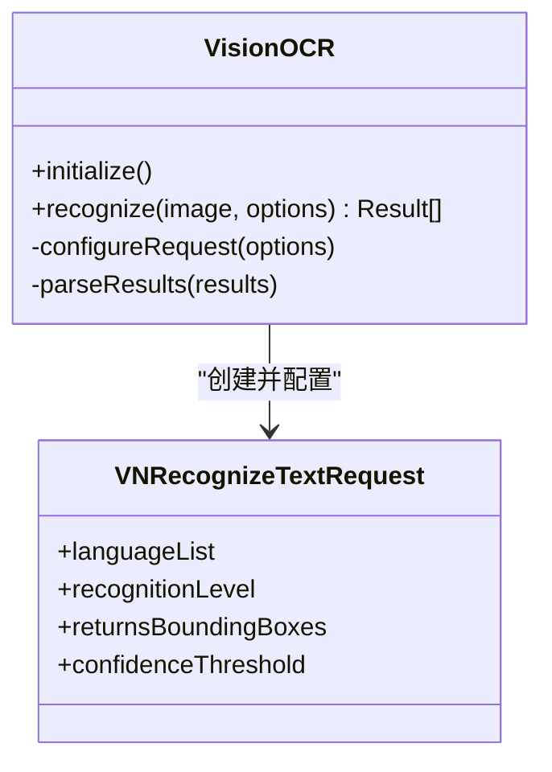
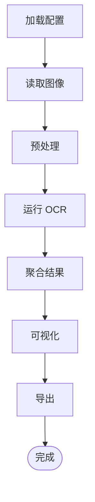
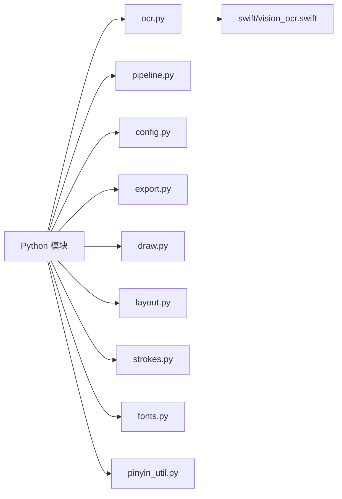

# OCR 文本识别

<cite>
**本文引用的文件**   
- [ocr.py](file://zige/ocr.py)
- [vision_ocr.swift](file://zige/swift/vision_ocr.swift)
- [pipeline.py](file://zige/pipeline.py)
- [config.py](file://zige/config.py)
- [cli.py](file://zige/cli.py)
- [export.py](file://zige/export.py)
- [draw.py](file://zige/draw.py)
- [layout.py](file://zige/layout.py)
- [strokes.py](file://zige/strokes.py)
- [fonts.py](file://zige/fonts.py)
- [pinyin_util.py](file://zige/pinyin_util.py)
- [__init__.py](file://zige/__init__.py)
- [__main__.py](file://zige/__main__.py)
- [requirements.txt](file://requirements.txt)
- [run.sh](file://run.sh)
</cite>

## 目录
1. [简介](#简介)
2. [项目结构](#项目结构)
3. [核心组件](#核心组件)
4. [架构总览](#架构总览)
5. [详细组件分析](#详细组件分析)
6. [依赖关系分析](#依赖关系分析)
7. [性能与精度优化](#性能与精度优化)
8. [故障排查指南](#故障排查指南)
9. [结论](#结论)
10. [附录](#附录)

## 简介
本技术文档围绕仓库中的 OCR 文本识别模块展开，重点说明基于 Swift Vision 框架的 OCR 实现原理、Python 与 Swift 的集成方式、文本识别流程、识别精度优化与性能调优策略。文档同时涵盖 OCR 引擎配置选项、输入输出格式、错误处理机制，并提供与其他模块的集成方式与数据流向说明，以及常见问题解决方案和调试技巧。

## 项目结构
本项目采用 Python 作为主入口与编排层，Swift 侧提供基于 Vision 框架的高性能 OCR 能力，通过进程间调用或桥接方式进行集成。Python 侧负责图像预处理、结果后处理、可视化与导出；Swift 侧专注于图像到文本的识别计算。

**图示来源**
- [cli.py:1-200](file://zige/cli.py#L1-L200)
- [pipeline.py:1-200](file://zige/pipeline.py#L1-L200)
- [ocr.py:1-200](file://zige/ocr.py#L1-L200)
- [config.py:1-200](file://zige/config.py#L1-L200)
- [export.py:1-200](file://zige/export.py#L1-L200)
- [draw.py:1-200](file://zige/draw.py#L1-L200)
- [layout.py:1-200](file://zige/layout.py#L1-L200)
- [strokes.py:1-200](file://zige/strokes.py#L1-L200)
- [fonts.py:1-200](file://zige/fonts.py#L1-L200)
- [pinyin_util.py:1-200](file://zige/pinyin_util.py#L1-L200)
- [vision_ocr.swift:1-200](file://zige/swift/vision_ocr.swift#L1-L200)

**章节来源**
- [cli.py:1-200](file://zige/cli.py#L1-L200)
- [pipeline.py:1-200](file://zige/pipeline.py#L1-L200)
- [ocr.py:1-200](file://zige/ocr.py#L1-L200)
- [config.py:1-200](file://zige/config.py#L1-L200)

## 核心组件
- OCR 封装（Python）：对外暴露统一的 OCR 接口，负责参数校验、图像预处理、调用 Swift Vision OCR、结果解析与后处理。
- Swift Vision OCR：基于 Apple Vision 框架进行文本检测与识别，返回结构化文本结果（如行/词级边界框、置信度、文本内容）。
- 处理管线：串联图像读取、预处理、OCR、后处理、可视化、导出等步骤，支持批处理与流式处理。
- 配置管理：集中管理 OCR 引擎参数（语言、方向、阈值、区域选择等）、IO 路径、日志级别等。
- 可视化与导出：将识别结果以图形叠加形式展示，并导出为 JSON、CSV、PDF 等格式。
- 辅助工具：字体、笔画、拼音、版面分析等工具模块，用于增强 OCR 结果的可用性与可读性。

**章节来源**
- [ocr.py:1-200](file://zige/ocr.py#L1-L200)
- [vision_ocr.swift:1-200](file://zige/swift/vision_ocr.swift#L1-L200)
- [pipeline.py:1-200](file://zige/pipeline.py#L1-L200)
- [config.py:1-200](file://zige/config.py#L1-L200)
- [export.py:1-200](file://zige/export.py#L1-L200)
- [draw.py:1-200](file://zige/draw.py#L1-L200)

## 架构总览
下图展示了从命令行到 OCR 识别再到结果导出的端到端流程，包括 Python 与 Swift 之间的交互点。

**图示来源**
- [cli.py:1-200](file://zige/cli.py#L1-L200)
- [pipeline.py:1-200](file://zige/pipeline.py#L1-L200)
- [ocr.py:1-200](file://zige/ocr.py#L1-L200)
- [vision_ocr.swift:1-200](file://zige/swift/vision_ocr.swift#L1-L200)
- [export.py:1-200](file://zige/export.py#L1-L200)

## 详细组件分析

### OCR 封装（Python）
- 职责
  - 接收图像与配置参数，进行必要的预处理（缩放、旋转、去噪、二值化等）。
  - 调用 Swift Vision OCR 进行文本检测与识别。
  - 对返回的结构化结果进行清洗、合并、排序与坐标归一化。
  - 输出统一的数据模型供下游使用。
- 关键流程
  - 参数校验与默认值填充。
  - 图像预处理流水线。
  - 与 Swift 进程的通信（进程启动、参数序列化、结果反序列化）。
  - 结果后处理（置信度过滤、重复行合并、文本规范化）。
- 错误处理
  - 捕获 Swift 进程异常、超时、内存不足等情况。
  - 记录详细日志并抛出可诊断的错误类型。
- 性能要点
  - 批量图像处理时复用 Swift 进程实例。
  - 控制图像尺寸与通道数，避免不必要的转换。
  - 合理设置并行度与线程池大小。

**图示来源**
- [ocr.py:1-200](file://zige/ocr.py#L1-L200)

**章节来源**
- [ocr.py:1-200](file://zige/ocr.py#L1-L200)

### Swift Vision OCR 实现
- 职责
  - 基于 Apple Vision 框架进行文本检测与识别。
  - 支持多语言、方向约束、区域裁剪等配置。
  - 返回包含文本内容、边界框、置信度的结构化结果。
- 关键流程
  - 初始化 Vision 请求（VNRecognizeTextRequest）。
  - 配置语言、层级（行/词）、置信度阈值。
  - 执行识别并收集结果。
  - 将结果序列化为 Python 可消费的格式。
- 错误处理
  - 捕获 Vision API 异常、图像格式不支持、内存不足等。
  - 返回明确的错误码与消息以便 Python 侧处理。

**图示来源**
- [vision_ocr.swift:1-200](file://zige/swift/vision_ocr.swift#L1-L200)

**章节来源**
- [vision_ocr.swift:1-200](file://zige/swift/vision_ocr.swift#L1-L200)

### 处理管线（Pipeline）
- 职责
  - 编排图像读取、预处理、OCR、后处理、可视化、导出等步骤。
  - 支持单图与多图批处理，支持流式处理。
  - 管理中间状态与缓存，提升吞吐。
- 关键流程
  - 加载配置与资源（字体、模板）。
  - 构建任务队列与并发控制。
  - 调用 OCR 封装并聚合结果。
  - 触发可视化与导出。
- 错误处理
  - 捕获 IO 异常、解析失败、导出失败等。
  - 提供重试与降级策略。

**图示来源**
- [pipeline.py:1-200](file://zige/pipeline.py#L1-L200)

**章节来源**
- [pipeline.py:1-200](file://zige/pipeline.py#L1-L200)

### 配置管理（Config）
- 职责
  - 集中管理 OCR 引擎参数（语言、方向、阈值、区域选择）。
  - 管理 IO 路径、日志级别、并发设置。
- 关键项
  - OCR 引擎：语言列表、识别层级、置信度阈值。
  - 图像预处理：缩放比例、裁剪区域、灰度/二值化开关。
  - 导出格式：JSON、CSV、PDF 等。
  - 性能：并发线程数、批大小、超时时间。

**章节来源**
- [config.py:1-200](file://zige/config.py#L1-L200)

### 命令行接口（CLI）
- 职责
  - 解析用户输入参数，映射到配置对象。
  - 调用处理管线执行任务。
  - 输出进度与结果摘要。
- 常见命令
  - 单图识别：指定图片路径与语言。
  - 批量识别：指定目录与输出格式。
  - 可视化：生成带标注的图片与报告。

**章节来源**
- [cli.py:1-200](file://zige/cli.py#L1-L200)

### 导出模块（Export）
- 职责
  - 将 OCR 结果导出为多种格式（JSON、CSV、PDF）。
  - 支持元数据附加（文件名、时间戳、版本）。
- 关键流程
  - 序列化结果对象。
  - 写入文件或流。
  - 校验输出完整性。

**章节来源**
- [export.py:1-200](file://zige/export.py#L1-L200)

### 可视化绘制（Draw）
- 职责
  - 在图像上绘制边界框、文本标签、置信度。
  - 支持不同样式与颜色方案。
- 关键流程
  - 加载图像与结果。
  - 计算绘制坐标与字体大小。
  - 渲染并保存图像。

**章节来源**
- [draw.py:1-200](file://zige/draw.py#L1-L200)

### 版面分析与笔画工具（Layout/Strokes/Fonts/Pinyin）
- 职责
  - 版面分析：识别段落、列、表格等结构。
  - 笔画/字形工具：辅助中文字形分析与渲染。
  - 字体资源：提供渲染所需字体文件。
  - 拼音工具：将中文转换为拼音，便于检索与展示。
- 关键流程
  - 根据 OCR 结果进行结构推断。
  - 渲染字形与拼音标注。
  - 与导出模块协作生成报告。

**章节来源**
- [layout.py:1-200](file://zige/layout.py#L1-L200)
- [strokes.py:1-200](file://zige/strokes.py#L1-L200)
- [fonts.py:1-200](file://zige/fonts.py#L1-L200)
- [pinyin_util.py:1-200](file://zige/pinyin_util.py#L1-L200)

## 依赖关系分析
- Python 依赖
  - 图像处理库（如 Pillow/OpenCV），用于预处理与可视化。
  - 序列化库（如 json/csv），用于结果导出。
  - 日志与配置库（如 logging/configparser），用于调试与配置管理。
- Swift 依赖
  - Apple Vision 框架，用于文本检测与识别。
  - Foundation/Dispatch，用于进程通信与并发控制。

**图示来源**
- [ocr.py:1-200](file://zige/ocr.py#L1-L200)
- [pipeline.py:1-200](file://zige/pipeline.py#L1-L200)
- [config.py:1-200](file://zige/config.py#L1-L200)
- [export.py:1-200](file://zige/export.py#L1-L200)
- [draw.py:1-200](file://zige/draw.py#L1-L200)
- [layout.py:1-200](file://zige/layout.py#L1-L200)
- [strokes.py:1-200](file://zige/strokes.py#L1-L200)
- [fonts.py:1-200](file://zige/fonts.py#L1-L200)
- [pinyin_util.py:1-200](file://zige/pinyin_util.py#L1-L200)
- [vision_ocr.swift:1-200](file://zige/swift/vision_ocr.swift#L1-L200)

**章节来源**
- [requirements.txt:1-200](file://requirements.txt#L1-L200)
- [run.sh:1-200](file://run.sh#L1-L200)

## 性能与精度优化
- 图像预处理
  - 自适应缩放：根据目标分辨率与设备内存调整图像尺寸。
  - 去噪与对比度增强：提升小字与低对比度文本的可识别性。
  - 二值化与形态学操作：改善字符连通性与轮廓清晰度。
- OCR 引擎配置
  - 语言列表：仅启用必要语言以减少计算量。
  - 识别层级：优先使用“行”级识别以提升速度，必要时切换至“词”级。
  - 置信度阈值：根据业务需求调整，平衡召回率与准确率。
  - 区域选择：限定 ROI（感兴趣区域）减少无关背景干扰。
- 并发与批处理
  - 批大小：根据 GPU/CPU 资源调整批大小，最大化吞吐。
  - 线程池：限制并发线程数，避免上下文切换开销过大。
  - 进程复用：复用 Swift 进程实例，减少启动开销。
- 结果后处理
  - 重复行合并：基于空间重叠与文本相似度合并重复结果。
  - 文本规范化：去除多余空白、统一标点与大小写。
  - 置信度过滤：剔除低置信度片段，提升整体质量。
- 监控与调优
  - 指标采集：记录每步耗时、内存占用、识别数量。
  - A/B 测试：对比不同预处理与阈值组合的效果。
  - 回归测试：确保更新不降低精度与性能。

[本节为通用指导，不涉及具体文件分析]

## 故障排查指南
- 常见问题
  - Swift 进程无法启动：检查系统权限、依赖库是否安装、路径是否正确。
  - 识别结果为空：检查图像质量、语言配置、ROI 设置、置信度阈值。
  - 导出失败：检查文件格式权限、磁盘空间、序列化对象完整性。
  - 性能瓶颈：检查图像尺寸、并发设置、批大小、内存占用。
- 调试技巧
  - 开启详细日志：记录每一步的参数与中间结果。
  - 可视化中间图像：检查预处理效果与 ROI 选择。
  - 单元测试：针对 OCR 封装与 Swift 桥接编写用例，覆盖异常路径。
  - 压力测试：模拟大图、多图、高并发场景，定位稳定性问题。
- 错误处理建议
  - 明确错误分类：IO 错误、解析错误、引擎错误、导出错误。
  - 提供恢复策略：重试、降级、跳过坏样本。
  - 记录上下文：附带图像哈希、参数快照、堆栈信息。

**章节来源**
- [ocr.py:1-200](file://zige/ocr.py#L1-L200)
- [pipeline.py:1-200](file://zige/pipeline.py#L1-L200)
- [export.py:1-200](file://zige/export.py#L1-L200)

## 结论
本 OCR 模块通过 Python 编排与 Swift Vision 高性能识别相结合，提供了可扩展、可配置的文本识别能力。通过合理的预处理、引擎配置与后处理策略，可在保证精度的同时提升性能。建议在业务场景中结合具体数据特征进行参数调优，并通过监控与测试保障稳定性与可维护性。

[本节为总结性内容，不涉及具体文件分析]

## 附录
- 快速上手
  - 安装依赖：参考 requirements.txt 与 run.sh。
  - 运行示例：使用命令行传入图片路径与语言参数。
  - 查看结果：导出 JSON/CSV/PDF，并在可视化图中查看标注。
- 扩展开发
  - 新增语言：在配置中添加语言代码，并确保 Swift 侧支持。
  - 自定义后处理：在 OCR 封装中扩展清洗与合并逻辑。
  - 集成第三方工具：在管线中插入新的处理节点（如版面分析、OCR 纠错）。

**章节来源**
- [requirements.txt:1-200](file://requirements.txt#L1-L200)
- [run.sh:1-200](file://run.sh#L1-L200)
- [cli.py:1-200](file://zige/cli.py#L1-L200)
- [export.py:1-200](file://zige/export.py#L1-L200)