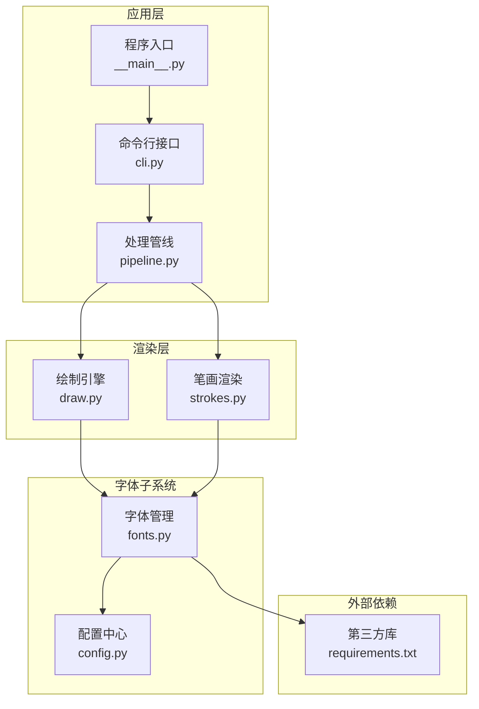
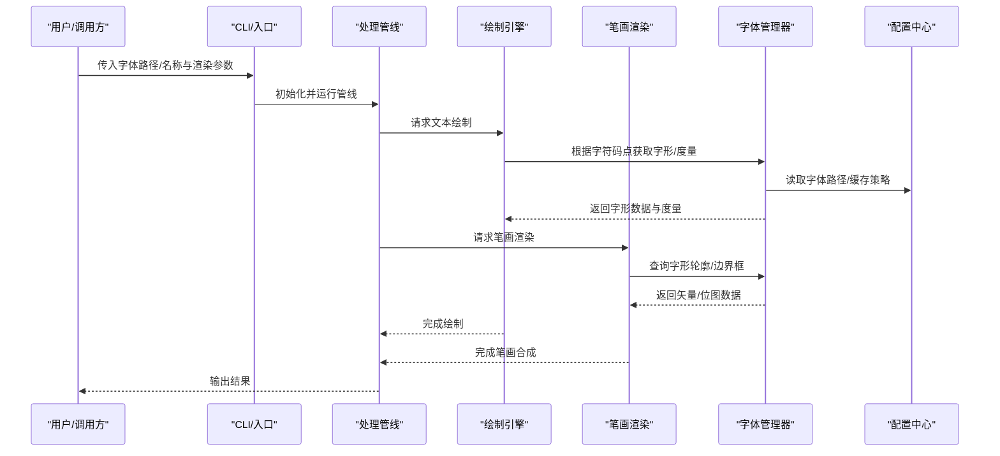
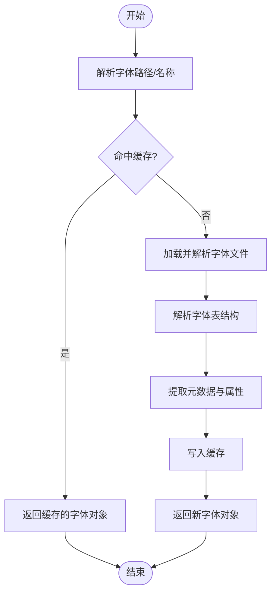
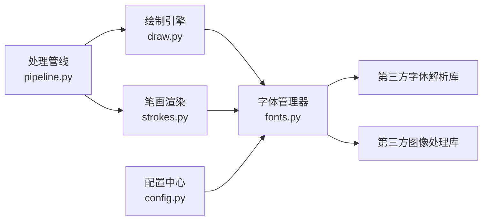

# 字体管理

<cite>
**本文引用的文件**   
- [fonts.py](file://zigge/fonts.py)
- [draw.py](file://zigge/draw.py)
- [strokes.py](file://zigge/strokes.py)
- [config.py](file://zigge/config.py)
- [pipeline.py](file://zigge/pipeline.py)
- [cli.py](file://zigge/cli.py)
- [__main__.py](file://zigge/__main__.py)
- [requirements.txt](file://requirements.txt)
</cite>

## 目录
1. [简介](#简介)
2. [项目结构](#项目结构)
3. [核心组件](#核心组件)
4. [架构总览](#架构总览)
5. [详细组件分析](#详细组件分析)
6. [依赖关系分析](#依赖关系分析)
7. [性能与内存优化](#性能与内存优化)
8. [故障排除与兼容性](#故障排除与兼容性)
9. [结论](#结论)
10. [附录：使用示例与最佳实践](#附录使用示例与最佳实践)

## 简介
本技术文档围绕“字体管理”子系统，系统阐述字体文件的加载机制、资源管理、属性提取、缓存策略、内存优化与性能调优，并说明与笔画渲染系统的集成方式及字体适配机制。文档同时提供故障排除与兼容性处理方案，帮助开发者在复杂环境下稳定地加载和使用自定义字体。

## 项目结构
本项目采用按功能模块划分的组织方式，字体相关能力集中在 fonts.py，并在绘制与笔画渲染流程中被调用；配置项集中于 config.py；CLI 与入口脚本负责参数解析与启动流程；依赖通过 requirements.txt 声明。

图表来源
- [cli.py](file://zigge/cli.py)
- [__main__.py](file://zigge/__main__.py)
- [pipeline.py](file://zigge/pipeline.py)
- [draw.py](file://zigge/draw.py)
- [strokes.py](file://zigge/strokes.py)
- [fonts.py](file://zigge/fonts.py)
- [config.py](file://zigge/config.py)
- [requirements.txt](file://requirements.txt)

章节来源
- [cli.py](file://zigge/cli.py)
- [__main__.py](file://zigge/__main__.py)
- [pipeline.py](file://zigge/pipeline.py)
- [draw.py](file://zigge/draw.py)
- [strokes.py](file://zigge/strokes.py)
- [fonts.py](file://zigge/fonts.py)
- [config.py](file://zigge/config.py)
- [requirements.txt](file://requirements.txt)

## 核心组件
- 字体管理器（fonts.py）：负责字体文件发现、加载、解析、缓存与属性提取，对外暴露统一的字体访问接口。
- 绘制引擎（draw.py）：将文本与字形绘制到画布，依赖字体管理器获取字形数据与度量信息。
- 笔画渲染（strokes.py）：基于矢量路径或位图进行笔画级渲染，需要精确的字形边界框、基线、字距等元数据。
- 配置中心（config.py）：集中管理字体路径、缓存策略、回退字体、缩放与抗锯齿等全局设置。
- 处理管线（pipeline.py）：编排 OCR、布局、绘制与导出流程，协调字体在不同阶段的消费。
- CLI 与入口（cli.py, __main__.py）：解析用户输入，初始化配置与管线，触发渲染任务。

章节来源
- [fonts.py](file://zigge/fonts.py)
- [draw.py](file://zigge/draw.py)
- [strokes.py](file://zigge/strokes.py)
- [config.py](file://zigge/config.py)
- [pipeline.py](file://zigge/pipeline.py)
- [cli.py](file://zigge/cli.py)
- [__main__.py](file://zigge/__main__.py)

## 架构总览
字体子系统作为基础设施被绘制与笔画渲染模块共同依赖，遵循“按需加载 + 缓存复用”的策略，避免重复解析与内存膨胀。

图表来源
- [cli.py](file://zigge/cli.py)
- [__main__.py](file://zigge/__main__.py)
- [pipeline.py](file://zigge/pipeline.py)
- [draw.py](file://zigge/draw.py)
- [strokes.py](file://zigge/strokes.py)
- [fonts.py](file://zigge/fonts.py)
- [config.py](file://zigge/config.py)

## 详细组件分析

### 字体管理器（fonts.py）
职责
- 字体发现与注册：扫描指定目录或系统字体路径，建立字体索引。
- 字体加载与解析：支持多种字体格式，解析表结构与元数据。
- 属性提取：提取字形轮廓、边界框、基线、字距、行高、字重、斜体等属性。
- 缓存与回收：对已加载字形与度量进行缓存，控制内存占用。
- 回退与兼容：当目标字符缺失时，自动回退到备用字体。

关键流程（加载与属性提取）

图表来源
- [fonts.py](file://zigge/fonts.py)

章节来源
- [fonts.py](file://zigge/fonts.py)

### 绘制引擎（draw.py）
职责
- 将文本与字形绘制到画布，计算布局与对齐。
- 从字体管理器获取字形图像或矢量路径，结合字号、缩放、抗锯齿等参数进行栅格化。
- 维护绘制上下文，处理颜色、透明度、变换矩阵等。

与字体子系统的交互
- 通过字体管理器查询字符对应的字形数据与度量。
- 根据字体元数据（如基线、行高）计算文本行间距与垂直对齐。

章节来源
- [draw.py](file://zigge/draw.py)

### 笔画渲染（strokes.py）
职责
- 基于矢量路径或位图进行笔画级渲染，支持描边、填充、连接与合并。
- 利用字体提供的字形轮廓与边界框信息进行精确定位与拼接。

与字体子系统的交互
- 向字体管理器请求字形轮廓与边界框，用于笔画定位与裁剪。
- 根据字体属性（如字重、斜体）调整笔画粗细与角度。

章节来源
- [strokes.py](file://zigge/strokes.py)

### 配置中心（config.py）
职责
- 集中管理字体路径、默认字体、回退字体列表。
- 定义缓存策略（最大条目数、过期时间、清理策略）。
- 提供全局开关（如是否启用抗锯齿、是否启用字形缓存）。

章节来源
- [config.py](file://zigge/config.py)

### 处理管线（pipeline.py）
职责
- 编排 OCR、布局、绘制与导出流程。
- 在合适阶段注入字体选择与替换逻辑。
- 协调各模块之间的数据传递与状态同步。

章节来源
- [pipeline.py](file://zigge/pipeline.py)

### CLI 与入口（cli.py, __main__.py）
职责
- 解析命令行参数（字体路径、字号、输出格式等）。
- 初始化配置与管线，触发渲染任务。
- 捕获异常并输出错误信息。

章节来源
- [cli.py](file://zigge/cli.py)
- [__main__.py](file://zigge/__main__.py)

## 依赖关系分析
字体子系统依赖第三方库以解析字体文件与进行图形操作；绘制与笔画渲染依赖字体子系统提供的字形与度量数据。

图表来源
- [fonts.py](file://zigge/fonts.py)
- [draw.py](file://zigge/draw.py)
- [strokes.py](file://zigge/strokes.py)
- [config.py](file://zigge/config.py)
- [pipeline.py](file://zigge/pipeline.py)
- [requirements.txt](file://requirements.txt)

章节来源
- [requirements.txt](file://requirements.txt)

## 性能与内存优化
- 字体缓存策略
  - 字形缓存：对常用字形进行缓存，减少重复解析与栅格化开销。
  - 度量缓存：缓存基线、行高、字距等度量信息，降低计算成本。
  - LRU 淘汰：按最近最少使用原则淘汰冷数据，控制内存峰值。
- 按需加载
  - 仅在首次访问某字符时加载对应字形，避免一次性加载全部字形。
- 批量处理
  - 对连续文本进行批量字形查找与绘制，减少函数调用与锁竞争。
- 矢量化优先
  - 尽可能使用矢量路径进行缩放与抗锯齿，减少位图放大失真。
- 并发安全
  - 对共享缓存加锁或使用线程局部存储，避免竞态条件。
- 内存监控
  - 定期统计缓存大小与命中率，动态调整策略。

[本节为通用指导，不直接分析具体文件]

## 故障排除与兼容性
常见问题
- 字体文件损坏或格式不支持
  - 现象：加载失败或解析异常。
  - 处理：记录日志并回退到默认字体；提示用户检查字体路径与权限。
- 字符缺失（缺字）
  - 现象：部分字符无法显示或显示为占位符。
  - 处理：启用回退字体链，依次尝试备用字体；记录缺失字符集合以便后续补充。
- 渲染错位或行高异常
  - 现象：文本重叠或行间距过大/过小。
  - 处理：校验字体元数据（基线、行高），必要时进行修正；检查缩放与抗锯齿参数。
- 内存溢出
  - 现象：长时间运行后内存持续增长。
  - 处理：检查缓存上限与清理策略；减少单次批处理规模；释放不再使用的字形。
- 跨平台差异
  - 现象：不同操作系统下字体路径或可用字体不一致。
  - 处理：抽象字体发现逻辑，提供平台适配；统一字体命名与版本管理。

章节来源
- [fonts.py](file://zigge/fonts.py)
- [draw.py](file://zigge/draw.py)
- [strokes.py](file://zigge/strokes.py)
- [config.py](file://zigge/config.py)

## 结论
字体管理系统通过统一的加载、解析、缓存与属性提取接口，为绘制与笔画渲染提供稳定可靠的基础能力。配合合理的缓存策略与内存优化，可在大规模文本渲染场景中保持高性能与低内存占用。通过回退机制与兼容性处理，系统在多平台与多字体环境下具备较强的鲁棒性。

[本节为总结性内容，不直接分析具体文件]

## 附录：使用示例与最佳实践
- 加载自定义字体
  - 步骤：在配置中指定字体路径或名称；通过字体管理器加载；在绘制或笔画渲染前确保已缓存常用字形。
  - 参考实现位置：[fonts.py](file://zigge/fonts.py)、[config.py](file://zigge/config.py)
- 在绘制中使用字体
  - 步骤：从字体管理器获取字形数据与度量；设置字号、缩放与抗锯齿；执行绘制。
  - 参考实现位置：[draw.py](file://zigge/draw.py)
- 在笔画渲染中使用字体
  - 步骤：查询字形轮廓与边界框；根据字重与斜体调整笔画参数；合成最终笔画。
  - 参考实现位置：[strokes.py](file://zigge/strokes.py)
- 性能调优建议
  - 启用字形与度量缓存；限制缓存大小；批量处理文本；优先使用矢量路径。
  - 参考实现位置：[fonts.py](file://zigge/fonts.py)、[config.py](file://zigge/config.py)
- 兼容性处理
  - 配置回退字体链；检测并记录缺失字符；对不同平台进行字体发现适配。
  - 参考实现位置：[fonts.py](file://zigge/fonts.py)、[config.py](file://zigge/config.py)

[本节为使用指南，不直接分析具体文件]