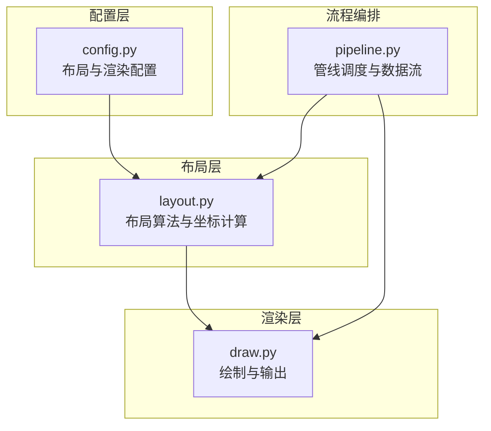
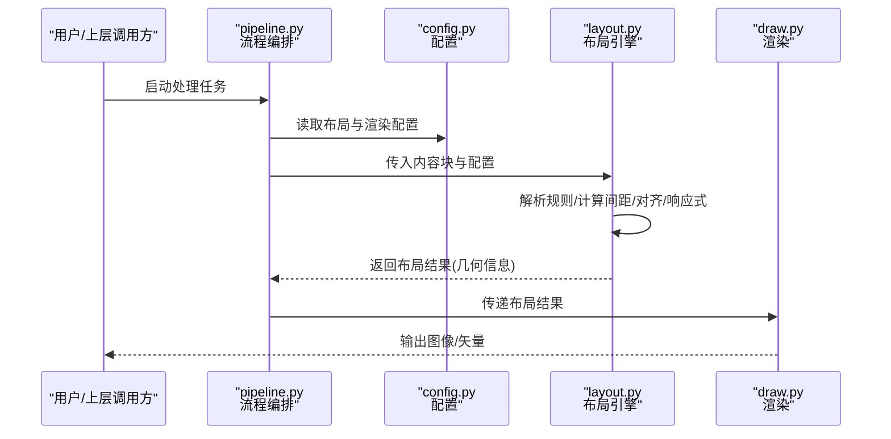
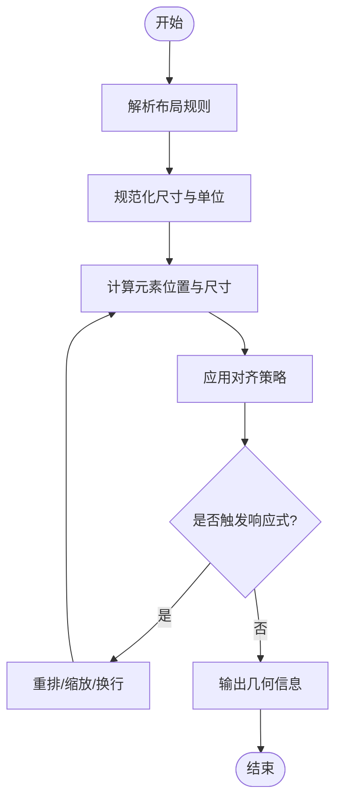
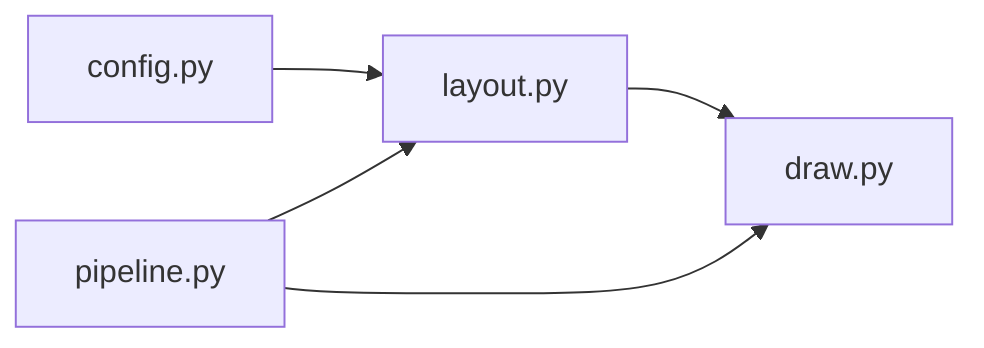

# 布局算法

<cite>
**本文引用的文件**   
- [layout.py](file://zige/layout.py)
- [config.py](file://zige/config.py)
- [draw.py](file://zige/draw.py)
- [pipeline.py](file://zige/pipeline.py)
</cite>

## 目录
1. [简介](#简介)
2. [项目结构](#项目结构)
3. [核心组件](#核心组件)
4. [架构总览](#架构总览)
5. [详细组件分析](#详细组件分析)
6. [依赖关系分析](#依赖关系分析)
7. [性能考虑](#性能考虑)
8. [故障排查指南](#故障排查指南)
9. [结论](#结论)
10. [附录](#附录)

## 简介
本技术文档聚焦于布局算法模块，系统阐述元素排列算法、坐标计算逻辑与响应式布局策略。文档覆盖布局规则定义、间距计算、对齐方式与自适应调整机制，并给出不同布局模式的配置选项与使用场景说明。同时解释与渲染系统的集成方式、性能考量以及自定义布局规则的扩展方法与最佳实践。

## 项目结构
本项目采用按功能划分的模块化组织方式，布局相关代码集中在 layout.py，配置项在 config.py，绘制/渲染在 draw.py，整体流程编排在 pipeline.py。

**图表来源**
- [layout.py:1-200](file://zige/layout.py#L1-L200)
- [config.py:1-200](file://zige/config.py#L1-L200)
- [draw.py:1-200](file://zige/draw.py#L1-L200)
- [pipeline.py:1-200](file://zige/pipeline.py#L1-L200)

**章节来源**
- [layout.py:1-200](file://zige/layout.py#L1-L200)
- [config.py:1-200](file://zige/config.py#L1-L200)
- [draw.py:1-200](file://zige/draw.py#L1-L200)
- [pipeline.py:1-200](file://zige/pipeline.py#L1-L200)

## 核心组件
- 布局引擎：负责解析布局规则、计算元素位置与尺寸、处理对齐与间距、执行响应式适配。
- 配置系统：提供布局模式、网格参数、边距、对齐策略等可配置项。
- 渲染接口：接收布局结果（几何信息）并调用绘图后端进行绘制。
- 流程编排：串联 OCR/文本处理、布局计算、渲染输出的完整管线。

**章节来源**
- [layout.py:1-200](file://zige/layout.py#L1-L200)
- [config.py:1-200](file://zige/config.py#L1-L200)
- [draw.py:1-200](file://zige/draw.py#L1-L200)
- [pipeline.py:1-200](file://zige/pipeline.py#L1-L200)

## 架构总览
下图展示布局算法在整体系统中的位置与交互关系：配置驱动布局引擎，布局引擎产出几何信息供渲染层使用；流程编排统一调度各阶段。

**图表来源**
- [pipeline.py:1-200](file://zige/pipeline.py#L1-L200)
- [config.py:1-200](file://zige/config.py#L1-L200)
- [layout.py:1-200](file://zige/layout.py#L1-L200)
- [draw.py:1-200](file://zige/draw.py#L1-L200)

## 详细组件分析

### 布局引擎（layout.py）
- 职责
  - 解析布局规则（如列数、行高、对齐方式、间距）。
  - 计算每个元素的坐标与尺寸（含基线对齐、垂直居中、水平对齐）。
  - 根据容器宽度/高度进行响应式重排（换行、缩放、溢出处理）。
  - 输出标准化几何对象（包含 x, y, width, height, baseline 等字段）。

- 关键流程
  - 输入：内容块列表 + 配置对象。
  - 预处理：规范化尺寸、单位换算、边界检查。
  - 布局计算：按行/列分配、计算间距、对齐修正。
  - 响应式：检测可用空间，触发重排或缩放策略。
  - 输出：布局结果集合，供渲染层消费。

**图表来源**
- [layout.py:1-200](file://zige/layout.py#L1-L200)

**章节来源**
- [layout.py:1-200](file://zige/layout.py#L1-L200)

### 配置系统（config.py）
- 职责
  - 定义布局模式（如单列、多列、网格、流式）。
  - 定义间距参数（内边距、外边距、行间距、列间距）。
  - 定义对齐策略（左对齐、居中、右对齐、两端对齐、基线对齐）。
  - 定义响应式断点与缩放策略（最小/最大宽度、比例缩放）。

- 典型配置项
  - 布局模式：控制元素排列方向与分组方式。
  - 间距：控制元素间距离与容器内边距。
  - 对齐：控制元素在行/列内的对齐方式。
  - 响应式：定义在不同容器尺寸下的行为。

**章节来源**
- [config.py:1-200](file://zige/config.py#L1-L200)

### 渲染接口（draw.py）
- 职责
  - 接收布局引擎输出的几何信息。
  - 将几何信息映射到具体绘图原语（矩形、路径、文本基线等）。
  - 支持多种输出格式（位图、矢量）。

- 集成要点
  - 坐标系统与像素精度处理。
  - 字体度量与基线对齐的精确绘制。
  - 批量绘制优化（减少状态切换、合并绘制命令）。

**章节来源**
- [draw.py:1-200](file://zige/draw.py#L1-L200)

### 流程编排（pipeline.py）
- 职责
  - 协调 OCR/文本处理、布局计算、渲染输出。
  - 管理中间数据结构与错误传播。
  - 提供统一的 API 入口与批处理能力。

- 数据流
  - 输入数据 → 预处理 → 布局计算 → 渲染 → 输出。

**章节来源**
- [pipeline.py:1-200](file://zige/pipeline.py#L1-L200)

## 依赖关系分析
布局模块依赖配置模块获取规则，并向渲染模块输出几何信息；流程编排作为中枢调度三者协作。

**图表来源**
- [layout.py:1-200](file://zige/layout.py#L1-L200)
- [config.py:1-200](file://zige/config.py#L1-L200)
- [draw.py:1-200](file://zige/draw.py#L1-L200)
- [pipeline.py:1-200](file://zige/pipeline.py#L1-L200)

**章节来源**
- [layout.py:1-200](file://zige/layout.py#L1-L200)
- [config.py:1-200](file://zige/config.py#L1-L200)
- [draw.py:1-200](file://zige/draw.py#L1-L200)
- [pipeline.py:1-200](file://zige/pipeline.py#L1-L200)

## 性能考虑
- 批量计算：对大量元素进行向量化或批处理以减少循环开销。
- 缓存策略：缓存已计算的度量与布局结果，避免重复计算。
- 增量更新：仅重算受影响的区域，降低重排成本。
- 绘制优化：合并绘制命令、减少状态切换、按需刷新。
- 内存管理：复用缓冲区、及时释放中间对象。

[本节为通用性能建议，不直接分析具体文件]

## 故障排查指南
- 布局错位
  - 检查对齐策略与基线设置是否正确。
  - 确认间距与边距配置未产生负值或异常大值。
- 响应式失效
  - 验证断点与容器尺寸匹配。
  - 检查缩放策略是否被正确触发。
- 渲染异常
  - 核对坐标系统与像素精度。
  - 检查字体度量与文本基线对齐。
- 性能问题
  - 定位热点函数与频繁重排区域。
  - 启用批处理与缓存策略。

**章节来源**
- [layout.py:1-200](file://zige/layout.py#L1-L200)
- [draw.py:1-200](file://zige/draw.py#L1-L200)

## 结论
布局算法模块通过清晰的职责划分与良好的扩展点，实现了灵活的元素排列、精确的坐标计算与稳健的响应式策略。配合配置系统与渲染接口，可在多种场景下实现一致的布局效果。遵循本文的最佳实践与性能建议，可进一步提升稳定性与效率。

[本节为总结性内容，不直接分析具体文件]

## 附录

### 布局模式与使用场景
- 单列布局：适合长文阅读、移动端纵向排版。
- 多列布局：适合杂志风格、桌面端分栏排版。
- 网格布局：适合卡片、图片墙等规整阵列。
- 流式布局：适合自适应内容、动态长度文本。

[本节为概念性说明，不直接分析具体文件]

### 自定义布局规则扩展方法
- 继承布局基类或实现布局接口，注入自定义排列逻辑。
- 在配置中注册自定义规则名称与默认参数。
- 在流程编排中接入自定义布局阶段。

[本节为概念性说明，不直接分析具体文件]

### 代码示例路径（以源码引用代替代码片段）
- 布局引擎主流程与坐标计算参考：[layout.py:1-200](file://zige/layout.py#L1-L200)
- 配置项定义与默认值参考：[config.py:1-200](file://zige/config.py#L1-L200)
- 渲染绘制与基线对齐参考：[draw.py:1-200](file://zige/draw.py#L1-L200)
- 流程编排与数据流转参考：[pipeline.py:1-200](file://zige/pipeline.py#L1-L200)