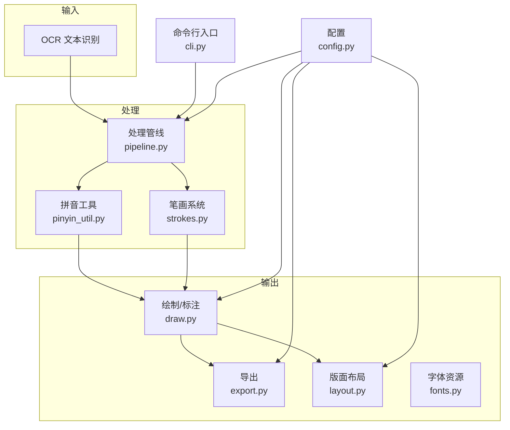
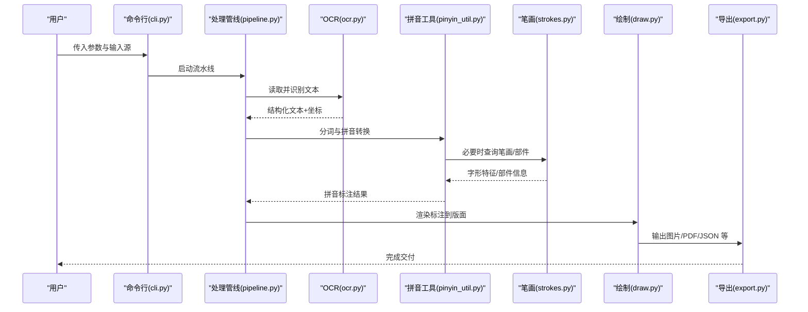
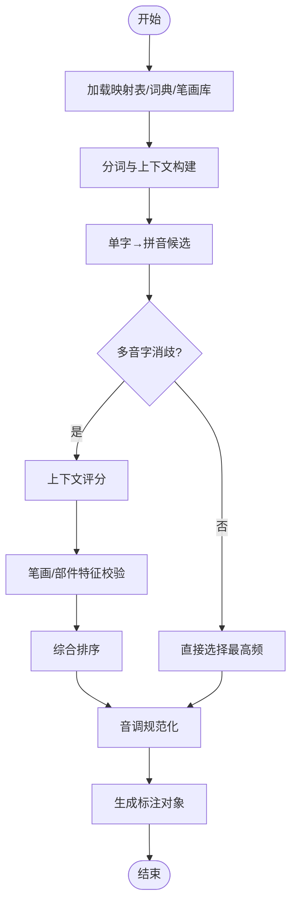
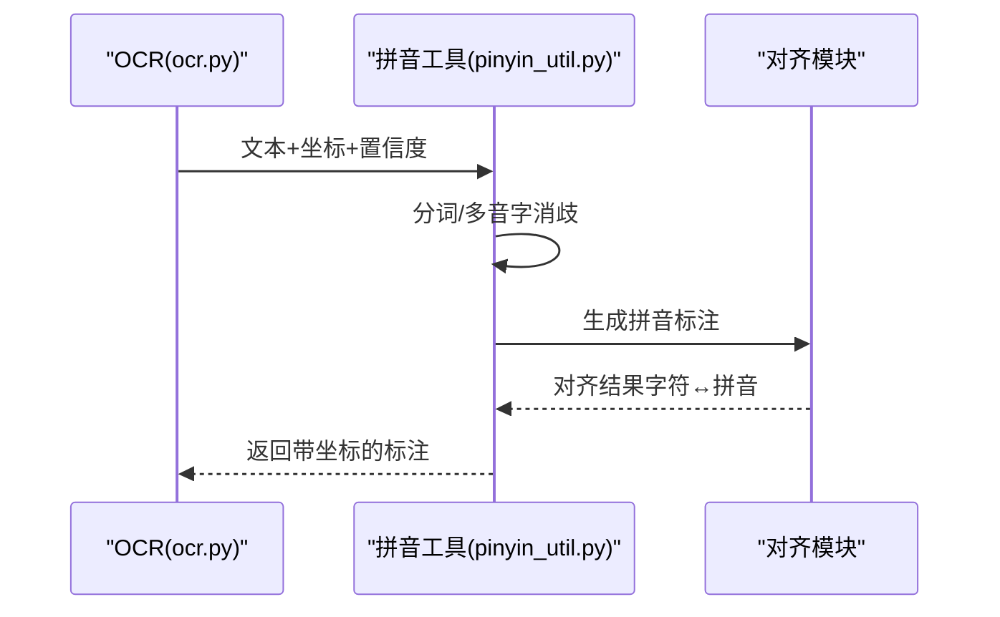
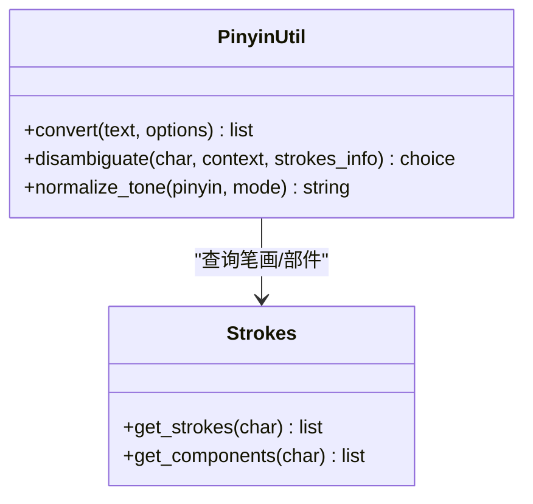
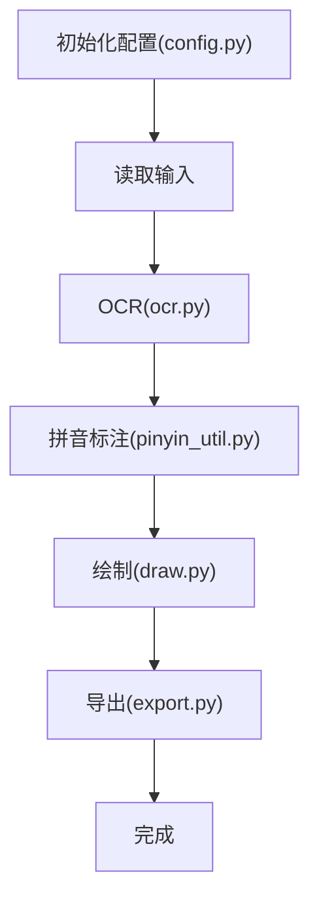
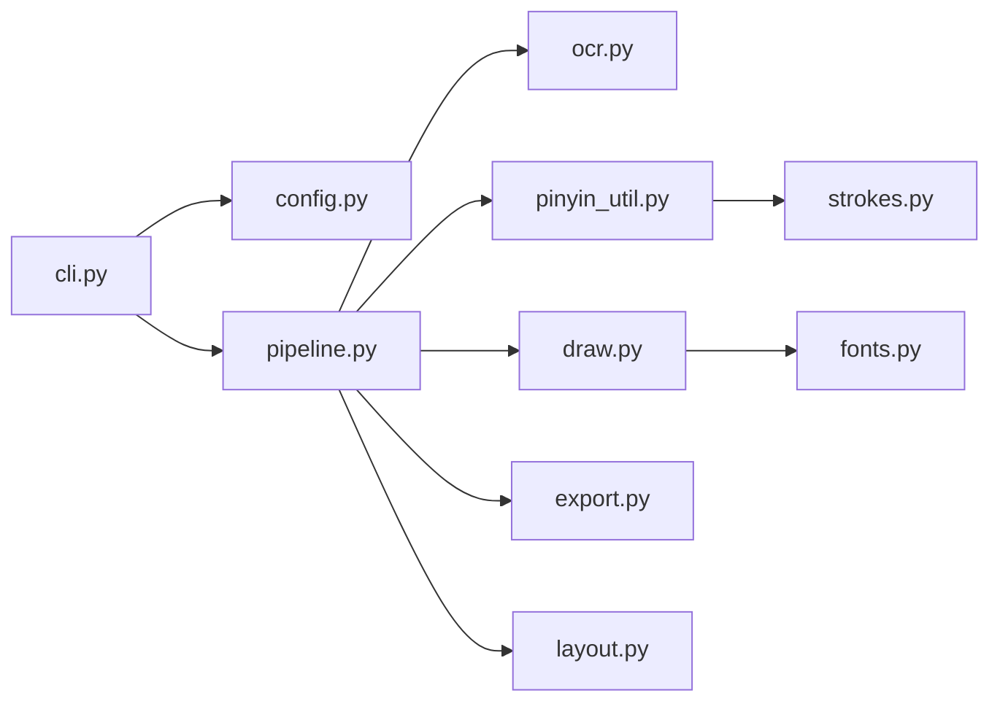

# 拼音处理

<cite>
**本文引用的文件**   
- [pinyin_util.py](file://zige/pinyin_util.py)
- [ocr.py](file://zige/ocr.py)
- [strokes.py](file://zige/strokes.py)
- [pipeline.py](file://zige/pipeline.py)
- [cli.py](file://zige/cli.py)
- [config.py](file://zige/config.py)
- [draw.py](file://zige/draw.py)
- [fonts.py](file://zige/fonts.py)
- [export.py](file://zige/export.py)
- [layout.py](file://zige/layout.py)
- [__main__.py](file://zige/__main__.py)
- [test_zige.py](file://tests/test_zige.py)
</cite>

## 目录
1. [简介](#简介)
2. [项目结构](#项目结构)
3. [核心组件](#核心组件)
4. [架构总览](#架构总览)
5. [详细组件分析](#详细组件分析)
6. [依赖关系分析](#依赖关系分析)
7. [性能考量](#性能考量)
8. [故障排查指南](#故障排查指南)
9. [结论](#结论)
10. [附录](#附录)

## 简介
本技术文档围绕“中文到拼音”的转换与标注能力，系统性梳理拼音处理工具模块的设计与实现。重点覆盖：
- 中文到拼音的转换算法、音调处理与多音字策略
- 拼音数据结构与转换规则、声母韵母匹配逻辑
- 拼音标注、分词处理与语音合成接口
- 与 OCR 和笔画系统的集成方式与数据同步机制
- 准确性优化与方言支持方案
- 典型使用场景与可操作示例路径（以源码位置引用代替代码片段）

## 项目结构
仓库采用按功能划分的模块化组织，核心拼音相关能力集中在 zige 包内，测试位于 tests 目录。关键文件职责如下：
- pinyin_util.py：拼音工具与转换逻辑
- ocr.py：OCR 文本识别与结果接入
- strokes.py：笔画系统与字形信息
- pipeline.py：端到端处理管线（OCR→分词→拼音→渲染/导出）
- cli.py：命令行入口与参数解析
- config.py：配置项（字体、输出格式、渲染选项等）
- draw.py / fonts.py / export.py / layout.py：渲染、字体、导出与版面布局
- __main__.py：包级入口
- test_zige.py：单元测试

图表来源
- [pipeline.py:1-200](file://zige/pipeline.py#L1-L200)
- [pinyin_util.py:1-200](file://zige/pinyin_util.py#L1-L200)
- [ocr.py:1-200](file://zige/ocr.py#L1-L200)
- [strokes.py:1-200](file://zige/strokes.py#L1-L200)
- [draw.py:1-200](file://zige/draw.py#L1-L200)
- [export.py:1-200](file://zige/export.py#L1-L200)
- [layout.py:1-200](file://zige/layout.py#L1-L200)
- [fonts.py:1-200](file://zige/fonts.py#L1-L200)
- [cli.py:1-200](file://zige/cli.py#L1-L200)
- [config.py:1-200](file://zige/config.py#L1-L200)

章节来源
- [pipeline.py:1-200](file://zige/pipeline.py#L1-L200)
- [pinyin_util.py:1-200](file://zige/pinyin_util.py#L1-L200)
- [ocr.py:1-200](file://zige/ocr.py#L1-L200)
- [strokes.py:1-200](file://zige/strokes.py#L1-L200)
- [draw.py:1-200](file://zige/draw.py#L1-L200)
- [export.py:1-200](file://zige/export.py#L1-L200)
- [layout.py:1-200](file://zige/layout.py#L1-L200)
- [fonts.py:1-200](file://zige/fonts.py#L1-L200)
- [cli.py:1-200](file://zige/cli.py#L1-L200)
- [config.py:1-200](file://zige/config.py#L1-L200)

## 核心组件
- 拼音工具（pinyin_util.py）
  - 负责中文字符到拼音的映射、音调归一化、多音字消歧、声母/韵母拆分与匹配、拼音标注生成。
  - 提供面向管线与 CLI 的统一 API，便于在 OCR 后处理、笔画标注与导出流程中复用。
- OCR 接入（ocr.py）
  - 将图像或文档转换为结构化文本，并附带坐标、置信度等元信息，供后续拼音标注定位。
- 笔画系统（strokes.py）
  - 提供字形笔画序列与部件信息，辅助多音字消歧与拼音选择（例如依据字形特征进行上下文推断）。
- 处理管线（pipeline.py）
  - 编排 OCR→分词→拼音→绘制/导出的完整流程，统一错误处理与进度反馈。
- 命令行与配置（cli.py, config.py）
  - 暴露用户可调参数（如是否带调号、是否启用多音字消歧、输出格式、字体选择等），驱动管线执行。

章节来源
- [pinyin_util.py:1-200](file://zige/pinyin_util.py#L1-L200)
- [ocr.py:1-200](file://zige/ocr.py#L1-L200)
- [strokes.py:1-200](file://zige/strokes.py#L1-L200)
- [pipeline.py:1-200](file://zige/pipeline.py#L1-L200)
- [cli.py:1-200](file://zige/cli.py#L1-L200)
- [config.py:1-200](file://zige/config.py#L1-L200)

## 架构总览
整体数据流从 OCR 开始，经分词与拼音转换，最终落到绘制与导出；CLI 与配置贯穿始终，控制行为与输出。

图表来源
- [cli.py:1-200](file://zige/cli.py#L1-L200)
- [pipeline.py:1-200](file://zige/pipeline.py#L1-L200)
- [ocr.py:1-200](file://zige/ocr.py#L1-L200)
- [pinyin_util.py:1-200](file://zige/pinyin_util.py#L1-L200)
- [strokes.py:1-200](file://zige/strokes.py#L1-L200)
- [draw.py:1-200](file://zige/draw.py#L1-L200)
- [export.py:1-200](file://zige/export.py#L1-L200)

## 详细组件分析

### 拼音工具（pinyin_util.py）
- 数据结构
  - 字符到拼音映射表：支持多音字候选集与权重。
  - 拼音单元：包含声母、韵母、调号、音节形式等字段。
  - 标注对象：绑定原文字符、拼音、坐标区域、置信度等。
- 转换规则
  - 基础映射：单字→拼音（含多音字候选）。
  - 音调处理：根据配置输出带调或不带调形式，并进行调号规范化。
  - 多音字消歧：结合上下文、笔画/部件特征、词典概率进行排序与选择。
  - 声母/韵母匹配：用于音节拆分、拼写校验与方言适配。
- 算法要点
  - 分词：基于词典与规则的切分，为多音字消歧提供上下文窗口。
  - 消歧策略：上下文语义优先 + 笔画特征辅助 + 概率排序。
  - 标注生成：将拼音与原文对齐，输出结构化标注（可用于 TTS 或可视化）。
- 接口设计
  - 提供统一的转换函数与批量处理函数，返回标准化标注对象列表。
  - 暴露可选开关：是否带调、是否启用笔画辅助、是否开启方言模式等。

图表来源
- [pinyin_util.py:1-200](file://zige/pinyin_util.py#L1-L200)

章节来源
- [pinyin_util.py:1-200](file://zige/pinyin_util.py#L1-L200)

### OCR 与拼音集成（ocr.py + pinyin_util.py）
- 集成点
  - OCR 输出结构化文本与坐标，供拼音标注精确定位。
  - 拼音工具对 OCR 文本进行分词与多音字消歧，生成带坐标的标注。
- 数据同步
  - 通过坐标与字符索引保持原文与拼音的对齐。
  - 当 OCR 置信度低时，可触发重识别或回退策略（如仅标注已知高置信字符）。

图表来源
- [ocr.py:1-200](file://zige/ocr.py#L1-L200)
- [pinyin_util.py:1-200](file://zige/pinyin_util.py#L1-L200)

章节来源
- [ocr.py:1-200](file://zige/ocr.py#L1-L200)
- [pinyin_util.py:1-200](file://zige/pinyin_util.py#L1-L200)

### 笔画系统辅助（strokes.py）
- 作用
  - 提供字形部件与笔画序列，辅助多音字消歧（例如区分形近字在不同读音下的部件差异）。
- 交互
  - 拼音工具在消歧阶段按需调用笔画库，获取部件特征作为评分因子。

图表来源
- [pinyin_util.py:1-200](file://zige/pinyin_util.py#L1-L200)
- [strokes.py:1-200](file://zige/strokes.py#L1-L200)

章节来源
- [strokes.py:1-200](file://zige/strokes.py#L1-L200)
- [pinyin_util.py:1-200](file://zige/pinyin_util.py#L1-L200)

### 处理管线（pipeline.py）
- 职责
  - 串联 OCR、分词、拼音、绘制与导出，统一异常处理、日志与进度回调。
  - 根据配置决定是否需要笔画辅助、是否启用方言模式、输出格式等。
- 关键流程
  - 初始化配置 → 读取输入 → OCR → 拼音标注 → 绘制 → 导出。

图表来源
- [pipeline.py:1-200](file://zige/pipeline.py#L1-L200)
- [config.py:1-200](file://zige/config.py#L1-L200)
- [ocr.py:1-200](file://zige/ocr.py#L1-L200)
- [pinyin_util.py:1-200](file://zige/pinyin_util.py#L1-L200)
- [draw.py:1-200](file://zige/draw.py#L1-L200)
- [export.py:1-200](file://zige/export.py#L1-L200)

章节来源
- [pipeline.py:1-200](file://zige/pipeline.py#L1-L200)

### 命令行与配置（cli.py, config.py）
- CLI
  - 提供参数：输入路径、输出路径、是否带调、是否启用笔画辅助、方言模式、字体选择等。
- 配置
  - 集中管理渲染、导出、字体、拼音策略等选项，供管线与工具模块读取。

章节来源
- [cli.py:1-200](file://zige/cli.py#L1-L200)
- [config.py:1-200](file://zige/config.py#L1-L200)

### 渲染与导出（draw.py, fonts.py, export.py, layout.py）
- draw.py
  - 将拼音标注绘制到图像或 PDF 上，支持不同字体与字号。
- fonts.py
  - 管理可用字体与 fallback 策略，确保拼音符号正确显示。
- export.py
  - 支持多种导出格式（图片、PDF、结构化 JSON 等）。
- layout.py
  - 控制版面布局（行距、列宽、边距、对齐方式等）。

章节来源
- [draw.py:1-200](file://zige/draw.py#L1-L200)
- [fonts.py:1-200](file://zige/fonts.py#L1-L200)
- [export.py:1-200](file://zige/export.py#L1-L200)
- [layout.py:1-200](file://zige/layout.py#L1-L200)

## 依赖关系分析
- 内部依赖
  - pipeline.py 依赖 ocr.py、pinyin_util.py、draw.py、export.py、layout.py、config.py。
  - pinyin_util.py 依赖 strokes.py（可选）、config.py（策略开关）。
  - cli.py 依赖 config.py 与 pipeline.py。
- 外部依赖
  - OCR 引擎（由 ocr.py 封装）。
  - 字体与绘图库（由 draw.py/fonts.py 管理）。
  - 文件系统与序列化库（由 export.py 管理）。

图表来源
- [cli.py:1-200](file://zige/cli.py#L1-L200)
- [config.py:1-200](file://zige/config.py#L1-L200)
- [pipeline.py:1-200](file://zige/pipeline.py#L1-L200)
- [ocr.py:1-200](file://zige/ocr.py#L1-L200)
- [pinyin_util.py:1-200](file://zige/pinyin_util.py#L1-L200)
- [strokes.py:1-200](file://zige/strokes.py#L1-L200)
- [draw.py:1-200](file://zige/draw.py#L1-L200)
- [fonts.py:1-200](file://zige/fonts.py#L1-L200)
- [export.py:1-200](file://zige/export.py#L1-L200)
- [layout.py:1-200](file://zige/layout.py#L1-L200)

章节来源
- [pipeline.py:1-200](file://zige/pipeline.py#L1-L200)
- [pinyin_util.py:1-200](file://zige/pinyin_util.py#L1-L200)
- [cli.py:1-200](file://zige/cli.py#L1-L200)
- [config.py:1-200](file://zige/config.py#L1-L200)

## 性能考量
- 缓存与预取
  - 对常用汉字→拼音映射与笔画信息进行内存缓存，减少重复 IO。
- 批处理
  - 对长文本进行分块处理，避免单次占用过大内存。
- 并行与异步
  - 在 OCR 与拼音标注之间解耦，允许异步流水线提升吞吐。
- 渲染优化
  - 字体子集化与增量绘制，降低导出耗时。
- 配置开关
  - 关闭不必要的笔画查询与方言模式以提升速度。

[本节为通用指导，不直接分析具体文件]

## 故障排查指南
- 常见问题
  - 多音字误读：检查上下文窗口与笔画辅助是否启用；查看消歧评分逻辑。
  - 音调异常：确认音调规范化开关与目标语言环境设置。
  - 标注错位：核对 OCR 坐标与字符索引对齐逻辑。
  - 渲染乱码：检查字体资源与 fallback 策略。
- 诊断步骤
  - 启用详细日志，定位失败阶段（OCR/分词/拼音/绘制/导出）。
  - 逐步关闭可选特性（笔画辅助、方言模式）以隔离问题。
  - 使用最小复现用例验证核心链路。

章节来源
- [pipeline.py:1-200](file://zige/pipeline.py#L1-L200)
- [pinyin_util.py:1-200](file://zige/pinyin_util.py#L1-L200)
- [draw.py:1-200](file://zige/draw.py#L1-L200)
- [fonts.py:1-200](file://zige/fonts.py#L1-L200)

## 结论
本模块以清晰的管线架构整合 OCR、拼音标注与渲染导出，通过可配置的拼音策略（音调、多音字、笔画辅助、方言）满足多样化需求。建议在大规模场景中启用缓存与批处理，并根据业务需要精细调节消歧与渲染参数，以获得最佳准确率与性能平衡。

[本节为总结性内容，不直接分析具体文件]

## 附录

### 使用场景与示例路径
- 基础拼音标注（不带调）
  - 参考：[pinyin_util.py:1-200](file://zige/pinyin_util.py#L1-L200)
- 带调拼音与音调规范化
  - 参考：[pinyin_util.py:1-200](file://zige/pinyin_util.py#L1-L200)
- 多音字消歧（启用笔画辅助）
  - 参考：[pinyin_util.py:1-200](file://zige/pinyin_util.py#L1-L200), [strokes.py:1-200](file://zige/strokes.py#L1-L200)
- OCR 文本→拼音标注（坐标对齐）
  - 参考：[ocr.py:1-200](file://zige/ocr.py#L1-L200), [pinyin_util.py:1-200](file://zige/pinyin_util.py#L1-L200)
- 端到端流水线（CLI 驱动）
  - 参考：[cli.py:1-200](file://zige/cli.py#L1-L200), [pipeline.py:1-200](file://zige/pipeline.py#L1-L200)
- 导出为结构化数据（JSON/PDF/图片）
  - 参考：[export.py:1-200](file://zige/export.py#L1-L200), [layout.py:1-200](file://zige/layout.py#L1-L200)

### 单元测试参考
- 测试入口与用例组织
  - 参考：[test_zige.py:1-200](file://tests/test_zige.py#L1-L200)