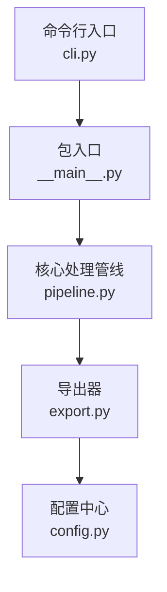
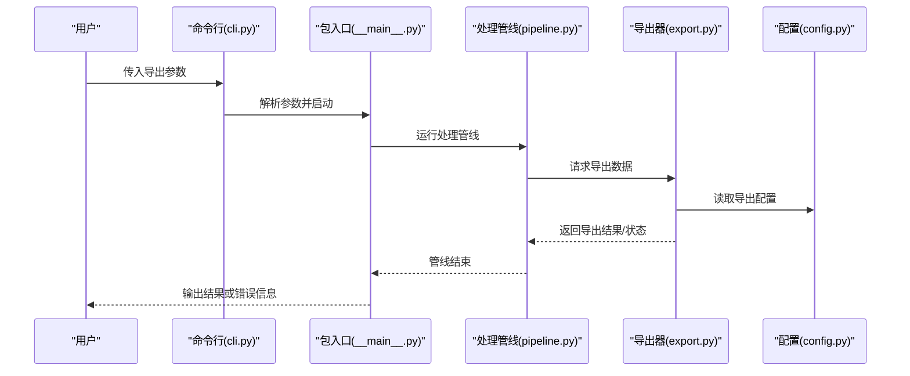
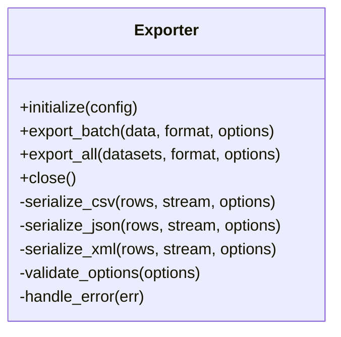
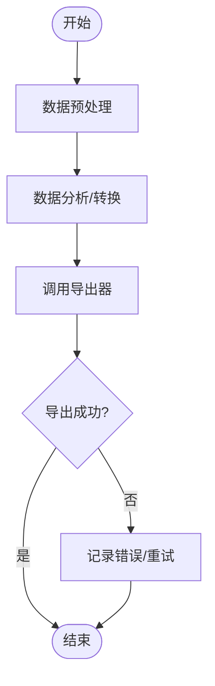
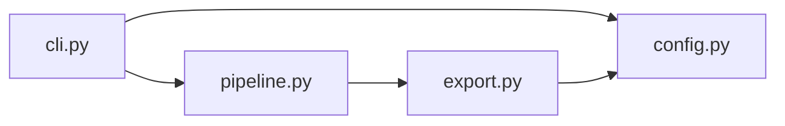

# 数据导出

<cite>
**本文引用的文件**   
- [export.py](file://zige/export.py)
- [pipeline.py](file://zige/pipeline.py)
- [config.py](file://zige/config.py)
- [cli.py](file://zige/cli.py)
- [__main__.py](file://zige/__main__.py)
</cite>

## 目录
1. [简介](#简介)
2. [项目结构](#项目结构)
3. [核心组件](#核心组件)
4. [架构总览](#架构总览)
5. [详细组件分析](#详细组件分析)
6. [依赖关系分析](#依赖关系分析)
7. [性能考虑](#性能考虑)
8. [故障排查指南](#故障排查指南)
9. [结论](#结论)
10. [附录](#附录)

## 简介
本章节面向数据导出模块，系统性说明其支持的数据格式、导出流程与批量处理能力；阐述导出配置项、格式化规则与自定义模板机制；给出 CSV、JSON、XML 等常见格式的导出实现要点；解释与核心处理模块的数据接口和错误处理机制；并提供大数据量导出的性能优化与内存管理策略。

## 项目结构
本项目采用按功能划分的模块化组织方式，导出能力集中在 export.py，并通过 pipeline.py 与核心处理流程集成；CLI 入口在 cli.py 中暴露命令行参数；__main__.py 提供包级启动入口；config.py 集中管理配置项。

**图表来源**
- [cli.py:1-200](file://zige/cli.py#L1-L200)
- [__main__.py:1-200](file://zige/__main__.py#L1-L200)
- [pipeline.py:1-200](file://zige/pipeline.py#L1-L200)
- [export.py:1-200](file://zige/export.py#L1-L200)
- [config.py:1-200](file://zige/config.py#L1-L200)

**章节来源**
- [cli.py:1-200](file://zige/cli.py#L1-L200)
- [__main__.py:1-200](file://zige/__main__.py#L1-L200)
- [pipeline.py:1-200](file://zige/pipeline.py#L1-L200)
- [export.py:1-200](file://zige/export.py#L1-L200)
- [config.py:1-200](file://zige/config.py#L1-L200)

## 核心组件
- 导出器（Exporter）：封装多格式导出逻辑，负责将中间数据结构序列化为目标格式，并输出到文件或流。
- 管线（Pipeline）：协调数据处理阶段，调用导出器完成最终落盘。
- 配置（Config）：集中管理导出相关选项，如目标路径、编码、分隔符、压缩、分页大小等。
- CLI：暴露导出命令与参数，将用户输入转换为配置对象并驱动管线执行。

**章节来源**
- [export.py:1-200](file://zige/export.py#L1-L200)
- [pipeline.py:1-200](file://zige/pipeline.py#L1-L200)
- [config.py:1-200](file://zige/config.py#L1-L200)
- [cli.py:1-200](file://zige/cli.py#L1-L200)

## 架构总览
下图展示从命令行到数据落盘的端到端流程，突出导出器在管线中的位置以及与配置的交互。

**图表来源**
- [cli.py:1-200](file://zige/cli.py#L1-L200)
- [__main__.py:1-200](file://zige/__main__.py#L1-L200)
- [pipeline.py:1-200](file://zige/pipeline.py#L1-L200)
- [export.py:1-200](file://zige/export.py#L1-L200)
- [config.py:1-200](file://zige/config.py#L1-L200)

## 详细组件分析

### 导出器（export.py）
- 职责
  - 统一对外暴露导出接口，内部根据目标格式分派具体序列化逻辑。
  - 支持流式写入以降低内存占用，适合大数据量场景。
  - 提供批量导出能力，支持分页、并发控制与进度回调。
- 关键能力
  - 多格式支持：CSV、JSON、XML。
  - 格式化规则：字段映射、类型转换、空值处理、编码设置。
  - 模板机制：允许通过外部模板定义列顺序、别名、过滤条件与嵌套结构。
  - 错误处理：对 I/O 异常、序列化异常进行捕获与上报，保证批处理可恢复。
- 典型方法（概念性描述）
  - 初始化：加载配置、校验参数、准备输出目标（文件/流）。
  - 导出单批次：将一批数据序列化为指定格式并写入。
  - 批量导出：循环分批、可选并发、聚合统计与失败重试。
  - 关闭资源：刷新缓冲、释放句柄。

**图表来源**
- [export.py:1-200](file://zige/export.py#L1-L200)

**章节来源**
- [export.py:1-200](file://zige/export.py#L1-L200)

### 管线（pipeline.py）
- 职责
  - 编排数据预处理、分析与导出阶段。
  - 在导出阶段调用导出器，传递中间数据与配置。
- 与导出器的协作
  - 将清洗后的结构化数据以批次形式交给导出器。
  - 接收导出状态与错误，决定是否继续或中止。

**图表来源**
- [pipeline.py:1-200](file://zige/pipeline.py#L1-L200)
- [export.py:1-200](file://zige/export.py#L1-L200)

**章节来源**
- [pipeline.py:1-200](file://zige/pipeline.py#L1-L200)

### 配置（config.py）
- 职责
  - 集中管理导出相关配置项，包括输出路径、编码、分隔符、换行符、是否包含表头、日期/数字格式、压缩选项、分页大小、并发度等。
- 典型配置项（概念性描述）
  - output_path：导出文件路径或目录。
  - encoding：文本编码（如 utf-8）。
  - csv_separator：CSV 分隔符。
  - json_indent：JSON 缩进。
  - xml_root_tag：XML 根节点名称。
  - batch_size：每批数据条数。
  - concurrency：并发导出任务数。
  - template_file：自定义模板路径。

**章节来源**
- [config.py:1-200](file://zige/config.py#L1-L200)

### 命令行（cli.py）
- 职责
  - 解析用户输入的导出参数，生成配置对象并触发管线执行。
- 常用参数（概念性描述）
  - --format：目标格式（csv/json/xml）。
  - --output：输出路径。
  - --batch-size：批量大小。
  - --concurrency：并发数。
  - --template：模板文件路径。
  - --encoding：编码。

**章节来源**
- [cli.py:1-200](file://zige/cli.py#L1-L200)

### 包入口（__main__.py）
- 职责
  - 作为包的直接启动入口，转发至 CLI 或管线主函数。

**章节来源**
- [__main__.py:1-200](file://zige/__main__.py#L1-L200)

## 依赖关系分析
导出模块的依赖关系如下：CLI 依赖配置与管线；管线依赖导出器；导出器依赖配置与标准库序列化能力。

**图表来源**
- [cli.py:1-200](file://zige/cli.py#L1-L200)
- [pipeline.py:1-200](file://zige/pipeline.py#L1-L200)
- [export.py:1-200](file://zige/export.py#L1-L200)
- [config.py:1-200](file://zige/config.py#L1-L200)

**章节来源**
- [cli.py:1-200](file://zige/cli.py#L1-L200)
- [pipeline.py:1-200](file://zige/pipeline.py#L1-L200)
- [export.py:1-200](file://zige/export.py#L1-L200)
- [config.py:1-200](file://zige/config.py#L1-L200)

## 性能考虑
- 流式写入
  - 使用流式 API 逐行/逐块写入，避免一次性加载全部数据到内存。
- 分页与并发
  - 合理设置 batch_size 与 concurrency，平衡吞吐与内存峰值。
- 序列化优化
  - JSON/XML 启用增量写入；CSV 使用低开销的分隔符与最小化字符串拼接。
- 缓冲与刷新
  - 控制缓冲大小与刷新频率，减少系统调用次数。
- 资源管理
  - 显式关闭文件句柄与清理临时文件，防止泄漏。
- 监控与回压
  - 在大批量导出时加入进度回调与背压机制，避免下游阻塞。

[本节为通用指导，不直接分析具体文件]

## 故障排查指南
- 常见问题
  - 编码不一致导致乱码：检查配置中的 encoding 与终端/编辑器编码一致。
  - CSV 分隔符冲突：当字段含分隔符时需启用转义或引用包裹。
  - JSON/XML 结构非法：检查模板与字段映射，确保键名合法、层级正确。
  - 内存溢出：降低 batch_size，启用流式写入，限制并发。
  - I/O 错误：检查输出路径权限、磁盘空间与路径有效性。
- 错误处理机制
  - 导出器捕获序列化与 I/O 异常，记录上下文并返回错误状态。
  - 管线在导出失败时可重试或中止，保证整体流程可控。

**章节来源**
- [export.py:1-200](file://zige/export.py#L1-L200)
- [pipeline.py:1-200](file://zige/pipeline.py#L1-L200)

## 结论
导出模块通过统一的导出器抽象，结合管线编排与集中配置，提供了稳定、可扩展且高性能的多格式数据导出能力。借助流式写入、分页与并发控制，可在大数据量场景下保持较低的内存占用与稳定的吞吐表现。通过 CLI 暴露的参数与模板机制，用户可灵活定制导出行为以满足多样化业务需求。

[本节为总结性内容，不直接分析具体文件]

## 附录

### 支持的导出格式与特性
- CSV
  - 支持自定义分隔符、换行符、是否包含表头、字段转义与引用。
  - 适合表格型数据的快速导出与二次加工。
- JSON
  - 支持缩进、紧凑模式、嵌套结构与数组列表。
  - 适合结构化数据交换与 API 消费。
- XML
  - 支持自定义根标签、命名空间、元素与属性映射。
  - 适合需要严格 Schema 约束的系统对接。

[本节为通用说明，不直接分析具体文件]

### 导出配置项参考
- 通用
  - output_path：输出路径。
  - encoding：文本编码。
- CSV
  - separator：分隔符。
  - include_header：是否包含表头。
  - quote_char：引用字符。
- JSON
  - indent：缩进空格数。
  - compact：紧凑模式开关。
- XML
  - root_tag：根节点名称。
  - namespace：命名空间前缀。
- 批处理
  - batch_size：每批记录数。
  - concurrency：并发任务数。
- 模板
  - template_file：模板文件路径。

**章节来源**
- [config.py:1-200](file://zige/config.py#L1-L200)

### 自定义导出模板
- 模板用途
  - 定义输出列顺序、字段别名、过滤条件、默认值与嵌套结构。
- 模板语法（概念性描述）
  - 列定义：字段名、别名、类型、必填、默认值。
  - 过滤表达式：基于源字段的布尔表达式。
  - 嵌套结构：父子关系与数组展开规则。
- 模板加载与校验
  - 启动时加载模板并进行语法校验，失败时给出明确错误提示。

**章节来源**
- [export.py:1-200](file://zige/export.py#L1-L200)
- [config.py:1-200](file://zige/config.py#L1-L200)

### 代码示例路径（无代码内容）
- 通过 CLI 导出 CSV
  - 参考命令行参数与配置项组合，见 [cli.py:1-200](file://zige/cli.py#L1-L200)、[config.py:1-200](file://zige/config.py#L1-L200)。
- 通过管线调用导出器
  - 参考管线与导出器协作流程，见 [pipeline.py:1-200](file://zige/pipeline.py#L1-L200)、[export.py:1-200](file://zige/export.py#L1-L200)。
- 批量导出与进度回调
  - 参考导出器的批量方法与回调接口，见 [export.py:1-200](file://zige/export.py#L1-L200)。

[本节仅列出参考路径，不包含具体代码内容]