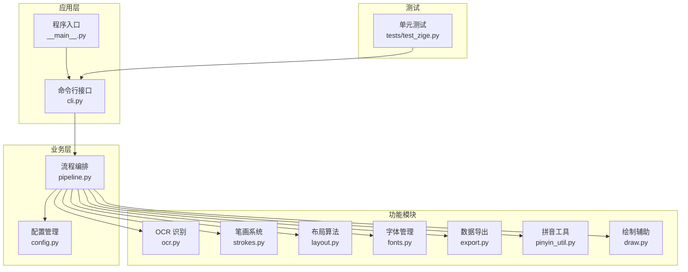
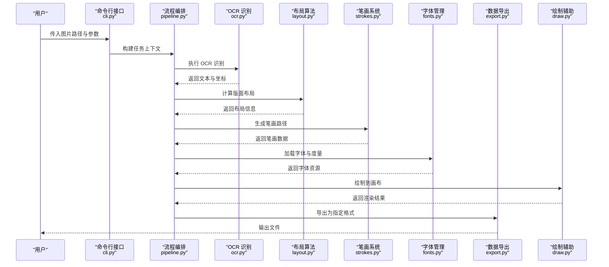
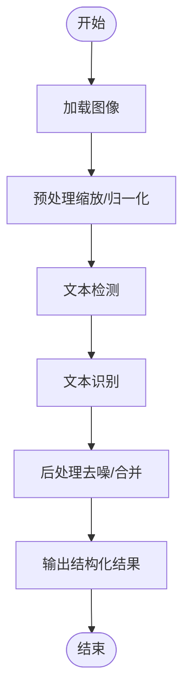
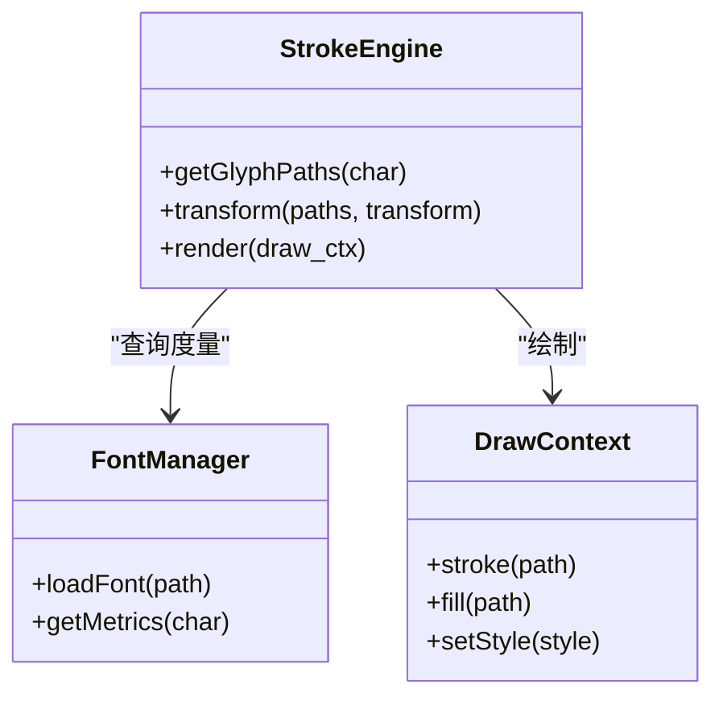
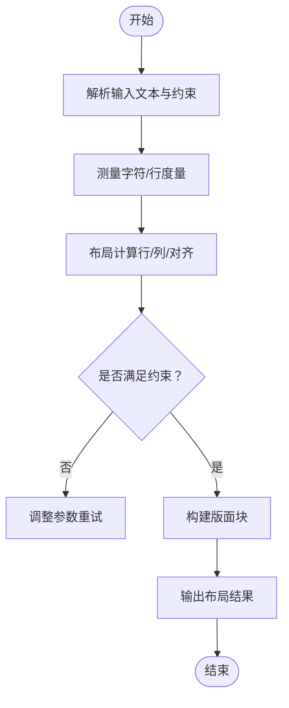
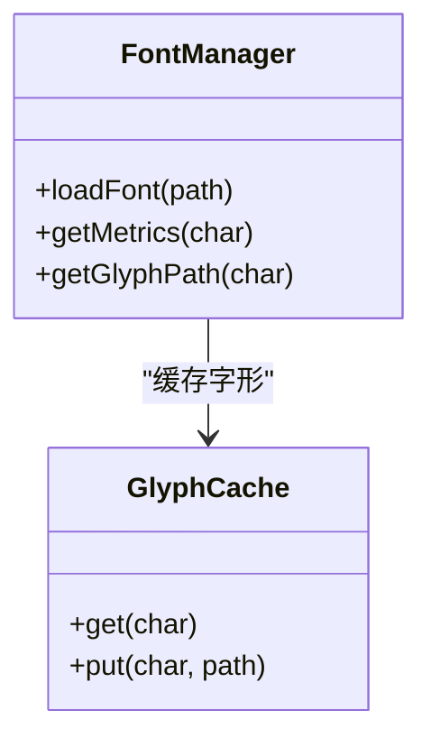
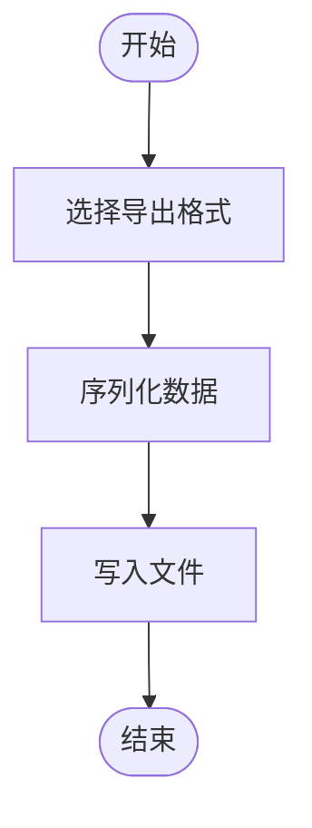
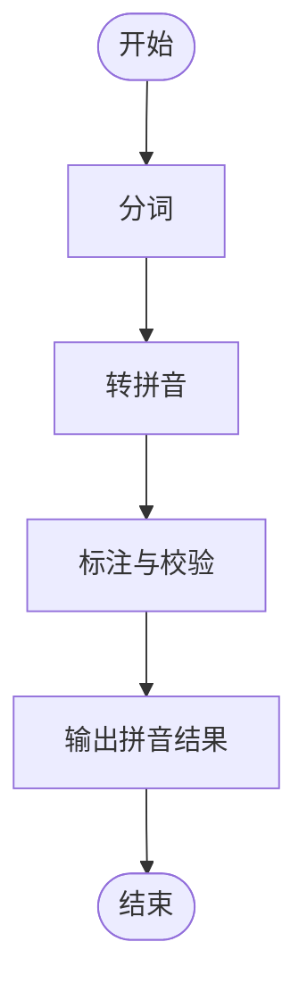
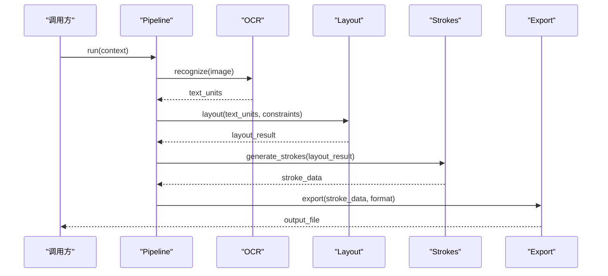
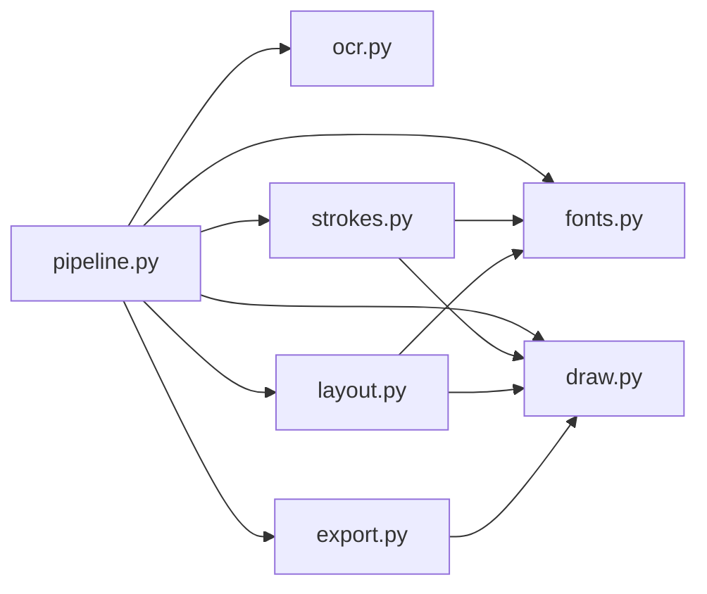

# 核心功能详解

<cite>
**本文引用的文件**   
- [zige/__init__.py](file://zige/__init__.py)
- [zige/__main__.py](file://zige/__main__.py)
- [zige/cli.py](file://zige/cli.py)
- [zige/config.py](file://zige/config.py)
- [zige/ocr.py](file://zige/ocr.py)
- [zige/strokes.py](file://zige/strokes.py)
- [zige/layout.py](file://zige/layout.py)
- [zige/fonts.py](file://zige/fonts.py)
- [zige/export.py](file://zige/export.py)
- [zige/pinyin_util.py](file://zige/pinyin_util.py)
- [zige/draw.py](file://zige/draw.py)
- [zige/pipeline.py](file://zige/pipeline.py)
- [tests/test_zige.py](file://tests/test_zige.py)
</cite>

## 目录
1. [简介](#简介)
2. [项目结构](#项目结构)
3. [核心组件](#核心组件)
4. [架构总览](#架构总览)
5. [详细组件分析](#详细组件分析)
6. [依赖关系分析](#依赖关系分析)
7. [性能考虑](#性能考虑)
8. [故障排查指南](#故障排查指南)
9. [结论](#结论)
10. [附录](#附录)

## 简介
本技术文档面向 Lucas（Python 实现）的核心功能模块，围绕 OCR 文本识别、笔画渲染系统、布局算法、字体管理、数据导出与拼音处理等关键能力进行深入解析。文档从系统架构、组件职责、数据流向、API 调用方式、配置项、性能调优与常见问题等方面展开，帮助开发者快速理解并高效使用各模块。

## 项目结构
Lucas 采用按功能划分的模块化组织方式：
- zige/ 包内包含入口、命令行、配置、OCR、笔画、布局、字体、导出、拼音工具、绘制与管线编排等模块
- tests/ 提供基础测试用例
- 根目录包含运行脚本与依赖清单

图表来源
- [zige/cli.py:1-200](file://zige/cli.py#L1-L200)
- [zige/__main__.py:1-200](file://zige/__main__.py#L1-L200)
- [zige/pipeline.py:1-200](file://zige/pipeline.py#L1-L200)
- [zige/config.py:1-200](file://zige/config.py#L1-L200)
- [zige/ocr.py:1-200](file://zige/ocr.py#L1-L200)
- [zige/layout.py:1-200](file://zige/layout.py#L1-L200)
- [zige/strokes.py:1-200](file://zige/strokes.py#L1-L200)
- [zige/fonts.py:1-200](file://zige/fonts.py#L1-L200)
- [zige/export.py:1-200](file://zige/export.py#L1-L200)
- [zige/pinyin_util.py:1-200](file://zige/pinyin_util.py#L1-L200)
- [zige/draw.py:1-200](file://zige/draw.py#L1-L200)
- [tests/test_zige.py:1-200](file://tests/test_zige.py#L1-L200)

章节来源
- [zige/__init__.py:1-200](file://zige/__init__.py#L1-L200)
- [zige/__main__.py:1-200](file://zige/__main__.py#L1-L200)
- [zige/cli.py:1-200](file://zige/cli.py#L1-L200)
- [zige/pipeline.py:1-200](file://zige/pipeline.py#L1-L200)

## 核心组件
- OCR 文本识别：负责图像到文本的识别，输出结构化结果（如行/词级文本、坐标、置信度等），供后续布局与渲染使用。
- 笔画渲染系统：将字符或字形的笔画路径进行矢量化表示与绘制，支持不同字体与样式。
- 布局算法：根据 OCR 结果与排版规则计算文本位置、行距、列宽、对齐等，生成最终版面信息。
- 字体管理：加载、选择与缓存字体资源，提供度量信息与字形映射。
- 数据导出：将处理后的文本、布局、笔画等信息导出为多种格式（如 JSON、SVG、PDF 等）。
- 拼音处理：对中文文本进行拼音标注、分词与音序排序等辅助功能。
- 绘制辅助：封装绘图 API，统一画布、画笔、颜色、变换等操作。
- 流程编排：串联 OCR、布局、笔画、导出等步骤，提供统一的执行入口与参数控制。

章节来源
- [zige/ocr.py:1-200](file://zige/ocr.py#L1-L200)
- [zige/strokes.py:1-200](file://zige/strokes.py#L1-L200)
- [zige/layout.py:1-200](file://zige/layout.py#L1-L200)
- [zige/fonts.py:1-200](file://zige/fonts.py#L1-L200)
- [zige/export.py:1-200](file://zige/export.py#L1-L200)
- [zige/pinyin_util.py:1-200](file://zige/pinyin_util.py#L1-L200)
- [zige/draw.py:1-200](file://zige/draw.py#L1-L200)
- [zige/pipeline.py:1-200](file://zige/pipeline.py#L1-L200)

## 架构总览
下图展示从输入图像到最终导出的端到端数据流，以及各模块之间的依赖关系。

图表来源
- [zige/cli.py:1-200](file://zige/cli.py#L1-L200)
- [zige/pipeline.py:1-200](file://zige/pipeline.py#L1-L200)
- [zige/ocr.py:1-200](file://zige/ocr.py#L1-L200)
- [zige/layout.py:1-200](file://zige/layout.py#L1-L200)
- [zige/strokes.py:1-200](file://zige/strokes.py#L1-L200)
- [zige/fonts.py:1-200](file://zige/fonts.py#L1-L200)
- [zige/export.py:1-200](file://zige/export.py#L1-L200)
- [zige/draw.py:1-200](file://zige/draw.py#L1-L200)

## 详细组件分析

### OCR 文本识别
- 功能要点
  - 接收图像输入，输出结构化文本单元（含文本内容、边界框、置信度等）
  - 支持多语言与混合文本场景
  - 可配置识别模型、阈值、后处理策略
- 数据流
  - 输入：图像字节或路径
  - 中间：检测与识别流水线
  - 输出：文本对象列表，供布局与渲染使用
- 关键 API
  - 初始化 OCR 引擎
  - 识别方法：传入图像，返回结构化结果
  - 配置项：模型路径、阈值、语言包、并行度等
- 错误处理
  - 模型加载失败、图像解码异常、内存不足等
- 性能优化
  - 批处理、GPU 加速、缓存模型、降低分辨率预处理

图表来源
- [zige/ocr.py:1-200](file://zige/ocr.py#L1-L200)

章节来源
- [zige/ocr.py:1-200](file://zige/ocr.py#L1-L200)

### 笔画渲染系统
- 功能要点
  - 将字符转换为矢量笔画路径，支持不同字体风格与粗细
  - 提供笔画合并、平滑、描边、填充等能力
- 数据流
  - 输入：字符或字形 ID
  - 中间：字形到笔画路径的映射
  - 输出：笔画集合（点集/线段/曲线）
- 关键 API
  - 获取字形笔画
  - 笔画变换（平移、旋转、缩放）
  - 渲染到画布
- 错误处理
  - 字体缺失、字形不存在、路径无效
- 性能优化
  - 笔画缓存、增量更新、减少重复计算

图表来源
- [zige/strokes.py:1-200](file://zige/strokes.py#L1-L200)
- [zige/fonts.py:1-200](file://zige/fonts.py#L1-L200)
- [zige/draw.py:1-200](file://zige/draw.py#L1-L200)

章节来源
- [zige/strokes.py:1-200](file://zige/strokes.py#L1-L200)
- [zige/fonts.py:1-200](file://zige/fonts.py#L1-L200)
- [zige/draw.py:1-200](file://zige/draw.py#L1-L200)

### 布局算法
- 功能要点
  - 基于 OCR 结果与字体度量计算行高、列宽、对齐方式
  - 支持分页、分栏、自动换行、基线对齐
- 数据流
  - 输入：文本单元与约束（页面尺寸、边距、列数）
  - 中间：布局计算（行分割、占位分配）
  - 输出：版面对象（包含每个元素的位置与尺寸）
- 关键 API
  - 创建布局器
  - 设置约束与样式
  - 计算并获取布局结果
- 错误处理
  - 文本溢出、不可见字符、非法约束
- 性能优化
  - 增量布局、懒计算、缓存已布局块

图表来源
- [zige/layout.py:1-200](file://zige/layout.py#L1-L200)

章节来源
- [zige/layout.py:1-200](file://zige/layout.py#L1-L200)

### 字体管理
- 功能要点
  - 加载 TTF/OTF 字体，建立字符到字形索引的映射
  - 提供度量信息（字宽、字高、基线、行距）
  - 支持字体回退与缓存
- 关键 API
  - 加载字体
  - 查询度量
  - 获取字形路径或位图
- 错误处理
  - 字体损坏、编码不匹配、资源不足
- 性能优化
  - 字体缓存、按需加载、预取常用字形

图表来源
- [zige/fonts.py:1-200](file://zige/fonts.py#L1-L200)

章节来源
- [zige/fonts.py:1-200](file://zige/fonts.py#L1-L200)

### 数据导出
- 功能要点
  - 将文本、布局、笔画等数据导出为多种格式（JSON、SVG、PDF 等）
  - 支持自定义导出器扩展
- 关键 API
  - 注册导出器
  - 导出方法：传入数据与目标格式
- 错误处理
  - 格式不支持、写入失败、路径权限问题
- 性能优化
  - 流式写入、批量序列化、压缩输出

图表来源
- [zige/export.py:1-200](file://zige/export.py#L1-L200)

章节来源
- [zige/export.py:1-200](file://zige/export.py#L1-L200)

### 拼音处理
- 功能要点
  - 中文文本转拼音、分词、音序排序
  - 支持多音字与方言扩展
- 关键 API
  - 拼音转换
  - 分词与标注
- 错误处理
  - 未知字符、编码异常
- 性能优化
  - 词典缓存、批量处理

图表来源
- [zige/pinyin_util.py:1-200](file://zige/pinyin_util.py#L1-L200)

章节来源
- [zige/pinyin_util.py:1-200](file://zige/pinyin_util.py#L1-L200)

### 绘制辅助
- 功能要点
  - 统一画布、画笔、颜色、变换等绘图操作
  - 提供矢量与位图绘制能力
- 关键 API
  - 创建画布
  - 绘制路径、文本、形状
  - 保存图像
- 错误处理
  - 画布尺寸非法、像素越界
- 性能优化
  - 离屏缓冲、批量绘制、避免重复状态切换

章节来源
- [zige/draw.py:1-200](file://zige/draw.py#L1-L200)

### 流程编排
- 功能要点
  - 串联 OCR、布局、笔画、导出等步骤
  - 提供统一的任务上下文与参数传递
- 关键 API
  - 构建任务
  - 执行管线
  - 获取结果
- 错误处理
  - 阶段失败、资源不足、超时
- 性能优化
  - 并行阶段、结果缓存、进度回调

图表来源
- [zige/pipeline.py:1-200](file://zige/pipeline.py#L1-L200)

章节来源
- [zige/pipeline.py:1-200](file://zige/pipeline.py#L1-L200)

## 依赖关系分析
- 模块耦合
  - pipeline 作为编排中心，依赖 ocr、layout、strokes、fonts、export、draw
  - strokes 依赖 fonts 与 draw
  - layout 依赖 fonts 与 draw
  - export 依赖 draw 与各数据模型
- 外部依赖
  - OCR 可能依赖第三方视觉库
  - 字体渲染依赖字体库（如 FreeType）
  - 导出可能依赖 PDF/SVG 库

图表来源
- [zige/pipeline.py:1-200](file://zige/pipeline.py#L1-L200)
- [zige/ocr.py:1-200](file://zige/ocr.py#L1-L200)
- [zige/layout.py:1-200](file://zige/layout.py#L1-L200)
- [zige/strokes.py:1-200](file://zige/strokes.py#L1-L200)
- [zige/fonts.py:1-200](file://zige/fonts.py#L1-L200)
- [zige/export.py:1-200](file://zige/export.py#L1-L200)
- [zige/draw.py:1-200](file://zige/draw.py#L1-L200)

章节来源
- [zige/pipeline.py:1-200](file://zige/pipeline.py#L1-L200)
- [zige/ocr.py:1-200](file://zige/ocr.py#L1-L200)
- [zige/layout.py:1-200](file://zige/layout.py#L1-L200)
- [zige/strokes.py:1-200](file://zige/strokes.py#L1-L200)
- [zige/fonts.py:1-200](file://zige/fonts.py#L1-L200)
- [zige/export.py:1-200](file://zige/export.py#L1-L200)
- [zige/draw.py:1-200](file://zige/draw.py#L1-L200)

## 性能考虑
- OCR
  - 使用 GPU 加速；批量推理；合理缩放与裁剪；模型权重缓存
- 布局
  - 增量计算；避免全量重排；限制最大行数与列数
- 笔画
  - 字形缓存；路径简化；减少不必要的变换
- 字体
  - 预加载常用字体；按需加载；清理未用缓存
- 导出
  - 流式写入；压缩输出；异步 I/O
- 通用
  - 监控内存与 CPU；设置超时与重试；日志与指标采集

[本节为通用指导，无需具体文件引用]

## 故障排查指南
- OCR 无法识别
  - 检查图像质量与对比度；确认模型与语言包正确加载；查看阈值与后处理参数
- 笔画缺失或错位
  - 确认字体加载成功；检查字符编码与字形映射；验证变换矩阵
- 布局错乱
  - 检查页面尺寸、边距、列数与对齐设置；确认度量信息准确
- 导出失败
  - 检查目标格式与权限；确保数据完整性；查看序列化错误
- 性能瓶颈
  - 启用并行与缓存；减少重复计算；监控资源占用

章节来源
- [zige/ocr.py:1-200](file://zige/ocr.py#L1-L200)
- [zige/strokes.py:1-200](file://zige/strokes.py#L1-L200)
- [zige/layout.py:1-200](file://zige/layout.py#L1-L200)
- [zige/export.py:1-200](file://zige/export.py#L1-L200)

## 结论
Lucas 通过清晰的模块化设计与统一的流程编排，将 OCR、布局、笔画、字体、导出与拼音处理有机整合，形成完整的文本识别与排版管线。遵循本文档的 API 指引、配置建议与性能优化策略，可在实际项目中稳定高效地落地使用。

[本节为总结性内容，无需具体文件引用]

## 附录
- 命令行用法示例
  - 基本识别与导出：通过 cli 传入图片路径与导出格式
  - 高级参数：设置 OCR 阈值、布局约束、字体路径等
- 测试参考
  - 参考 tests/test_zige.py 中的用例了解常见调用方式与断言

章节来源
- [zige/cli.py:1-200](file://zige/cli.py#L1-L200)
- [tests/test_zige.py:1-200](file://tests/test_zige.py#L1-L200)