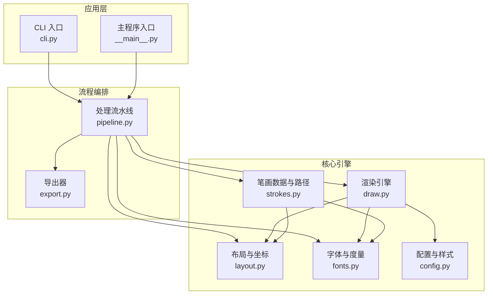
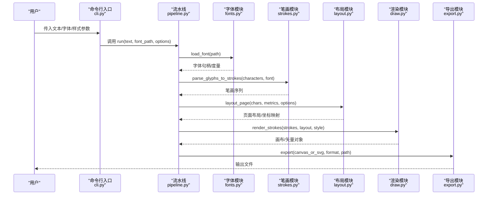
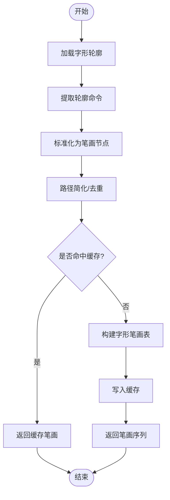
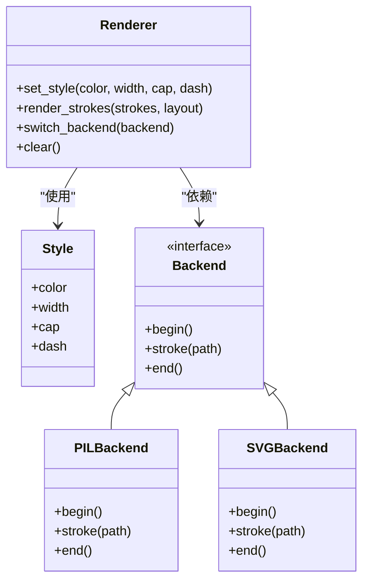
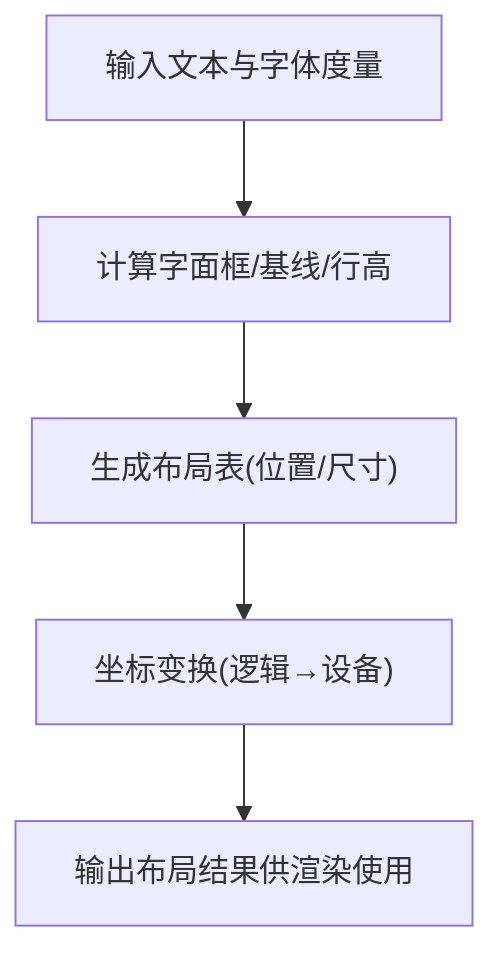
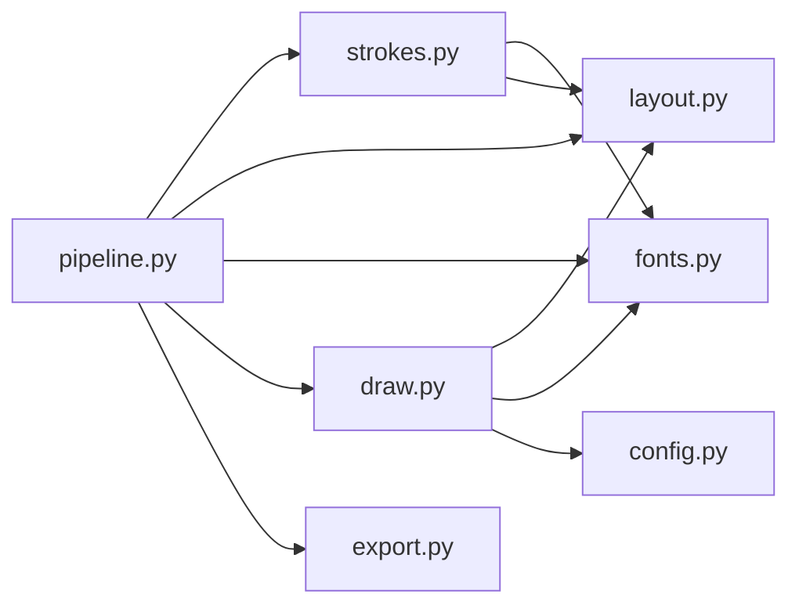

# 笔画渲染系统

<cite>
**本文引用的文件**   
- [strokes.py](file://zigestrokes.py)
- [draw.py](file://zigestroke.draw.py)
- [layout.py](file://zigestroke.layout.py)
- [fonts.py](file://zigestroke.fonts.py)
- [config.py](file://zigestroke.config.py)
- [pipeline.py](file://zigestroke.pipeline.py)
- [export.py](file://zigestroke.export.py)
- [cli.py](file://zigestroke.cli.py)
- [__main__.py](file://zigestroke.__main__.py)
- [requirements.txt](file://requirements.txt)
</cite>

## 目录
1. [简介](#简介)
2. [项目结构](#项目结构)
3. [核心组件](#核心组件)
4. [架构总览](#架构总览)
5. [详细组件分析](#详细组件分析)
6. [依赖关系分析](#依赖关系分析)
7. [性能与内存优化](#性能与内存优化)
8. [故障排查指南](#故障排查指南)
9. [结论](#结论)
10. [附录：可视化配置参考](#附录可视化配置参考)

## 简介
本技术文档围绕“笔画渲染系统”展开，聚焦于汉字笔画数据的解析、路径计算算法与图形渲染引擎的实现。文档从数据结构设计、坐标系统转换、绘制算法与优化策略入手，说明如何定制笔画样式（颜色、线条粗细等），并给出不同字体下的渲染示例思路。同时解释与布局系统的协作关系和数据传递机制，并提供性能优化建议与内存管理最佳实践。

## 项目结构
仓库采用按功能模块划分的组织方式，核心代码集中在 zige 包内，关键职责如下：
- strokes.py：笔画数据模型、解析与路径计算
- draw.py：图形渲染引擎与绘制管线
- layout.py：版面布局与坐标变换
- fonts.py：字体加载与度量信息
- config.py：全局配置与样式参数
- pipeline.py：端到端处理流程编排
- export.py：导出为图像或矢量格式
- cli.py / __main__.py：命令行入口与脚本启动
- requirements.txt：第三方依赖声明

图表来源
- [cli.py:1-50](file://zigestroke.cli.py#L1-L50)
- [__main__.py:1-50](file://zigestroke.__main__.py#L1-L50)
- [pipeline.py:1-120](file://zigestroke.pipeline.py#L1-L120)
- [strokes.py:1-200](file://zigestroke.strokes.py#L1-L200)
- [draw.py:1-200](file://zigestroke.draw.py#L1-L200)
- [layout.py:1-200](file://zigestroke.layout.py#L1-L200)
- [fonts.py:1-200](file://zigestroke.fonts.py#L1-L200)
- [config.py:1-200](file://zigestroke.config.py#L1-L200)
- [export.py:1-200](file://zigestroke.export.py#L1-L200)

章节来源
- [cli.py:1-50](file://zigestroke.cli.py#L1-L50)
- [__main__.py:1-50](file://zigestroke.__main__.py#L1-L50)
- [pipeline.py:1-120](file://zigestroke.pipeline.py#L1-L120)
- [strokes.py:1-200](file://zigestroke.strokes.py#L1-L200)
- [draw.py:1-200](file://zigestroke.draw.py#L1-L200)
- [layout.py:1-200](file://zigestroke.layout.py#L1-L200)
- [fonts.py:1-200](file://zigestroke.fonts.py#L1-L200)
- [config.py:1-200](file://zigestroke.config.py#L1-L200)
- [export.py:1-200](file://zigestroke.export.py#L1-L200)

## 核心组件
- 笔画数据与路径（strokes.py）
  - 定义笔画数据结构，包含起点、控制点、类型（直线/曲线）、权重等信息
  - 提供从字形轮廓到笔画序列的解析方法
  - 实现路径简化与平滑算法，减少冗余节点
- 渲染引擎（draw.py）
  - 将笔画路径转换为可绘制的几何图元
  - 支持多种后端（如 PIL/Pillow、SVG、PDF）
  - 统一样式接口：颜色、线宽、端点形状、虚线模式
- 布局与坐标（layout.py）
  - 负责字面框、基线、行高、字距等排版参数
  - 提供坐标系转换：逻辑坐标到设备坐标、像素对齐
- 字体与度量（fonts.py）
  - 加载字体文件，提取字形轮廓与度量信息
  - 提供字符到字形映射、Unicode 到字形 ID 转换
- 配置与样式（config.py）
  - 集中管理渲染参数：抗锯齿、DPI、默认颜色、线宽、背景色
- 流水线（pipeline.py）
  - 编排解析→布局→渲染→导出的完整流程
  - 支持批量处理与并行化
- 导出（export.py）
  - 输出位图（PNG/JPEG）或矢量（SVG/PDF）
  - 支持多页、分辨率与压缩选项

章节来源
- [strokes.py:1-200](file://zigestroke.strokes.py#L1-L200)
- [draw.py:1-200](file://zigestroke.draw.py#L1-L200)
- [layout.py:1-200](file://zigestroke.layout.py#L1-L200)
- [fonts.py:1-200](file://zigestroke.fonts.py#L1-L200)
- [config.py:1-200](file://zigestroke.config.py#L1-L200)
- [pipeline.py:1-120](file://zigestroke.pipeline.py#L1-L120)
- [export.py:1-200](file://zigestroke.export.py#L1-L200)

## 架构总览
笔画渲染系统遵循“数据→布局→渲染→导出”的分层架构。输入文本经字体解析得到字形轮廓，再被拆解为笔画序列；布局阶段计算每个字的定位与尺寸；渲染阶段将笔画路径转换为图元并绘制；最后由导出模块生成目标格式。

图表来源
- [cli.py:1-50](file://zigestroke.cli.py#L1-L50)
- [pipeline.py:1-120](file://zigestroke.pipeline.py#L1-L120)
- [fonts.py:1-200](file://zigestroke.fonts.py#L1-L200)
- [strokes.py:1-200](file://zigestroke.strokes.py#L1-L200)
- [layout.py:1-200](file://zigestroke.layout.py#L1-L200)
- [draw.py:1-200](file://zigestroke.draw.py#L1-L200)
- [export.py:1-200](file://zigestroke.export.py#L1-L200)

## 详细组件分析

### 笔画数据与路径（strokes.py）
- 数据结构
  - 笔画节点：包含坐标、类型（直线/二次贝塞尔/三次贝塞尔）、权重
  - 笔画段：由若干节点组成的有序路径片段
  - 字形笔画表：字符到笔画段的映射
- 解析流程
  - 从字体字形轮廓中提取轮廓命令（moveTo/lineTo/cubicTo/quadraticTo）
  - 将轮廓命令归一化为统一的笔画节点序列
  - 对路径进行简化与去重，合并共线线段，降低复杂度
- 路径计算
  - 提供长度估算、切线方向、曲率计算
  - 支持路径偏移（用于描边扩展）
- 复杂度与优化
  - 路径简化采用近似误差阈值控制，时间复杂度与节点数线性相关
  - 缓存字形到笔画的解析结果，避免重复解析

图表来源
- [strokes.py:1-200](file://zigestroke.strokes.py#L1-L200)

章节来源
- [strokes.py:1-200](file://zigestroke.strokes.py#L1-L200)

### 渲染引擎（draw.py）
- 绘制管线
  - 接收笔画序列与布局信息，转换为图元集合
  - 根据样式配置设置颜色、线宽、端点、虚线等
  - 选择后端（PIL/SVG/PDF）执行绘制
- 坐标系统
  - 逻辑坐标到设备坐标的缩放与平移
  - 像素对齐与抗锯齿开关
- 性能优化
  - 批量绘制相同样式的图元以减少状态切换
  - 使用顶点缓冲（在 SVG/PDF 后端）减少重复计算
  - 按需裁剪与视口剔除

图表来源
- [draw.py:1-200](file://zigestroke.draw.py#L1-L200)

章节来源
- [draw.py:1-200](file://zigestroke.draw.py#L1-L200)

### 布局与坐标（layout.py）
- 版面参数
  - 字面框、基线、行高、字距、行距
- 坐标变换
  - 逻辑坐标→设备坐标的矩阵变换
  - 像素对齐与 DPI 适配
- 与渲染协作
  - 为渲染器提供每个字的边界框与位移
  - 支持多列、分页与旋转

图表来源
- [layout.py:1-200](file://zigestroke.layout.py#L1-L200)

章节来源
- [layout.py:1-200](file://zigestroke.layout.py#L1-L200)

### 字体与度量（fonts.py）
- 字体加载
  - 支持 TTF/OTF，读取字形轮廓与度量
- 字符映射
  - Unicode→字形ID，字形ID→轮廓命令
- 性能
  - 字体句柄缓存，避免重复打开文件
  - 字形轮廓懒加载

章节来源
- [fonts.py:1-200](file://zigestroke.fonts.py#L1-L200)

### 配置与样式（config.py）
- 全局配置项
  - 默认颜色、线宽、抗锯齿、DPI、背景色
- 样式覆盖
  - 针对单个字/词/行的样式覆盖
- 校验与默认值
  - 参数合法性检查与回退默认值

章节来源
- [config.py:1-200](file://zigestroke.config.py#L1-L200)

### 流水线（pipeline.py）
- 流程编排
  - 解析→布局→渲染→导出
- 批处理
  - 支持多文本、多字体、多样式并行处理
- 错误处理
  - 捕获字体缺失、非法字符、IO 异常并上报

章节来源
- [pipeline.py:1-120](file://zigestroke.pipeline.py#L1-L120)

### 导出（export.py）
- 输出格式
  - PNG/JPEG（位图）、SVG/PDF（矢量）
- 质量与压缩
  - JPEG 质量、PNG 压缩级别、DPI 设置
- 多页与分页
  - 支持长文分页导出

章节来源
- [export.py:1-200](file://zigestroke.export.py#L1-L200)

### 命令行与入口（cli.py / __main__.py）
- CLI 参数
  - 输入文本、字体路径、输出路径、样式参数
- 启动流程
  - 解析参数→调用流水线→退出

章节来源
- [cli.py:1-50](file://zigestroke.cli.py#L1-L50)
- [__main__.py:1-50](file://zigestroke.__main__.py#L1-L50)

## 依赖关系分析
- 内部依赖
  - pipeline 依赖 strokes、layout、fonts、draw、export
  - draw 依赖 layout、fonts、config
  - strokes 依赖 fonts、layout
- 外部依赖
  - 图像处理库（如 Pillow）
  - 矢量库（如 cairosvg、reportlab）
  - 字体解析库（如 freetype/pyftpd）

图表来源
- [pipeline.py:1-120](file://zigestroke.pipeline.py#L1-L120)
- [strokes.py:1-200](file://zigestroke.strokes.py#L1-L200)
- [draw.py:1-200](file://zigestroke.draw.py#L1-L200)
- [layout.py:1-200](file://zigestroke.layout.py#L1-L200)
- [fonts.py:1-200](file://zigestroke.fonts.py#L1-L200)
- [config.py:1-200](file://zigestroke.config.py#L1-L200)
- [export.py:1-200](file://zigestroke.export.py#L1-L200)

章节来源
- [requirements.txt:1-50](file://requirements.txt#L1-L50)
- [pipeline.py:1-120](file://zigestroke.pipeline.py#L1-L120)

## 性能与内存优化
- 解析阶段
  - 字形→笔画的解析结果缓存，避免重复计算
  - 路径简化阈值可调，平衡精度与性能
- 布局阶段
  - 批量计算布局，复用公共度量
  - 视口裁剪，仅处理可见区域
- 渲染阶段
  - 批量绘制相同样式图元，减少状态切换
  - 使用矢量后端的顶点缓冲，减少重复路径描述
  - 启用抗锯齿时注意 DPI 与缩放比例，避免过度采样
- 内存管理
  - 及时释放中间画布与临时路径对象
  - 大文档分页处理，避免一次性加载全部内容
- I/O 优化
  - 批量导出时复用文件句柄
  - 合理设置压缩级别与质量参数

[本节为通用指导，不直接分析具体文件]

## 故障排查指南
- 字体相关问题
  - 字体文件损坏或不可读：检查路径与权限
  - 缺少字形：确认字符是否在字体子集中
- 渲染异常
  - 线条过细或断裂：调整线宽与像素对齐
  - 颜色异常：检查样式配置与后端色彩空间
- 性能问题
  - 渲染缓慢：减少不必要的抗锯齿、降低分辨率、启用批量绘制
  - 内存溢出：分页处理、释放中间对象、减小路径复杂度
- 导出失败
  - 格式不支持：检查后端库安装与版本
  - 文件过大：调整压缩与分辨率

章节来源
- [pipeline.py:1-120](file://zigestroke.pipeline.py#L1-L120)
- [export.py:1-200](file://zigestroke.export.py#L1-L200)

## 结论
笔画渲染系统通过清晰的模块化设计与分层架构，实现了从字形轮廓到笔画路径再到最终输出的完整流程。通过对笔画数据结构、坐标系统与绘制算法的系统化设计，配合灵活的样式配置与高效的渲染后端，能够在保证视觉质量的同时兼顾性能与可扩展性。建议在大规模场景中优先启用缓存、批量绘制与分页导出，以获得更优的性能表现。

[本节为总结性内容，不直接分析具体文件]

## 附录：可视化配置参考
- 颜色
  - 前景色：笔画颜色
  - 背景色：画布背景
- 线条
  - 线宽：单位通常为像素或点
  - 端点：圆头/平头/方头
  - 虚线：模式与间隔
- 渲染
  - 抗锯齿：开/关
  - DPI：每英寸点数
  - 缩放：整体缩放比例
- 布局
  - 字距/行距：排版间距
  - 基线：文字基线位置
  - 对齐：左/中/右/两端

[本节为概念性说明，不直接分析具体文件]