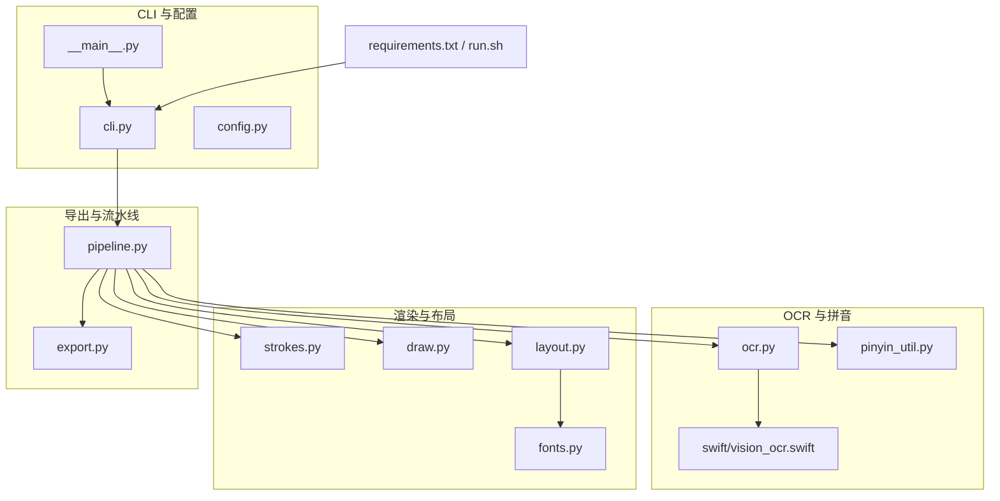
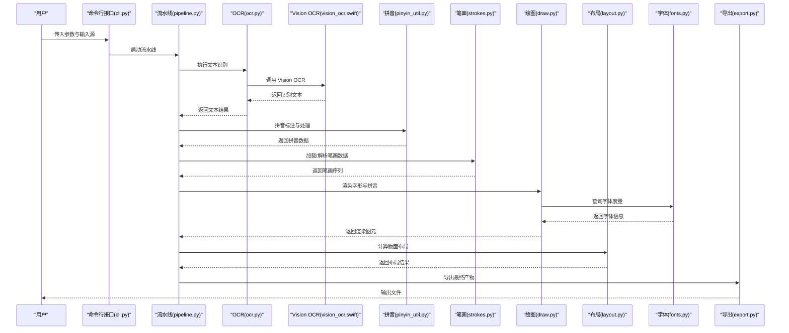
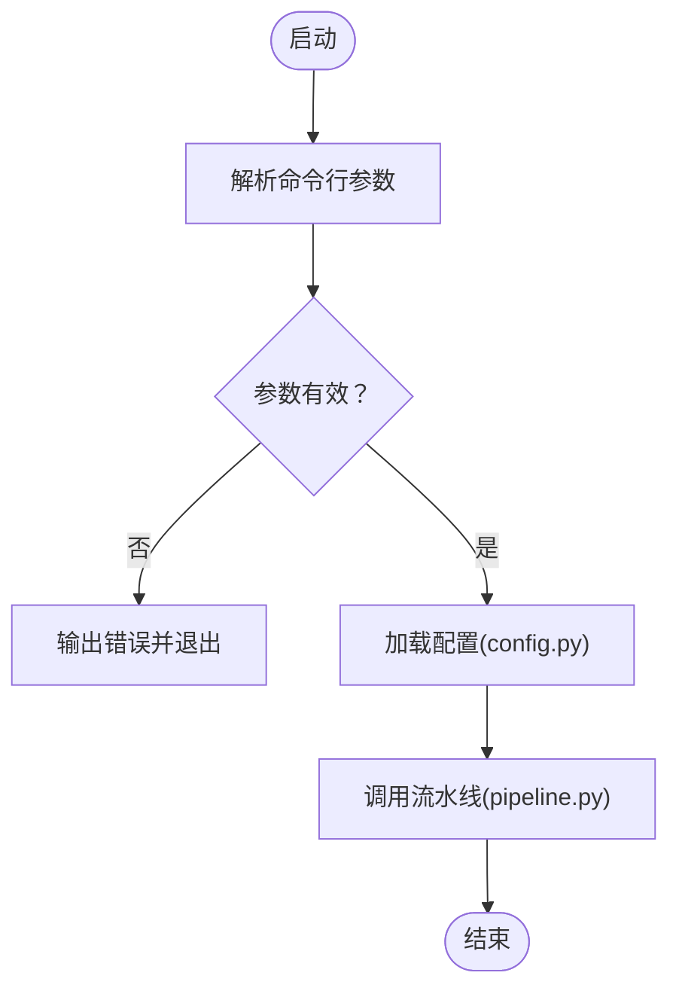
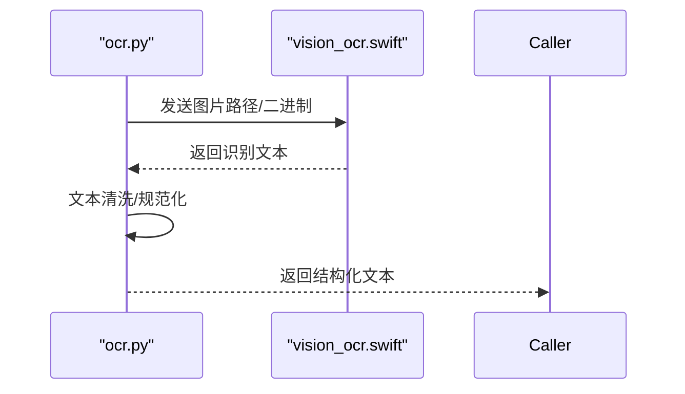
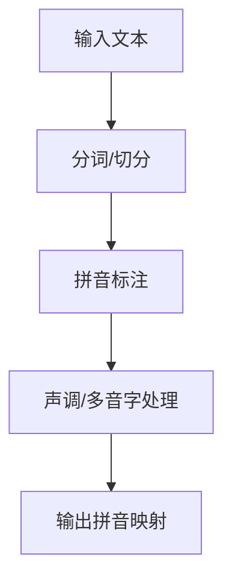
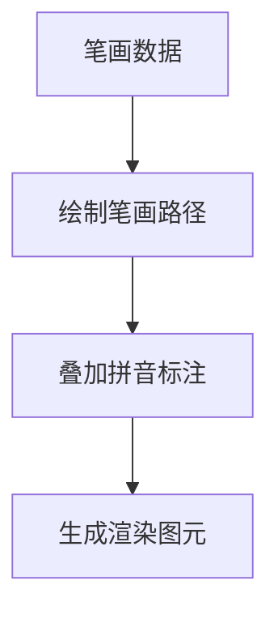
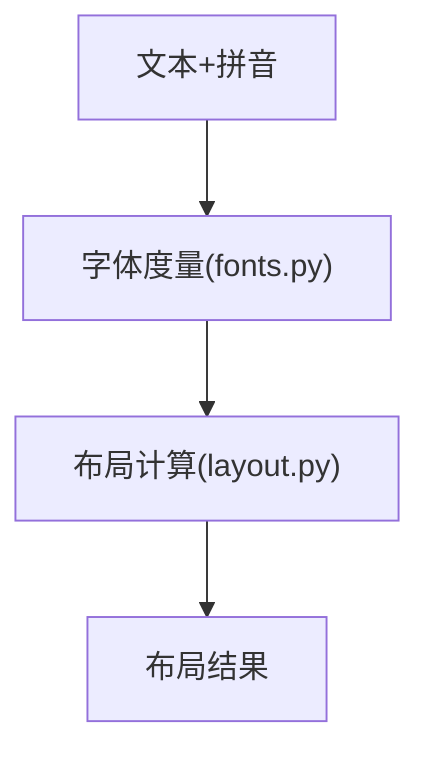
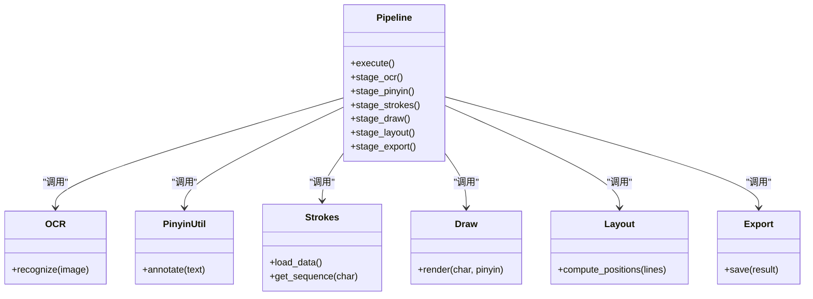
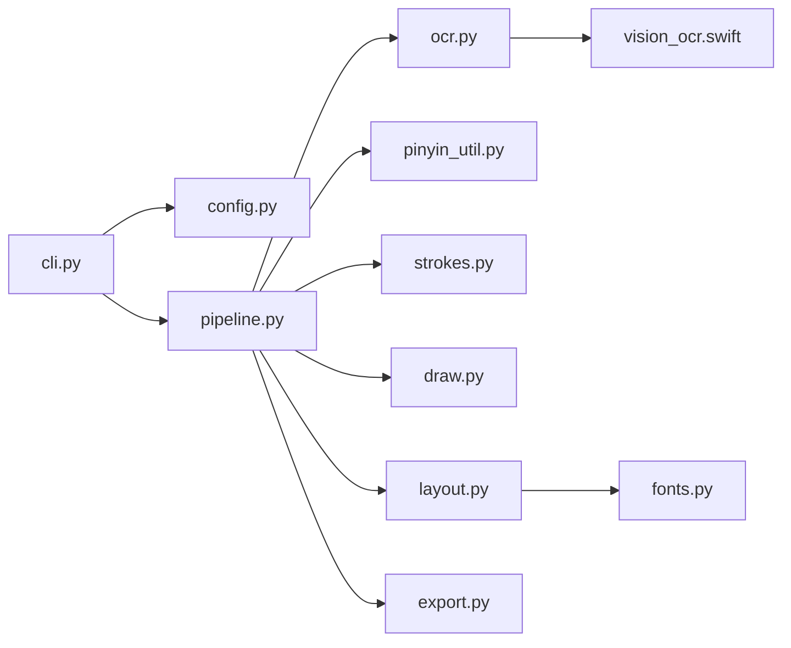

# 项目概述

<cite>
**本文引用的文件**   
- [cli.py](file://zige/cli.py)
- [config.py](file://zige/config.py)
- [draw.py](file://zige/draw.py)
- [export.py](file://zige/export.py)
- [fonts.py](file://zige/fonts.py)
- [layout.py](file://zige/layout.py)
- [ocr.py](file://zige/ocr.py)
- [pinyin_util.py](file://zige/pinyin_util.py)
- [pipeline.py](file://zige/pipeline.py)
- [strokes.py](file://zige/strokes.py)
- [__main__.py](file://zige/__main__.py)
- [vision_ocr.swift](file://zige/swift/vision_ocr.swift)
- [requirements.txt](file://requirements.txt)
- [run.sh](file://run.sh)
</cite>

## 目录
1. [简介](#简介)
2. [项目结构](#项目结构)
3. [核心组件](#核心组件)
4. [架构总览](#架构总览)
5. [详细组件分析](#详细组件分析)
6. [依赖关系分析](#依赖关系分析)
7. [性能考虑](#性能考虑)
8. [故障排查指南](#故障排查指南)
9. [结论](#结论)
10. [附录：快速开始](#附录快速开始)

## 简介
Lucas 中文拼音处理工具是一个专注于汉字笔画渲染与中文拼音处理的命令行工具。它通过 Python 实现核心业务逻辑，并集成 Swift 模块以利用 Vision OCR 能力进行文本识别；同时提供布局算法、字体管理、导出等配套能力，形成从“OCR 识别 → 拼音解析 → 笔画渲染 → 版面布局 → 结果导出”的完整流水线。该工具适用于中文教育应用、文本处理工具开发、教学材料生成等场景。

## 项目结构
项目采用模块化设计，按职责划分清晰：
- CLI 入口与配置：命令行接口、参数解析、全局配置
- OCR 与拼音：文本识别（Python + Swift Vision）、拼音工具
- 渲染与布局：笔画数据、绘图、排版布局
- 导出：将渲染结果输出为图像或文档
- 流水线：串联各模块的统一编排
- 资源与环境：字体、依赖声明、运行脚本

图表来源
- [cli.py:1-200](file://zige/cli.py#L1-L200)
- [config.py:1-200](file://zige/config.py#L1-L200)
- [ocr.py:1-200](file://zige/ocr.py#L1-L200)
- [vision_ocr.swift:1-200](file://zige/swift/vision_ocr.swift#L1-L200)
- [pinyin_util.py:1-200](file://zige/pinyin_util.py#L1-L200)
- [strokes.py:1-200](file://zige/strokes.py#L1-L200)
- [draw.py:1-200](file://zige/draw.py#L1-L200)
- [layout.py:1-200](file://zige/layout.py#L1-L200)
- [fonts.py:1-200](file://zige/fonts.py#L1-L200)
- [export.py:1-200](file://zige/export.py#L1-L200)
- [pipeline.py:1-200](file://zige/pipeline.py#L1-L200)
- [requirements.txt:1-200](file://requirements.txt#L1-L200)
- [run.sh:1-200](file://run.sh#L1-L200)

章节来源
- [cli.py:1-200](file://zige/cli.py#L1-L200)
- [config.py:1-200](file://zige/config.py#L1-L200)
- [pipeline.py:1-200](file://zige/pipeline.py#L1-L200)

## 核心组件
- 命令行接口（CLI）
  - 负责参数解析、子命令分发、日志与错误提示
  - 与流水线模块对接，驱动端到端任务执行
- 配置管理
  - 集中管理路径、模型/字体、OCR 开关、渲染选项等
- OCR 文本识别
  - Python 侧调用 Swift Vision OCR 模块完成图片到文本的识别
- 拼音工具
  - 对识别出的中文文本进行拼音标注、声调处理、音节切分等
- 笔画系统
  - 加载/解析笔画数据，构建笔画序列与顺序信息
- 绘图与渲染
  - 基于笔画数据绘制字形、叠加拼音标注、控制样式与尺寸
- 布局算法
  - 根据页面尺寸、字号、行距、边距等计算字符位置与段落排版
- 字体管理
  - 字体发现、回退策略、度量信息获取
- 导出
  - 将最终渲染结果保存为图像或文档格式
- 流水线
  - 统一编排 OCR → 拼音 → 笔画 → 渲染 → 布局 → 导出的步骤

章节来源
- [cli.py:1-200](file://zige/cli.py#L1-L200)
- [config.py:1-200](file://zige/config.py#L1-L200)
- [ocr.py:1-200](file://zige/ocr.py#L1-L200)
- [pinyin_util.py:1-200](file://zige/pinyin_util.py#L1-L200)
- [strokes.py:1-200](file://zige/strokes.py#L1-L200)
- [draw.py:1-200](file://zige/draw.py#L1-L200)
- [layout.py:1-200](file://zige/layout.py#L1-L200)
- [fonts.py:1-200](file://zige/fonts.py#L1-L200)
- [export.py:1-200](file://zige/export.py#L1-L200)
- [pipeline.py:1-200](file://zige/pipeline.py#L1-L200)

## 架构总览
整体架构遵循“输入 → 处理 → 输出”的流水线模式，关键交互如下：

图表来源
- [cli.py:1-200](file://zige/cli.py#L1-L200)
- [pipeline.py:1-200](file://zige/pipeline.py#L1-L200)
- [ocr.py:1-200](file://zige/ocr.py#L1-L200)
- [vision_ocr.swift:1-200](file://zige/swift/vision_ocr.swift#L1-L200)
- [pinyin_util.py:1-200](file://zige/pinyin_util.py#L1-L200)
- [strokes.py:1-200](file://zige/strokes.py#L1-L200)
- [draw.py:1-200](file://zige/draw.py#L1-L200)
- [layout.py:1-200](file://zige/layout.py#L1-L200)
- [fonts.py:1-200](file://zige/fonts.py#L1-L200)
- [export.py:1-200](file://zige/export.py#L1-L200)

## 详细组件分析

### 命令行接口（CLI）
- 功能要点
  - 定义子命令与参数，如输入源、输出路径、OCR 开关、渲染选项等
  - 校验参数合法性，打印帮助与错误信息
  - 调用流水线执行具体任务
- 交互流程
  - 解析参数 → 初始化配置 → 调用流水线 → 输出结果或错误

图表来源
- [cli.py:1-200](file://zige/cli.py#L1-L200)
- [config.py:1-200](file://zige/config.py#L1-L200)
- [pipeline.py:1-200](file://zige/pipeline.py#L1-L200)

章节来源
- [cli.py:1-200](file://zige/cli.py#L1-L200)

### OCR 文本识别（Python + Swift Vision）
- 功能要点
  - Python 侧封装 OCR 调用，支持本地图片文件或路径
  - 通过 Swift 模块调用 Vision OCR，提高识别准确率与速度
- 数据流
  - 输入图片 → Swift Vision OCR → 返回文本 → Python 清洗与标准化

图表来源
- [ocr.py:1-200](file://zige/ocr.py#L1-L200)
- [vision_ocr.swift:1-200](file://zige/swift/vision_ocr.swift#L1-L200)

章节来源
- [ocr.py:1-200](file://zige/ocr.py#L1-L200)
- [vision_ocr.swift:1-200](file://zige/swift/vision_ocr.swift#L1-L200)

### 拼音工具
- 功能要点
  - 对中文文本进行拼音标注、声调转换、多音字处理
  - 与笔画系统协同，确保拼音与字形对齐
- 典型流程
  - 输入文本 → 拼音标注 → 输出拼音映射表

图表来源
- [pinyin_util.py:1-200](file://zige/pinyin_util.py#L1-L200)

章节来源
- [pinyin_util.py:1-200](file://zige/pinyin_util.py#L1-L200)

### 笔画系统与渲染
- 功能要点
  - 笔画系统负责加载/解析笔画数据，维护笔画顺序与坐标
  - 渲染模块根据笔画数据绘制字形，并可叠加拼音标注
- 渲染流程
  - 笔画数据 → 绘制路径 → 叠加拼音 → 生成图元

图表来源
- [strokes.py:1-200](file://zige/strokes.py#L1-L200)
- [draw.py:1-200](file://zige/draw.py#L1-L200)

章节来源
- [strokes.py:1-200](file://zige/strokes.py#L1-L200)
- [draw.py:1-200](file://zige/draw.py#L1-L200)

### 布局算法与字体管理
- 功能要点
  - 布局算法依据页面尺寸、字号、行距、边距等参数计算字符位置
  - 字体管理负责字体发现、度量信息与回退策略
- 布局流程
  - 文本与拼音 → 字体度量 → 计算行列 → 生成布局

图表来源
- [layout.py:1-200](file://zige/layout.py#L1-L200)
- [fonts.py:1-200](file://zige/fonts.py#L1-L200)

章节来源
- [layout.py:1-200](file://zige/layout.py#L1-L200)
- [fonts.py:1-200](file://zige/fonts.py#L1-L200)

### 导出模块
- 功能要点
  - 将渲染后的图像或文档保存到指定路径
  - 支持多种输出格式（由实现决定）

章节来源
- [export.py:1-200](file://zige/export.py#L1-L200)

### 流水线编排
- 功能要点
  - 统一调度 OCR、拼音、笔画、渲染、布局、导出等步骤
  - 提供可插拔的阶段接口，便于扩展与测试

图表来源
- [pipeline.py:1-200](file://zige/pipeline.py#L1-L200)
- [ocr.py:1-200](file://zige/ocr.py#L1-L200)
- [pinyin_util.py:1-200](file://zige/pinyin_util.py#L1-L200)
- [strokes.py:1-200](file://zige/strokes.py#L1-L200)
- [draw.py:1-200](file://zige/draw.py#L1-L200)
- [layout.py:1-200](file://zige/layout.py#L1-L200)
- [export.py:1-200](file://zige/export.py#L1-L200)

章节来源
- [pipeline.py:1-200](file://zige/pipeline.py#L1-L200)

## 依赖关系分析
- 内部依赖
  - CLI 依赖配置与流水线
  - 流水线依赖 OCR、拼音、笔画、渲染、布局、导出
  - 渲染依赖字体管理
- 外部依赖
  - Swift Vision OCR（通过 Swift 模块调用）
  - Python 第三方库（见 requirements.txt）

图表来源
- [cli.py:1-200](file://zige/cli.py#L1-L200)
- [config.py:1-200](file://zige/config.py#L1-L200)
- [pipeline.py:1-200](file://zige/pipeline.py#L1-L200)
- [ocr.py:1-200](file://zige/ocr.py#L1-L200)
- [pinyin_util.py:1-200](file://zige/pinyin_util.py#L1-L200)
- [strokes.py:1-200](file://zige/strokes.py#L1-L200)
- [draw.py:1-200](file://zige/draw.py#L1-L200)
- [layout.py:1-200](file://zige/layout.py#L1-L200)
- [fonts.py:1-200](file://zige/fonts.py#L1-L200)
- [export.py:1-200](file://zige/export.py#L1-L200)
- [vision_ocr.swift:1-200](file://zige/swift/vision_ocr.swift#L1-L200)

章节来源
- [requirements.txt:1-200](file://requirements.txt#L1-L200)

## 性能考虑
- OCR 阶段
  - 使用 Swift Vision OCR 提升识别速度与准确率
  - 建议批量处理图片以减少跨进程开销
- 渲染与布局
  - 预加载字体度量，避免重复 IO
  - 合理设置字号与行距，减少重绘次数
- 内存与并发
  - 大文档分页处理，降低峰值内存占用
  - 对独立阶段（如 OCR）进行并行化（若实现允许）

[本节为通用指导，不直接分析具体文件]

## 故障排查指南
- 常见问题
  - 无法找到 Swift 模块或 Vision 框架：检查运行环境与编译产物路径
  - 字体缺失导致渲染异常：确认字体安装与回退策略
  - OCR 结果为空或乱码：检查输入图片质量与语言设置
- 定位方法
  - 启用更详细的日志输出（由 CLI 与配置控制）
  - 逐步禁用流水线阶段，定位问题模块
  - 使用最小输入样本复现问题

章节来源
- [cli.py:1-200](file://zige/cli.py#L1-L200)
- [config.py:1-200](file://zige/config.py#L1-L200)

## 结论
Lucas 中文拼音处理工具以清晰的模块化架构和统一的流水线编排，实现了从 OCR 识别到笔画渲染、布局与导出的完整链路。其 Python + Swift 的双语言组合兼顾了易用性与高性能，适合中文教育、文本处理等多样化场景。通过合理的配置与扩展点，开发者可以快速定制与集成所需功能。

[本节为总结性内容，不直接分析具体文件]

## 附录：快速开始
- 环境要求
  - Python 环境满足 requirements.txt 中的依赖
  - Swift 运行时可用（用于 Vision OCR）
- 基本用法
  - 安装依赖：参考 requirements.txt
  - 运行示例：参考 run.sh
  - 常用参数：通过 CLI 的帮助信息查看

章节来源
- [requirements.txt:1-200](file://requirements.txt#L1-L200)
- [run.sh:1-200](file://run.sh#L1-L200)
- [cli.py:1-200](file://zige/cli.py#L1-L200)